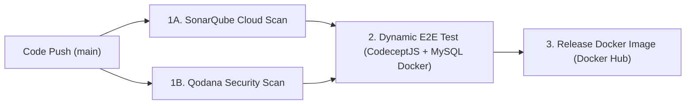

# 🎬 Netfix2 — Hệ Thống Xem Phim Trực Tuyến & Dự Án Kiểm Thử Phần Mềm (QA Testing)

[](https://sonarcloud.io/summary/new_code?id=Col255_QA-netfilxfake)
[](https://sonarcloud.io/summary/new_code?id=Col255_QA-netfilxfake)
[](https://sonarcloud.io/summary/new_code?id=Col255_QA-netfilxfake)
[](https://sonarcloud.io/summary/new_code?id=Col255_QA-netfilxfake)
[](https://sonarcloud.io/summary/new_code?id=Col255_QA-netfilxfake)
[](https://github.com/Col255/QA-netfilxfake/actions/workflows/ci-cd-pipeline.yml)

**Netfix2** là nền tảng xem phim trực tuyến xây dựng trên kiến trúc **PHP 8.2 & MariaDB/MySQL**, phục vụ cho khách vãng lai (Guest), thành viên người dùng (User thường & User VIP), và Quản trị viên (Admin CMS). 

Repository này là giải pháp toàn diện cho môn học **Kiểm thử Phần mềm & Đảm bảo Chất lượng (QA/QC)**, bao gồm toàn bộ mã nguồn ứng dụng (`netfix2/`), cơ sở dữ liệu mẫu (`database/netfixvn.sql`), tài liệu đặc tả yêu cầu SRS (IEEE 830), thiết kế kịch bản kiểm thử hộp đen & hộp trắng (`docs/`), bộ sưu tập kiểm thử tự động API **Postman** (`Postman/`), bộ kiểm thử giao diện End-to-End **CodeceptJS + Playwright** (`tests/`), và đường ống **CI/CD GitHub Actions** tích hợp phân tích mã tĩnh **SonarCloud & JetBrains Qodana** đạt chứng chỉ **Quality Gate Passed**.

> ⚠️ Các trang `.php` cần chạy qua web server có hỗ trợ PHP (XAMPP, Laragon hoặc Docker). Không mở trực tiếp file PHP bằng trình duyệt hoặc VS Code.

🔗 **Liên kết Quản lý Dự án & Báo cáo:**
- 📋 **Jira Project Board (QA Testing 002):** [https://lochnt0228.atlassian.net/jira/software/projects/KAN/boards/2](https://lochnt0228.atlassian.net/jira/software/projects/KAN/boards/2)
- 📑 **Danh sách Jira Tasks (JQL):** [Xem toàn bộ danh sách công việc trên Jira](https://lochnt0228.atlassian.net/jira/software/projects/KAN/list?jql=project+%3D+KAN+ORDER+BY+%22cf%5B10019%5D%22+ASC)
- 📊 **SonarCloud Dashboard:** [https://sonarcloud.io/project/overview?id=Col255_QA-netfilxfake](https://sonarcloud.io/project/overview?id=Col255_QA-netfilxfake)

---

## 📊 Bảng Thống Kê & Chỉ Số Chất Lượng (Quality Metrics)

| Chỉ số / Phép đo | Kết quả kiểm thử | Mục tiêu / Chuẩn áp dụng | Trạng thái |
| :--- | :---: | :---: | :---: |
| **SonarCloud Quality Gate** | **PASSED (OK)** | Ngưỡng tiêu chuẩn SonarCloud |  Đạt chuẩn |
| **Code Coverage (Overall)** | **99.8%** | $\ge 80\%$ (Import Clover XML) |  Xuất sắc |
| **New Code Coverage** | **100.0%** | $\ge 80\%$ trên mã nguồn mới |  Tuyệt đối |
| **Bugs trên SonarCloud** | **0 Bugs** | 0 Bugs (Giảm từ 19 về 0) |  Sạch hoàn toàn |
| **Vulnerabilities / Blockers** | **0 Blocker / 0 Critical** | 0 Lỗ hổng bảo mật nghiêm trọng |  Vá XSS & Secret |
| **Code Smells** | **0** | A (1.0) |  Clean Code |
| **Độ bao phủ White-Box ($C_0 / C_1$)** | **100% $C_0$ / 100% $C_1$** | Bao phủ 100% Statement & Branch |  133/133 TCs Pass |
| **Tổng độ phức tạp Cyclomatic $V(G)$** | **732** | Chuẩn độ phức tạp Thomas McCabe |  Đã bao phủ |
| **Kiểm thử Động E2E (CodeceptJS)** | **100% PASS** | 5 Phân hệ lõi trên Docker CI/CD |  Xanh toàn diện |

---

## 🛠️ Công Nghệ & Công Cụ Kiểm Thử Sử Dụng

- 🐘 **Backend & Database:** PHP 8.2 (`mysqli`), MySQL / MariaDB (`utf8mb4_unicode_ci`)
- 🌐 **Frontend:** HTML5, CSS3, JavaScript ES6
- 🏢 **XAMPP / Docker:** Khởi chạy môi trường Web Server Apache & MySQL cục bộ hoặc container hóa
- 📮 **Postman & Newman:** Kiểm thử tự động API & HTTP Endpoints (Black-Box, EP, BVA, Security, Pre-request & Assertions)
- 🎭 **CodeceptJS + Playwright (Chromium):** Kiểm thử động End-to-End (E2E UI & Functional Testing qua BDD framework)
- 🔬 **Custom White-Box Runner (Node.js Evaluator):** Đánh giá đường đi cơ sở (Basis Path Testing), tự động kích hoạt các nhánh $D_i$ và câu lệnh $S_i$ của 5 phân hệ
- 🔍 **SonarQube Cloud & JetBrains Qodana:** Kiểm thử tĩnh (Static White-Box Analysis) quét lỗi cú pháp, lỗ hổng bảo mật OWASP, Taint Analysis và Code Smells
- 📈 **Clover XML & HTML Reporter:** Tự động sinh báo cáo độ phủ mã nguồn trực quan kèm đồ thị Mermaid Control Flow Graph (CFG)
- ⚙️ **GitHub Actions CI/CD & Docker Hub:** Tự động hóa quy trình Kiểm thử Tĩnh $\rightarrow$ Kiểm thử Động $\rightarrow$ Đóng gói Docker Image

---

## ✨ 5 Phân Hệ Cốt Lõi & Phạm Vi Kiểm Thử

Hệ thống bao gồm **5 nhóm chức năng chính**, được kiểm thử chéo và phối hợp thực hiện bởi cả nhóm thông qua các kỹ thuật **Phân lớp tương đương (EP)**, **Phân tích giá trị biên (BVA)**, **Bảng quyết định (Decision Table)**, **Chuyển đổi trạng thái (State Transition)** và **Kiểm thử hộp trắng (Basis Path Testing)**:

- 👤 **Phân hệ 1: Xác thực & Người dùng (`AUTH`):** Đăng ký tài khoản, đăng nhập người dùng/quản trị viên, đăng xuất, xem và cập nhật hồ sơ cá nhân, đổi mật khẩu và bảo vệ phiên làm việc (`register.php`, `login.php`, `admin_login.php`, `logout.php`, `profile.php`, `edit_profile.php`, `change_password.php`, `user_sidebar.php`).
- 🍿 **Phân hệ 2: Phim & Xem Phim (`MOV`):** Duyệt trang chủ, phân loại phim lẻ / phim bộ / hoạt hình / chiếu rạp, tìm kiếm phim theo từ khóa, phát video đa tập, kiểm soát quyền xem phim VIP (`index.php`, `movies.php`, `search.php`, `watch.php`, `header.php`, `footer.php`, `about.php`).
- 💬 **Phân hệ 3: Tương tác & Trải nghiệm (`INT`):** API bộ đếm lượt xem không đồng bộ, gửi và duyệt bình luận phim, hiển thị danh sách bình luận theo thời gian thực, lưu trữ và xóa lịch sử xem phim (`api/view_counter.php`, `comments.php`, `watch_history.php`).
- 💳 **Phân hệ 4: Gói VIP & Thanh toán (`VIP`):** Hiển thị bảng giá dịch vụ VIP, thanh toán chuyển khoản và quét mã MoMo Sandbox, xác thực chữ ký số HMAC-SHA256, xử lý callback IPN và tự động cộng dồn hạn VIP (`pricing.php`, `checkout.php`, `process_payment.php`, `payment_return.php`, `order_history.php`, `vip_helper.php`).
- 🛡️ **Phân hệ 5: Quản trị Hệ thống CMS (`ADM`):** Dashboard thống kê tổng quan, thêm mới phim, chỉnh sửa phim & danh sách tập, xóa phim, duyệt đơn hàng nâng cấp VIP, quản lý tài khoản khách hàng và báo cáo doanh thu (`admin_dashboard.php`, `admin_sidebar.php`, `add_movie.php`, `edit_movie.php`, `manage_movies.php`, `manage_vip.php`, `orders.php`, `customers.php`, `statistics.php`).

---

## 📂 Cấu Trúc Thư Mục Dự Án

```text
QA-netfilxfake/
├── .github/workflows/
│   └── ci-cd-pipeline.yml            # Pipeline CI/CD: SonarQube + Qodana + CodeceptJS + Docker Hub
├── database/
│   └── netfixvn.sql                  # File SQL khởi tạo CSDL và dữ liệu mẫu chuẩn (MariaDB/MySQL)
├── diagrams/                         # Sơ đồ kiến trúc phần mềm C4 Model & Use Case
│   └── workspace.dsl                 # Định nghĩa mô hình Structurizr C4 Architecture DSL
├── docs/                             # Toàn bộ tài liệu kiểm thử, SRS, kịch bản & báo cáo
│   ├── Design/                       # Bảng thiết kế Test Case CSV (AUTH, MOV, INT, VIP, ADM, Master)
│   ├── Report/                       # Báo cáo thực thi kiểm thử & Code Coverage
│   │   ├── clover.xml                # Báo cáo Code Coverage chuẩn Clover XML phục vụ SonarCloud (99.8%)
│   │   ├── whitebox_coverage_report.html # Báo cáo kiểm thử White-Box HTML trực quan (133 TCs, CFG Mermaid)
│   │   ├── report_whitebox_*.csv     # Báo cáo thực thi White-Box từng phân hệ (100% C0/C1)
│   │   └── report_run_testcase_*.csv # Báo cáo kiểm thử Black-Box tự động
│   └── testrun/                      # Bộ mã nguồn thực thi kiểm thử tự động
│       ├── generate_clover.js        # Script tự động trích xuất độ phủ mã nguồn ra Clover XML
│       ├── generate_html_report.js   # Script tạo báo cáo kiểm thử White-Box HTML Dashboard
│       ├── whitebox_runner_*.js      # 5 Unit Branch Evaluators kiểm thử White-Box (Node.js)
│       └── test_runner_*.py          # 5 Script Python kiểm thử tự động Black-Box HTTP
├── netfix2/                          # Toàn bộ mã nguồn website xem phim trực tuyến PHP Netfix2
│   ├── api/                          # REST API Endpoints (bộ đếm lượt xem, ajax)
│   ├── css/ & js/                    # Giao diện Frontend, Boxicons, JavaScript
│   └── *.php                         # Các trang chức năng của 5 phân hệ
├── Postman/                          # Bộ sưu tập Postman API Collections & Environment
│   ├── Netfix2_MASTER_ALL_5_MODULES_Automation.postman_collection.json
│   ├── Netfix2_AUTH_Security_Automation.postman_collection.json
│   ├── movie_mov_collection.json
│   ├── netfix2_Interactions & Engagement_automatic.postman.collection.json
│   ├── Netfix2_VIP_Packages_Payment_Automation.postman_collection.json
│   ├── admin_collection.json
│   └── Netfix2 - Local Environment.json
├── tests/                            # Bộ kịch bản kiểm thử tự động End-to-End CodeceptJS + Playwright
│   ├── master_all_modules_test.js    # Kịch bản E2E tổng hợp chạy toàn trình 5 phân hệ
│   ├── login_test.js                 # Kịch bản E2E Phân hệ 1: Authentication & Security
│   ├── movies_search_test.js         # Kịch bản E2E Phân hệ 2: Movies & Search
│   ├── Interactions & Engagement.js  # Kịch bản E2E Phân hệ 3: Interactions & Engagement
│   ├── vip_test.js                   # Kịch bản E2E Phân hệ 4: VIP Packages & MoMo Payment
│   └── admin_management_test.js      # Kịch bản E2E Phân hệ 5: Admin CMS Management
├── codecept.conf.js                  # File cấu hình CodeceptJS + Playwright (Headless Chromium)
├── steps_file.js                     # File định nghĩa các bước dùng chung (Page Object / Helpers)
├── Dockerfile                        # Cấu hình đóng gói container Docker cho web app PHP
├── sonar-project.properties          # Cấu hình quét mã tĩnh & đường dẫn Clover Coverage SonarCloud
├── qodana.yaml                       # Cấu hình quét chất lượng JetBrains Qodana
└── package.json                      # Quản lý dependencies & các lệnh thực thi kiểm thử nhanh
```

---

## 🟧 Hướng Dẫn Cài Đặt Và Chạy Ứng Dụng Với XAMPP / Laragon

1. Cài đặt **XAMPP** hoặc **Laragon**, khởi động dịch vụ **Apache** và **MySQL**.
2. Đặt thư mục `netfix2` vào thư mục web root: `C:\xampp\htdocs\netfix2` (hoặc tạo Virtual Host trỏ vào).
3. Truy cập [phpMyAdmin](http://localhost/phpmyadmin), tạo cơ sở dữ liệu `netfixvn` (Bảng mã: `utf8mb4_unicode_ci`).
4. Nhấn tab **Import** $\rightarrow$ Chọn tệp `database/netfixvn.sql` $\rightarrow$ Nhấn **Import** để nạp dữ liệu mẫu.
5. Cấu hình kết nối CSDL tại `netfix2/db.php` (mặc định user `root`, mật khẩu rỗng).
6. Truy cập website qua trình duyệt: [http://localhost/netfix2/](http://localhost/netfix2/)
   - **Tài khoản User:** `tuan@gmail.com` / Mật khẩu: `123456`
   - **Tài khoản Admin:** `admin` / Mật khẩu: `admin123` (Cổng đăng nhập: `/admin_login.php`)

---

## 🧪 Hướng Dẫn Chạy Toàn Bộ Các Bộ Kiểm Thử (CLI Commands)

Tại thư mục gốc dự án, cài đặt các thư viện cần thiết:
```powershell
npm install
```

### 1. Chạy Kiểm Thử Hộp Trắng (White-Box Testing C0/C1)
Chạy kiểm thử từng phân hệ hoặc sinh lại toàn bộ báo cáo:
```powershell
# Chạy White-Box từng phân hệ:
npm run test:whitebox:auth    # Phân hệ 1: AUTH (33 TCs)
npm run test:whitebox:mov     # Phân hệ 2: MOV (20 TCs)
npm run test:whitebox:int     # Phân hệ 3: INT (23 TCs)
npm run test:whitebox:vip     # Phân hệ 4: VIP (29 TCs)
npm run test:whitebox:adm     # Phân hệ 5: ADM (28 TCs)

# Sinh lại Báo cáo White-Box HTML trực quan:
npm run report:whitebox:html

# Sinh lại file Code Coverage Clover XML cho SonarCloud:
npm run report:clover
```
*Sau khi chạy, mở tệp `docs/Report/whitebox_coverage_report.html` trên trình duyệt để xem báo cáo HTML đầy đủ sơ đồ luồng điều khiển (CFG).*

### 2. Chạy Kiểm Thử Động Tự Động (CodeceptJS + Playwright E2E)
```powershell
# Chạy toàn bộ kịch bản E2E cả 5 phân hệ:
npm test

# Chạy có hiển thị từng bước hành động:
npx codeceptjs run --steps

# Chạy lọc theo từng phân hệ bằng tag:
npx codeceptjs run tests/master_all_modules_test.js --grep "@AUTH"
npx codeceptjs run tests/master_all_modules_test.js --grep "@VIP"
npx codeceptjs run tests/master_all_modules_test.js --grep "@ADM"
```

### 3. Chạy Kiểm Thử API Bằng Postman Collection Runner
1. Mở **Postman** $\rightarrow$ Chọn **Import**.
2. Chọn file `Postman/Netfix2_MASTER_ALL_5_MODULES_Automation.postman_collection.json` và file môi trường `Postman/Netfix2 - Local Environment.json`.
3. Chuột phải vào collection $\rightarrow$ Chọn **Run collection** $\rightarrow$ Nhấn **Run** để tự động kiểm tra toàn bộ endpoint HTTP, Status Code, và assertions.

---

## 🔄 Luồng Tích Hợp Liên Tục CI/CD (GitHub Actions Pipeline)

Đường ống CI/CD được định nghĩa tại `.github/workflows/ci-cd-pipeline.yml`, tự động kích hoạt mỗi khi có commit đẩy lên nhánh `main` hoặc tạo `Pull Request`. Quy trình gồm **3 Giai đoạn liên hoàn**:



1. **Giai đoạn 1: Kiểm thử Tĩnh (Static Analysis)**
   - **Job 1A (SonarQube Cloud):** Kiểm tra cú pháp `php -l`, chạy `generate_clover.js` nạp báo cáo `clover.xml`, phân tích bảo mật OWASP, kiểm soát 0 Bugs, 0 Code Smells và kiểm tra ngưỡng Quality Gate.
   - **Job 1B (JetBrains Qodana):** Phân tích sâu luồng điều khiển, Data-flow và an toàn kiểu dữ liệu PHP.
2. **Giai đoạn 2: Kiểm thử Động (Dynamic E2E Testing)**
   - **Job 2 (CodeceptJS + MySQL Container):** Khởi tạo container MySQL 8.0, nạp database `database/netfixvn.sql`, khởi chạy PHP Server ngầm (`php -S 0.0.0.0:8000`) và thực thi toàn bộ kịch bản E2E trên trình duyệt Chromium Headless. Nếu có lỗi, tự động chụp ảnh màn hình lưu vào Artifact để đính kèm Jira.
3. **Giai đoạn 3: Đóng gói & Phát hành (Delivery & Release)**
   - **Job 3 (Docker Hub):** Sau khi toàn bộ các bài kiểm thử tĩnh và động đạt 100% PASS, hệ thống tự động build Docker Image và đẩy lên Docker Hub với thẻ phiên bản phát hành `v1.0.<build_number>`.

---

## 👥 Thành Viên Nhóm & Phân Công Nhiệm Vụ

Dự án được thực hiện bởi nhóm sinh viên chuyên ngành Công nghệ Thông tin / Đảm bảo Chất lượng Phần mềm:

| STT | Họ và Tên | Mã Sinh Viên | Vai Trò & Nhiệm Vụ Đảm Nhiệm |
| :---: | :--- | :---: | :--- |
| **1** | **Huỳnh Nguyễn Tiến Lộc** *(Trưởng nhóm)* | **087205000228** | Quản lý dự án Jira, Kiến trúc CI/CD GitHub Actions, Thiết kế & Tự động hóa White-Box C0/C1, Vá lỗi bảo mật SonarCloud (Blocker XSS, Secret, Accessibility), Báo cáo Clover XML & Master E2E Runner. |
| **2** | **Nguyễn Tuấn Kiệt** | **087205002220** | Kiểm thử Hộp đen & API Phân hệ 1 (AUTH) & Phân hệ 2 (MOV), Thiết kế ma trận Test Case Black-Box, Kịch bản Postman Collection. |
| **3** | **Huỳnh Hải Đăng** | **087205002434** | Kiểm thử Hộp đen & API Phân hệ 3 (INT) & Phân hệ 4 (VIP), Kịch bản kiểm thử thanh toán MoMo Sandbox, Xây dựng kịch bản CodeceptJS E2E. |
| **4** | **Phan Vũ Nhật Huy** | **087205001552** | Kiểm thử Hộp đen & API Phân hệ 5 (ADM), Quản trị CMS, Báo cáo thống kê Test Case Excel & Báo cáo tổng kết đồ án. |

---

*Dự án hoàn thành phục vụ đánh giá môn học Đảm bảo Chất lượng Phần mềm (QA/QC) — Học kỳ I, Năm học 2026.*
