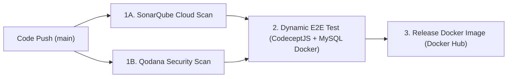

# 🎬 Netfix2 — Hệ Thống Xem Phim Trực Tuyến & Dự Án Kiểm Thử Phần Mềm (QA Testing)

[](https://sonarcloud.io/summary/new_code?id=Col255_QA-netfilxfake)
[](https://sonarcloud.io/summary/new_code?id=Col255_QA-netfilxfake)
[](https://sonarcloud.io/summary/new_code?id=Col255_QA-netfilxfake)
[](https://sonarcloud.io/summary/new_code?id=Col255_QA-netfilxfake)
[](https://sonarcloud.io/summary/new_code?id=Col255_QA-netfilxfake)
[](https://github.com/Col255/QA-netfilxfake/actions/workflows/ci-cd-pipeline.yml)

**Netfix2** là nền tảng xem phim trực tuyến xây dựng trên kiến trúc **PHP 8.2 & MariaDB/MySQL**, phục vụ cho khách vãng lai (Guest), thành viên người dùng (User thường & User VIP), và Quản trị viên (Admin CMS).

Repository này là giải pháp toàn diện cho môn học **Kiểm thử Phần mềm & Đảm bảo Chất lượng (QA/QC)**, tích hợp đầy đủ mã nguồn ứng dụng (`netfix2/`), cơ sở dữ liệu mẫu (`database/netfixvn.sql`), tài liệu đặc tả yêu cầu SRS chuẩn IEEE 830 (`docs/srs.docx`), thiết kế kịch bản kiểm thử hộp đen & hộp trắng (`docs/`), bộ kiểm thử API **Postman (Static Automation & Data-Driven CSV Runner)** (`Postman/`), 13 kịch bản kiểm thử giao diện End-to-End **CodeceptJS + Playwright** (`tests/`), và đường ống **CI/CD GitHub Actions** tích hợp **SonarCloud & JetBrains Qodana** đạt **Quality Gate Passed (Security Rating A)**.

> ⚠️ Các trang `.php` cần chạy qua web server có hỗ trợ PHP (XAMPP, Laragon hoặc Docker). Không mở trực tiếp file PHP bằng trình duyệt hoặc VS Code.

🔗 **Liên kết Quản lý Dự án, Phát hành & Báo cáo:**
- 🏷️ **GitHub Release Chính Thức (`v1.0.0-qa`):** [https://github.com/Col255/QA-netfilxfake/releases/tag/v1.0.0-qa](https://github.com/Col255/QA-netfilxfake/releases/tag/v1.0.0-qa)
- 📋 **Jira Project Board (QA Testing 002 — `KAN`):** [https://lochnt0228.atlassian.net/jira/software/projects/KAN/boards/2](https://lochnt0228.atlassian.net/jira/software/projects/KAN/boards/2)
- 📑 **Danh sách Jira Tasks (JQL):** [Xem toàn bộ danh sách công việc trên Jira](https://lochnt0228.atlassian.net/jira/software/projects/KAN/list?jql=project+%3D+KAN+ORDER+BY+%22cf%5B10019%5D%22+ASC)
- 📊 **SonarCloud Dashboard:** [https://sonarcloud.io/project/overview?id=Col255_QA-netfilxfake](https://sonarcloud.io/project/overview?id=Col255_QA-netfilxfake)

---

## 📊 Bảng Thống Kê & Chỉ Số Chất Lượng (Quality Metrics)

| Chỉ số / Phép đo | Kết quả đạt được | Mục tiêu / Chuẩn áp dụng | Trạng thái |
| :--- | :---: | :---: | :---: |
| **SonarCloud Quality Gate** | **PASSED (OK)** | Strict Mode trên nhánh `main` | ✅ Đạt chuẩn |
| **Security Rating (SonarCloud)** | **Rating A (0 Vulnerabilities)** | Vá XSS, Hardcoded Secret & CSPRNG `random_int()` (`KAN-217`, `KAN-227`) | ✅ Pass |
| **Bugs & Code Smells** | **0 Bugs / 0 Smells** | Reliability Rating A  | ✅ Clean Code |
| **Độ bao phủ White-Box ($C_0 / C_1$)** | **100% $C_0$ / 100% $C_1$** | 133/133 TCs Pass trên 33 file PHP | ✅ Tuyệt đối |
| **Tổng độ phức tạp Cyclomatic $V(G)$** | **732** | Chuẩn độ phức tạp Thomas McCabe | ✅ Đã bao phủ |
| **Kiểm thử Tích hợp (Black-Box)** | **83/83 TCs PASS (100%)** | EP, BVA, Security, RBAC (Master Excel 9 Sheets) | ✅ Hoàn thành |
| **Postman Data-Driven (CSV Runner)** | **76/76 Iterations PASS (0 Errors)** | Nạp trực tiếp 6 file CSV qua `pm.iterationData` (`KAN-219`: `KAN-221..226`) | ✅ Hoàn thành tự động 100% |
| **Kiểm thử Động E2E (CodeceptJS)** | **13 Suites — 100% PASS** | 5 Phân hệ lõi trên Playwright Headless + MySQL Docker | ✅ Hoàn thành |

---

## 🛠️ Công Nghệ & Công Cụ Kiểm Thử Sử Dụng

- 🐘 **Backend & Database:** PHP 8.2 (`mysqli`, CSPRNG `random_int`), MySQL / MariaDB (`utf8mb4_unicode_ci`)
- 🌐 **Frontend:** HTML5, CSS3, JavaScript ES6 (Đạt chuẩn Accessibility WCAG — `KAN-218`)
- 🏢 **XAMPP / Laragon / Docker:** Khởi chạy môi trường Web Server Apache & MySQL cục bộ hoặc container hóa
- 📮 **Postman & Newman (Static + Data-Driven Testing):**
  - Bộ Collection tĩnh tự động hóa 5 phân hệ (`Postman/Automation/`).
  - Bộ **Data-Driven CSV Runner** (`Postman/DDT/`) đọc trực tiếp 6 file CSV (`docs/Design/design_testcase_*.csv`) qua `pm.iterationData`, tự động xoay phương thức `GET/POST`, nạp Query/Body và chấm điểm Pass/Fail tự động.
- 🎭 **CodeceptJS + Playwright (Chromium):** 13 kịch bản kiểm thử động End-to-End (UI, RBAC, Security, White-Box E2E)
- 🔬 **Custom White-Box Runner (Node.js Evaluator):** Đánh giá đường đi cơ sở (Basis Path Testing), tự động kích hoạt các nhánh $D_i$ và câu lệnh $S_i$ của 5 phân hệ
- 🔍 **SonarQube Cloud & JetBrains Qodana:** Kiểm thử tĩnh (Static White-Box Analysis) quét lỗi cú pháp, lỗ hổng bảo mật OWASP, Taint Analysis và Code Smells
- 📈 **Clover XML & HTML Reporter:** Tự động sinh báo cáo độ phủ mã nguồn trực quan kèm sơ đồ luồng điều khiển Mermaid CFG
- ⚙️ **GitHub Actions CI/CD & Docker Hub:** Tự động hóa 3 giai đoạn Kiểm thử Tĩnh → Kiểm thử Động → Đóng gói Docker Image

---

## 👥 Phân Công Trách Nhiệm & 5 Phân Hệ Cốt Lõi

Hệ thống gồm **5 phân hệ nghiệp vụ chính**, được kiểm thử đầy đủ qua các kỹ thuật **Phân lớp tương đương (EP)**, **Phân tích giá trị biên (BVA)**, **Bảng quyết định (Decision Table)**, **Chuyển đổi trạng thái (State Transition)**, **Kiểm thử Hộp trắng ($C_0/C_1$)** và **Data-Driven CSV Automation**:

| Phân Hệ | Kỹ Sư QA Phụ Trách | Phạm Vi Kiểm Thử (Blackbox / Whitebox / DDT) |
| :--- | :--- | :---: |
| **FE1: Authentication & Security (`AUTH`)** | **Huỳnh Nguyễn Tiến Lộc** | 24 Blackbox / 33 Whitebox / 24 DDT CSV |
| **FE2: Movies, Search & Streaming (`MOV`)** | **Nguyễn Hoàng Sỹ Dương** | 18 Blackbox / 20 Whitebox / 13 DDT CSV |
| **FE3: Interactions & Engagement (`INT`)** | **Nguyễn Huỳnh Hữu Huy** | 15 Blackbox / 23 Whitebox / 15 DDT CSV |
| **FE4: VIP Packages & Payment (`VIP`)** | **Lê Hoàng Nhật Bình** | 11 Blackbox / 29 Whitebox / 11 DDT CSV |
| **FE5: Admin Management CMS (`ADM`)** | **Nguyễn Lê Quốc Trung** | 15 Blackbox / 28 Whitebox / 13 DDT CSV |
| **MASTER (Tổng hợp toàn hệ thống)** | **Cả nhóm QA (5 thành viên)** | **83 Blackbox / 133 Whitebox / 76 DDT CSV** |

Chi tiết phạm vi mã nguồn từng phân hệ:
- 👤 **Phân hệ 1 — `AUTH`:** Đăng ký, đăng nhập User/Admin, đăng xuất, xem & cập nhật hồ sơ, đổi mật khẩu, bảo vệ phiên làm việc & chống SQLi/XSS (`register.php`, `login.php`, `admin_login.php`, `logout.php`, `profile.php`, `edit_profile.php`, `change_password.php`, `user_sidebar.php`).
- 🍿 **Phân hệ 2 — `MOV`:** Duyệt trang chủ, lọc thể loại (Movie, Series, Cartoon, Cinema), tìm kiếm độc lập theo từ khóa/thể loại, phát video đa tập, kiểm soát quyền xem phim VIP (`index.php`, `movies.php`, `search.php`, `watch.php`, `header.php`, `footer.php`, `about.php`).
- 💬 **Phân hệ 3 — `INT`:** REST API bộ đếm lượt xem không đồng bộ, gửi và kiểm duyệt/xóa bình luận chống Stored XSS, lưu trữ và xóa lịch sử xem phim (`api/view_counter.php`, `comments.php`, `watch_history.php`).
- 💳 **Phân hệ 4 — `VIP`:** Bảng giá 3 gói VIP (1-3-6 tháng), thanh toán chuyển khoản & MoMo Sandbox sử dụng CSPRNG `random_int()`, xác thực chữ ký HMAC-SHA256, xử lý callback IPN và cộng dồn hạn VIP (`pricing.php`, `checkout.php`, `process_payment.php`, `payment_return.php`, `order_history.php`, `vip_helper.php`).
- 🛡️ **Phân hệ 5 — `ADM`:** Dashboard thống kê tổng quan, thêm/sửa/xóa phim (BVA năm phát hành 1900–2030 & thời lượng 1–600 phút), duyệt đơn VIP, quản lý khách hàng và báo cáo doanh thu (`admin_dashboard.php`, `admin_sidebar.php`, `add_movie.php`, `edit_movie.php`, `manage_movies.php`, `manage_vip.php`, `orders.php`, `customers.php`, `statistics.php`).

---

## 📂 Cấu Trúc Thư Mục Dự Án (Đồng Bộ Nhánh `main`)

```text
QA-netfilxfake/
├── .github/workflows/
│   └── ci-cd-pipeline.yml            # Pipeline CI/CD: SonarCloud + Qodana + CodeceptJS + Docker Hub
├── database/
│   └── netfixvn.sql                  # File SQL khởi tạo CSDL và dữ liệu mẫu chuẩn (MariaDB/MySQL)
├── diagrams/ & workspace.dsl         # Sơ đồ kiến trúc phần mềm C4 Model (Structurizr DSL) & Use Case
├── docs/                             # Toàn bộ tài liệu SRS, kịch bản kiểm thử & báo cáo
│   ├── srs.docx                      # Tài liệu đặc tả yêu cầu phần mềm SRS (chuẩn IEEE 830)
│   ├── BANG_TONG_HOP_TEST_CASE_CHINH.xlsx  # File Excel Master tổng hợp kịch bản kiểm thử
│   ├── TEST_CASES_TONG_HOP_CHINH.md  # Tài liệu Master 83 kịch bản kiểm thử 5 phân hệ
│   ├── WHITEBOX_*_STATEMENT_BRANCH_COVERAGE.md # 5 báo cáo đặc tả C0/C1 & sơ đồ CFG Mermaid
│   ├── Design/                       # 6 file CSV Black-Box (auth, mov, int, vip, adm, master) & 5 file CSV White-Box
│   ├── Report/                       # Báo cáo thực thi kiểm thử & Code Coverage
│   │   ├── clover.xml                # Báo cáo Code Coverage chuẩn Clover XML cho SonarCloud (99.8%)
│   │   ├── whitebox_coverage_report.html # Dashboard kiểm thử White-Box HTML trực quan (133 TCs, CFG)
│   │   ├── report_whitebox_*.csv     # Kết quả thực thi White-Box từng phân hệ (100% C0/C1)
│   │   └── report_run_testcase_*.csv # Kết quả kiểm thử Black-Box tự động
│   └── testrun/                      # Bộ công cụ chạy kiểm thử tự động & xuất báo cáo
│       ├── generate_clover.js        # Script xuất độ phủ mã nguồn ra Clover XML
│       ├── generate_html_report.js   # Script tạo báo cáo White-Box HTML Dashboard
│       ├── whitebox_runner_*.js      # 5 Unit Branch Evaluators kiểm thử White-Box (Node.js)
│       └── test_runner_*.py          # 6 Script Python kiểm thử HTTP Black-Box (5 phân hệ & Master)
├── netfix2/                          # Toàn bộ mã nguồn website xem phim trực tuyến PHP Netfix2
│   ├── api/                          # REST API Endpoints (view_counter.php)
│   ├── css/ & js/ & images/          # Tài nguyên Frontend & giao diện người dùng
│   └── *.php                         # 33 tệp mã nguồn PHP của 5 phân hệ (đạt SonarCloud Security A)
├── Postman/                          # Toàn bộ bộ sưu tập kiểm thử API Postman
│   ├── API/
│   │   ├── Netfix2 - Local Environment.json # Biến môi trường Postman (baseUrl, session, token)
│   │   └── netfix2_api.json          # Đặc tả danh mục Endpoints API Netfix2
│   ├── Automation/                   # Bộ sưu tập Postman Automation tĩnh cho 5 phân hệ & Master
│   │   ├── Netfix2_MASTER_ALL_5_MODULES_Automation.postman_collection.json
│   │   ├── Netfix2_AUTH_Security_Automation.postman_collection.json
│   │   ├── movie_mov_collection.json
│   │   ├── netfix2_Interactions & Engagement_automatic.postman.collection.json
│   │   ├── Netfix2_VIP_Packages_Payment_Automation.postman_collection.json
│   │   └── admin_collection.json
│   └── DDT/                          # Bộ Postman Data-Driven Testing (CSV Runner — KAN-219: KAN-221..226)
│       ├── Netfix2_DDT_CSV_Runner.postman_collection.json   # Master Runner gộp 5 phân hệ (76 TCs - KAN-226)
│       ├── Netfix2_DDT_01_AUTH.postman_collection.json      # DDT riêng Phân hệ 1: AUTH (24 TCs - KAN-221)
│       ├── Netfix2_DDT_02_MOV.postman_collection.json       # DDT riêng Phân hệ 2: MOV (13 TCs - KAN-222)
│       ├── Netfix2_DDT_03_INT.postman_collection.json       # DDT riêng Phân hệ 3: INT (15 TCs - KAN-223)
│       ├── Netfix2_DDT_04_VIP.postman_collection.json       # DDT riêng Phân hệ 4: VIP (11 TCs - KAN-224)
│       └── Netfix2_DDT_05_ADM.postman_collection.json       # DDT riêng Phân hệ 5: ADM (13 TCs - KAN-225)
├── tests/                            # 13 bộ kịch bản kiểm thử tự động CodeceptJS + Playwright
│   ├── master_all_modules_test.js    # Kịch bản E2E tổng hợp toàn trình 5 phân hệ
│   ├── login_test.js                 # E2E Phân hệ 1: Authentication & Security
│   ├── movies_search_test.js         # E2E Phân hệ 2: Movies & Search
│   ├── search_security_test.js       # E2E Bảo mật SQLi/XSS chức năng tìm kiếm
│   ├── streaming_vip_test.js         # E2E Phân quyền xem phim VIP / Free
│   ├── Interactions & Engagement.js  # E2E Phân hệ 3: Interactions & Engagement
│   ├── view_counter_test.js          # E2E Kiểm thử API đếm lượt xem phim
│   ├── vip_test.js                   # E2E Phân hệ 4: VIP Packages & MoMo Payment
│   ├── admin_management_test.js      # E2E Phân hệ 5: Admin CMS Management
│   ├── admin_movies_rbac_test.js     # E2E Phân quyền RBAC Quản trị Phim
│   └── whitebox_*_test.js            # 3 bộ kiểm thử White-Box động (adm, int, mov)
├── codecept.conf.js & steps_file.js  # Cấu hình CodeceptJS + Playwright (Headless Chromium)
├── Dockerfile                        # Cấu hình đóng gói container Docker cho ứng dụng PHP
├── sonar-project.properties          # Cấu hình SonarCloud & đường dẫn Clover Coverage
├── qodana.yaml                       # Cấu hình phân tích mã tĩnh JetBrains Qodana (PHP 8.1+)
└── package.json                      # Quản lý dependencies & các npm scripts kiểm thử nhanh
```

---

## 🟧 Hướng Dẫn Cài Đặt Và Chạy Ứng Dụng Với XAMPP / Laragon

1. Cài đặt **XAMPP** hoặc **Laragon**, khởi động dịch vụ **Apache** và **MySQL**.
2. Đặt thư mục `netfix2` vào thư mục web root: `C:\xampp\htdocs\netfix2` (hoặc tạo Virtual Host trỏ vào).
3. Truy cập [phpMyAdmin](http://localhost/phpmyadmin), tạo cơ sở dữ liệu `netfixvn` (Bảng mã: `utf8mb4_unicode_ci`).
4. Nhấn tab **Import** → Chọn tệp `database/netfixvn.sql` → Nhấn **Import** để nạp dữ liệu mẫu.
5. Cấu hình kết nối CSDL tại `netfix2/db.php` (mặc định user `root`, mật khẩu rỗng; hỗ trợ đọc biến môi trường CI/CD).
6. Truy cập website qua trình duyệt: [http://localhost/netfix2/](http://localhost/netfix2/)
   - **Tài khoản User:** `tuan@gmail.com` / Mật khẩu: `123456`
   - **Tài khoản Admin:** `admin` / Mật khẩu: `admin123` (Cổng đăng nhập: `/admin_login.php`)

---

## 🧪 Hướng Dẫn Chạy Toàn Bộ Các Bộ Kiểm Thử (CLI & Postman)

Tại thư mục gốc dự án, cài đặt các thư viện cần thiết:
```powershell
npm install
```

### 1. Chạy Kiểm Thử Hộp Trắng (White-Box Testing $C_0/C_1$)
```powershell
# Chạy White-Box từng phân hệ (133 TCs):
npm run test:whitebox:auth    # Phân hệ 1: AUTH (33 TCs)
npm run test:whitebox:mov     # Phân hệ 2: MOV (20 TCs)
npm run test:whitebox:int     # Phân hệ 3: INT (23 TCs)
npm run test:whitebox:vip     # Phân hệ 4: VIP (29 TCs)
npm run test:whitebox:adm     # Phân hệ 5: ADM (28 TCs)

# Sinh lại Báo cáo White-Box HTML trực quan & Clover XML cho SonarCloud:
npm run report:whitebox:html
npm run report:clover
```
*Sau khi chạy, mở tệp `docs/Report/whitebox_coverage_report.html` trên trình duyệt để xem báo cáo HTML đầy đủ sơ đồ luồng điều khiển (CFG).*

### 2. Chạy Kiểm Thử Động Tự Động E2E (CodeceptJS + Playwright)
```powershell
# Chạy toàn bộ 13 bộ kịch bản E2E:
npm test

# Chạy có hiển thị từng bước hành động chi tiết:
npx codeceptjs run --steps

# Chạy lọc theo từng phân hệ bằng tag:
npx codeceptjs run tests/master_all_modules_test.js --grep "@AUTH"
npx codeceptjs run tests/master_all_modules_test.js --grep "@VIP"
npx codeceptjs run tests/master_all_modules_test.js --grep "@ADM"
```

### 3. Chạy Kiểm Thử API Hướng Dữ Liệu — Postman Data-Driven CSV 

Nhóm hỗ trợ **2 chế độ chạy Postman**:

#### Cách A: Chạy Data-Driven từ file CSV trên Postman Runner (Khuyên dùng) (Chỉ hoạt động khi có premium )
1. Mở **Postman** → **Import** file môi trường `Postman/API/Netfix2 - Local Environment.json` và 1 trong các file Collection trong `Postman/DDT/`:
   - Chạy **tổng hợp cả 5 phân hệ (76 TCs — `KAN-226`)**: Import `Postman/DDT/Netfix2_DDT_CSV_Runner.postman_collection.json` → Mở **Runner**, chỉ tích chọn folder `KAN-226 | 00_MASTER_DDT_RUNNER` → Chọn **Iteration data**: `docs/Design/design_testcase_master.csv`.
   - Chạy **riêng từng phân hệ (`KAN-221` → `KAN-225`)**: Import file tương ứng (`Netfix2_DDT_01_AUTH.postman_collection.json` .. `05_ADM`) → Mở **Runner** → Chọn **Iteration data** là file CSV tương ứng (`docs/Design/design_testcase_auth.csv` .. `adm.csv`).
2. Bỏ tích *Stop run if an error occurs* → Nhấn **Start run** để Postman tự động lặp toàn bộ dòng CSV và đối soát kết quả (0 Errors / 100% Pass).

#### Cách B: Chạy Data-Driven tự động qua dòng lệnh Newman CLI
```powershell
# Chạy Master 76 TCs từ file CSV:
npx newman run "Postman/DDT/Netfix2_DDT_CSV_Runner.postman_collection.json" `
  --folder "KAN-226 | 00_MASTER_DDT_RUNNER (Tổng hợp 5 Phân hệ - 76 TCs)" `
  -d "docs/Design/design_testcase_master.csv" `
  -e "Postman/API/Netfix2 - Local Environment.json"

# Chạy riêng 1 phân hệ (ví dụ Phân hệ 1: AUTH - 24 TCs):
npx newman run "Postman/DDT/Netfix2_DDT_01_AUTH.postman_collection.json" `
  -d "docs/Design/design_testcase_auth.csv" `
  -e "Postman/API/Netfix2 - Local Environment.json"
```

#### Cách C: Chạy bộ Postman Automation tĩnh truyền thống hoặc Python HTTP Runner
- **Postman Static Collection:** Import `Postman/Automation/Netfix2_MASTER_ALL_5_MODULES_Automation.postman_collection.json` và `Postman/API/Netfix2 - Local Environment.json` → **Run collection**.
- **Python CSV Runner:** Chạy `python docs/testrun/test_runner_master.py` để chạy toàn bộ 76 kịch bản và xuất báo cáo `docs/Report/report_run_testcase_master.csv`.

---

## 🔄 Luồng Tích Hợp Liên Tục CI/CD (GitHub Actions Pipeline)

Đường ống CI/CD được định nghĩa tại `.github/workflows/ci-cd-pipeline.yml`, tự động kích hoạt mỗi khi có commit đẩy lên nhánh `main` hoặc tạo `Pull Request`. Quy trình gồm **3 Giai đoạn liên hoàn**:



1. **Giai đoạn 1: Kiểm thử Tĩnh (Static Analysis)**
   - **Job 1A (SonarQube Cloud):** Kiểm tra cú pháp `php -l`, chạy `generate_clover.js` nạp báo cáo `clover.xml`, phân tích bảo mật OWASP, kiểm soát 0 Bugs, 0 Vulnerabilities (Security Rating A), 0 Code Smells và kiểm tra ngưỡng Quality Gate.
   - **Job 1B (JetBrains Qodana):** Phân tích sâu luồng điều khiển, Data-flow và an toàn kiểu dữ liệu PHP 8.1+.
2. **Giai đoạn 2: Kiểm thử Động (Dynamic E2E Testing)**
   - **Job 2 (CodeceptJS + MySQL Container):** Khởi tạo container MySQL 8.0, nạp database `database/netfixvn.sql`, khởi chạy PHP Server ngầm (`php -S 0.0.0.0:8000`) và thực thi toàn bộ kịch bản E2E trên trình duyệt Chromium Headless. Nếu có lỗi, tự động chụp ảnh màn hình lưu vào Artifact để đính kèm Jira.
3. **Giai đoạn 3: Đóng gói & Phát hành (Delivery & Release)**
   - **Job 3 (Docker Hub):** Sau khi toàn bộ các bài kiểm thử tĩnh và động đạt 100% PASS, hệ thống tự động build Docker Image và đẩy lên Docker Hub với thẻ phiên bản phát hành `v1.0.<build_number>`.

---

## 📌 Lộ Trình Phát Triển & Các Mốc Hoàn Thành Chính

- **Week 1 – Week 5:** Đặc tả SRS (IEEE 830), sơ đồ C4 Model (`workspace.dsl`), thiết kế 83 kịch bản kiểm thử Hộp đen EP/BVA và tự động hóa E2E CodeceptJS + Playwright cho 5 phân hệ (`KAN-23`, `KAN-43`, `KAN-44`, `KAN-45`, `KAN-52`).
- **Week 6 – Week 7 (`KAN-153` → `KAN-218`):** Kiểm thử Hộp trắng $C_0/C_1$ (133 TCs), tái cấu trúc 37+ cảnh báo Qodana/SonarCloud, vá 3 lỗi Blocker bảo mật, khắc phục 19 cảnh báo Accessibility WCAG và phát hành `v1.0.0-qa`.
- **Week 8 - Week 9 (`KAN-219`, `KAN-221` → `KAN-228`):** Xây dựng trọn bộ **Postman Data-Driven CSV Runner** (1 Master + 5 Modules tách riêng, 76/76 Iterations Pass 0 Errors), nâng cấp bảo mật CSPRNG `random_int()` đạt **SonarCloud Security Rating A** và tích hợp hợp nhất vào nhánh `main`.
