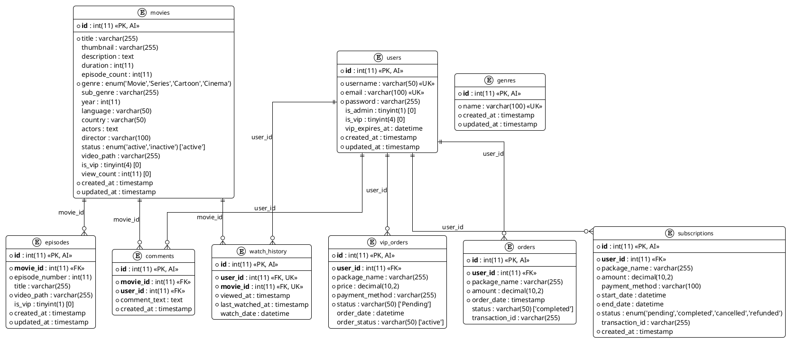

# 📊 Netfix2 — Sơ Đồ Thực Thể Quan Hệ (ERD) & Kiến Trúc Dữ Liệu

> **Tài liệu đặc tả kiến trúc dữ liệu (Data Architecture & ERD)**  
> Được xây dựng dựa trên lược đồ cơ sở dữ liệu `netfixvn.sql`, mã nguồn hệ thống `netfix2/` và mô hình kiến trúc **C4 Model** (Container Level 2 & Data Model Level 4).

---

## 1. Vị trí của CSDL trong mô hình kiến trúc C4 (C4 Model)

Trong mô hình **C4 Model**:
* **Level 1 (System Context):** Người dùng (Viewer / Admin) tương tác với hệ thống website xem phim **Netfix2**.
* **Level 2 (Container):** Ứng dụng gồm **Web Browser** -> **PHP Web Application (Apache/XAMPP)** -> **MySQL Database (`netfixvn`)** & **Local Media Storage (`Uploads/`)**.
* **Level 4 (Data Model / ERD):** Phản ánh cấu trúc bảng, các trường thuộc tính, khóa chính (PK), khóa ngoại (FK) và mối quan hệ ràng buộc (Cardinality) bên trong container CSDL `netfixvn`.

```
+-------------------------------------------------------------------------+
|                  C4 Level 2: Container (Netfix2 System)                 |
|                                                                         |
|  [Viewer / Admin]                                                       |
|         │                                                               |
|         ▼ (HTTPS)                                                       |
|  [Web Browser]                                                          |
|         │                                                               |
|         ▼ (HTTP / JSON / PHP Requests)                                  |
|  [Netfix2 Web Application] ────────────► [Local Media Storage]          |
|  (Apache / PHP 8.2)                      (Uploads/videos, thumbnails)   |
|         │                                                               |
|         ▼ (MySQL Protocol / TCP 3306)                                   |
|  ┌───────────────────────────────────────────────┐                      |
|  │ C4 Database Container: MySQL (`netfixvn`)     │                      |
|  │ ──► Chi tiết hóa thành C4 Level 4: ERD        │                      |
|  └───────────────────────────────────────────────┘                      |
+-------------------------------------------------------------------------+
```

---

## 2. Sơ đồ Thực thể Quan hệ (ERD - Mermaid Diagram)

```mermaid
erDiagram
    users ||--o{ vip_orders : "places (1:N)"
    users ||--o{ comments : "writes (1:N)"
    users ||--o{ watch_history : "tracks (1:N)"
    users ||--o{ orders : "legacy orders (1:N)"
    users ||--o{ subscriptions : "legacy subs (1:N)"

    movies ||--o{ episodes : "has episodes (1:N)"
    movies ||--o{ comments : "receives (1:N)"
    movies ||--o{ watch_history : "viewed in (1:N)"

    users {
        int id PK "AI"
        varchar username "UK, len 50"
        varchar email "UK, len 100"
        varchar password "len 255 (bcrypt)"
        tinyint is_admin "0: User, 1: Admin"
        tinyint is_vip "0: Normal, 1: VIP"
        datetime vip_expires_at "Hạn VIP"
        timestamp created_at "Mặc định current_timestamp"
        timestamp updated_at "Tự động cập nhật"
    }

    movies {
        int id PK "AI"
        varchar title "Tên phim"
        varchar thumbnail "Đường dẫn ảnh bìa"
        text description "Tóm tắt phim"
        int duration "Thời lượng (phút/tập)"
        int episode_count "Số tập dự kiến"
        enum genre "Movie, Series, Cartoon, Cinema"
        varchar sub_genre "Thể loại chi tiết (Hài hước, Tình cảm...)"
        int year "Năm phát hành"
        varchar language "Ngôn ngữ"
        varchar country "Quốc gia sản xuất"
        text actors "Danh sách diễn viên"
        varchar director "Đạo diễn"
        enum status "active, inactive"
        varchar video_path "Video cho phim lẻ (Movie/Cartoon)"
        tinyint is_vip "0: Miễn phí, 1: Yêu cầu VIP"
        int view_count "Lượt xem tích lũy"
        timestamp created_at "Thời điểm tạo"
        timestamp updated_at "Thời điểm cập nhật"
    }

    episodes {
        int id PK "AI"
        int movie_id FK "Liên kết movies(id) ON DELETE CASCADE"
        int episode_number "Số tập (1, 2, 3...)"
        varchar title "Tiêu đề tập phim"
        varchar video_path "Đường dẫn file video"
        tinyint is_vip "0: Thường, 1: VIP"
        timestamp created_at "Thời điểm tạo"
        timestamp updated_at "Thời điểm cập nhật"
    }

    comments {
        int id PK "AI"
        int movie_id FK "Liên kết movies(id) ON DELETE CASCADE"
        int user_id FK "Liên kết users(id) ON DELETE CASCADE"
        text comment_text "Nội dung bình luận"
        timestamp created_at "Thời điểm gửi bình luận"
    }

    watch_history {
        int id PK "AI"
        int user_id FK "Liên kết users(id) ON DELETE CASCADE"
        int movie_id FK "Liên kết movies(id) ON DELETE CASCADE"
        timestamp viewed_at "Lần xem gần nhất"
        timestamp last_watched_at "Mốc thời gian xem"
        datetime watch_date "Ngày xem"
    }

    vip_orders {
        int id PK "AI"
        int user_id FK "Liên kết users(id) ON DELETE CASCADE"
        varchar package_name "Tên gói (VD: Gói VIP 1 Tháng)"
        decimal price "Giá gói cước (10, 2)"
        varchar payment_method "MoMo, VNPAY"
        varchar status "Pending, Completed, Cancelled"
        datetime order_date "Ngày đặt hàng"
        varchar order_status "active, pending, cancelled, expired"
    }

    orders {
        int id PK "AI (Legacy / Backup)"
        int user_id FK "Liên kết users(id) ON DELETE CASCADE"
        varchar package_name "Tên gói cước"
        decimal amount "Số tiền (10, 2)"
        timestamp order_date "Thời gian đặt"
        varchar status "completed, pending..."
        varchar transaction_id "Mã giao dịch"
    }

    subscriptions {
        int id PK "AI (Định kỳ / Subscriptions)"
        int user_id FK "Liên kết users(id) ON DELETE CASCADE"
        varchar package_name "Tên gói"
        decimal amount "Số tiền"
        varchar payment_method "Phương thức"
        datetime start_date "Ngày bắt đầu"
        datetime end_date "Ngày hết hạn"
        enum status "pending, completed, cancelled, refunded"
        varchar transaction_id "Mã giao dịch"
        timestamp created_at "Thời gian tạo"
    }

    genres {
        int id PK "AI (Danh mục thể loại mở rộng)"
        varchar name "UK, tên thể loại"
        timestamp created_at "Thời gian tạo"
        timestamp updated_at "Thời gian cập nhật"
    }
```



---

## 3. Sơ đồ ERD dạng PlantUML



---

## 4. Từ điển Dữ liệu Chi tiết (Data Dictionary)

### 4.1. Bảng `users` (Người dùng & Quản trị viên)
Lưu trữ toàn bộ thông tin định danh, tài khoản đăng nhập, trạng thái phân quyền (Admin) và quyền hạn VIP của người dùng.

| Tên cột | Kiểu dữ liệu | Null | Khóa | Mặc định | Mô tả ý nghĩa |
|---|---|---|---|---|---|
| `id` | `int(11)` | NO | PK | Auto Increment | Định danh duy nhất của người dùng |
| `username` | `varchar(50)` | NO | UNIQUE | Không | Tên tài khoản đăng nhập |
| `email` | `varchar(100)` | NO | UNIQUE | Không | Email cá nhân dùng để kích hoạt, nhận diện |
| `password` | `varchar(255)` | NO | | Không | Mật khẩu băm (bcrypt hash) hoặc plaintext (tài khoản admin mẫu) |
| `is_admin` | `tinyint(1)` | YES | | `0` | Quyền quản trị: `1` là Quản trị viên, `0` là Người dùng thường |
| `is_vip` | `tinyint(4)` | YES | | `0` | Trạng thái gói VIP: `1` là thành viên VIP, `0` là tài khoản thường |
| `vip_expires_at` | `datetime` | YES | | `NULL` | Thời điểm hết hạn gói VIP |
| `created_at` | `timestamp` | NO | | `current_timestamp()` | Thời điểm đăng ký tài khoản |
| `updated_at` | `timestamp` | NO | | ON UPDATE CURRENT | Thời điểm cập nhật thông tin cuối |

---

### 4.2. Bảng `movies` (Kho phim)
Lưu trữ thông tin chi tiết về từng bộ phim, bao gồm thể loại phân loại, số tập, đường dẫn media, chế độ VIP và lượt xem.

| Tên cột | Kiểu dữ liệu | Null | Khóa | Mặc định | Mô tả ý nghĩa |
|---|---|---|---|---|---|
| `id` | `int(11)` | NO | PK | Auto Increment | Mã định danh duy nhất của phim |
| `title` | `varchar(255)` | NO | | Không | Tiêu đề phim |
| `thumbnail` | `varchar(255)` | YES | | `NULL` | Đường dẫn file ảnh poster (vd: `Uploads/thumbnails/...`) |
| `description` | `text` | YES | | `NULL` | Nội dung tóm tắt phim |
| `duration` | `int(11)` | YES | | `NULL` | Thời lượng phim (phút) hoặc độ dài mỗi tập |
| `episode_count` | `int(11)` | YES | | `NULL` | Số tập dự kiến (áp dụng cho Series, nếu phim lẻ là 0) |
| `genre` | `enum('Movie','Series','Cartoon','Cinema')` | NO | | Không | Thể loại định dạng chính của phim |
| `sub_genre` | `varchar(255)` | YES | | `NULL` | Thể loại nội dung phụ (vd: Hài hước, Tình cảm, Cổ trang...) |
| `year` | `int(11)` | YES | | `NULL` | Năm phát hành |
| `language` | `varchar(50)` | YES | | `NULL` | Ngôn ngữ phim |
| `country` | `varchar(50)` | YES | | `NULL` | Quốc gia sản xuất |
| `actors` | `text` | YES | | `NULL` | Danh sách dàn diễn viên tham gia |
| `director` | `varchar(100)` | YES | | `NULL` | Đạo diễn phim |
| `status` | `enum('active','inactive')` | YES | | `'active'` | Trạng thái hiển thị trên hệ thống |
| `video_path` | `varchar(255)` | YES | | `NULL` | Đường dẫn file video (đối với phim lẻ/Movie) |
| `is_vip` | `tinyint(4)` | YES | | `0` | Quyền xem: `1` yêu cầu tài khoản VIP, `0` xem miễn phí |
| `view_count` | `int(11)` | YES | | `0` | Số lượt xem tích lũy của bộ phim |
| `created_at` | `timestamp` | NO | | `current_timestamp()` | Ngày thêm phim vào hệ thống |
| `updated_at` | `timestamp` | NO | | ON UPDATE CURRENT | Ngày cập nhật thông tin phim |

---

### 4.3. Bảng `episodes` (Tập phim)
Quản lý các tập phim lẻ thuộc về một bộ phim nhiều tập (`Series`).

| Tên cột | Kiểu dữ liệu | Null | Khóa | Mặc định | Mô tả ý nghĩa |
|---|---|---|---|---|---|
| `id` | `int(11)` | NO | PK | Auto Increment | Mã định danh tập phim |
| `movie_id` | `int(11)` | NO | FK | Không | Khóa ngoại trỏ đến `movies(id)` (ON DELETE CASCADE) |
| `episode_number`| `int(11)` | NO | | Không | Thứ tự tập phim (Tập 1, Tập 2...) |
| `title` | `varchar(255)` | YES | | `NULL` | Tiêu đề riêng của tập phim |
| `video_path` | `varchar(255)` | NO | | Không | Đường dẫn file video của tập phim (`Uploads/videos/...`) |
| `is_vip` | `tinyint(1)` | YES | | `0` | Khóa VIP riêng cho từng tập phim (`1`: VIP, `0`: miễn phí) |
| `created_at` | `timestamp` | NO | | `current_timestamp()` | Thời điểm tải lên tập phim |
| `updated_at` | `timestamp` | NO | | ON UPDATE CURRENT | Thời điểm sửa đổi tập phim |

---

### 4.4. Bảng `comments` (Bình luận của người dùng)
Lưu trữ các trao đổi, nhận xét, đánh giá của người xem đối với từng bộ phim.

| Tên cột | Kiểu dữ liệu | Null | Khóa | Mặc định | Mô tả ý nghĩa |
|---|---|---|---|---|---|
| `id` | `int(11)` | NO | PK | Auto Increment | Mã bình luận |
| `movie_id` | `int(11)` | NO | FK | Không | Khóa ngoại trỏ đến `movies(id)` (ON DELETE CASCADE) |
| `user_id` | `int(11)` | NO | FK | Không | Khóa ngoại trỏ đến `users(id)` (ON DELETE CASCADE) |
| `comment_text` | `text` | NO | | Không | Nội dung phản hồi, nhận xét |
| `created_at` | `timestamp` | NO | | `current_timestamp()` | Thời gian đăng bình luận |

---

### 4.5. Bảng `watch_history` (Lịch sử xem phim)
Theo dõi hành vi người dùng, đánh dấu các phim đã xem để tiếp tục xem hoặc gợi ý.

| Tên cột | Kiểu dữ liệu | Null | Khóa | Mặc định | Mô tả ý nghĩa |
|---|---|---|---|---|---|
| `id` | `int(11)` | NO | PK | Auto Increment | Mã bản ghi lịch sử xem |
| `user_id` | `int(11)` | NO | FK, UK | Không | Khóa ngoại trỏ đến `users(id)` (ON DELETE CASCADE) |
| `movie_id` | `int(11)` | NO | FK, UK | Không | Khóa ngoại trỏ đến `movies(id)` (ON DELETE CASCADE) |
| `viewed_at` | `timestamp` | NO | | `current_timestamp()` | Thời gian xem gần nhất |
| `last_watched_at` | `timestamp`| NO | | ON UPDATE CURRENT | Mốc thời gian cập nhật xem lần cuối |
| `watch_date` | `datetime` | YES | | `current_timestamp()` | Ngày bắt đầu xem |

*Ràng buộc đặc biệt:* `UNIQUE KEY (user_id, movie_id)` đảm bảo mỗi người dùng chỉ có một bản ghi lịch sử duy nhất cho mỗi phim, được cập nhật thời gian xem lặp lại.

---

### 4.6. Bảng `vip_orders` (Đơn hàng gói VIP - Đang dùng chính thức)
Quản lý các giao dịch nâng cấp tài khoản VIP của người dùng qua MoMo, VNPay hoặc duyệt thủ công từ Admin.

| Tên cột | Kiểu dữ liệu | Null | Khóa | Mặc định | Mô tả ý nghĩa |
|---|---|---|---|---|---|
| `id` | `int(11)` | NO | PK | Auto Increment | Mã đơn hàng thanh toán |
| `user_id` | `int(11)` | NO | FK | Không | Khóa ngoại trỏ đến `users(id)` (ON DELETE CASCADE) |
| `package_name` | `varchar(255)` | NO | | Không | Tên gói cước VIP đăng ký (Gói 1 Tháng, 3 Tháng, 6 Tháng, 1 Năm) |
| `price` | `decimal(10,2)`| NO | | Không | Số tiền giao dịch (VND) |
| `payment_method`| `varchar(255)`| NO | | Không | Cổng thanh toán (VNPAY, Momo, Thẻ tín dụng) |
| `status` | `varchar(50)` | NO | | `'Pending'` | Trạng thái thanh toán (`Pending`, `Completed`, `Cancelled`) |
| `order_date` | `datetime` | YES | | `current_timestamp()` | Thời điểm tạo đơn |
| `order_status` | `varchar(50)` | YES | | `'active'` | Trạng thái hiệu lực đơn hàng (`active`, `pending`, `cancelled`, `expired`) |

---

### 4.7. Các bảng phụ / Mở rộng

#### Bảng `orders` (Lược đồ đơn hàng cũ / Backup)
* `id` (`int(11)`, PK, AI)
* `user_id` (`int(11)`, FK trỏ `users(id)`)
* `package_name` (`varchar(255)`)
* `amount` (`decimal(10,2)`)
* `order_date` (`timestamp`)
* `status` (`varchar(50)`, Mặc định `'completed'`)
* `transaction_id` (`varchar(255)`)

#### Bảng `subscriptions` (Quản lý chu kỳ đăng ký)
* `id` (`int(11)`, PK, AI)
* `user_id` (`int(11)`, FK trỏ `users(id)`)
* `package_name` (`varchar(255)`)
* `amount` (`decimal(10,2)`)
* `payment_method` (`varchar(100)`)
* `start_date` (`datetime`)
* `end_date` (`datetime`)
* `status` (`enum('pending','completed','cancelled','refunded')`)
* `transaction_id` (`varchar(255)`)
* `created_at` (`timestamp`)

#### Bảng `genres` (Danh mục thể loại chuẩn bị mở rộng)
* `id` (`int(11)`, PK, AI)
* `name` (`varchar(100)`, UNIQUE)
* `created_at` (`timestamp`)
* `updated_at` (`timestamp`)

---

## 5. Phân tích Quan hệ Ràng buộc & Toàn vẹn Dữ liệu

1. **Ràng buộc Toàn vẹn Tham chiếu (Foreign Keys & Cascade Rules):**
   * Tất cả các bảng con liên kết với `users` (`vip_orders`, `comments`, `watch_history`, `orders`, `subscriptions`) đều áp dụng chính sách **`ON DELETE CASCADE`**. Khi xóa người dùng, toàn bộ đơn hàng, bình luận và lịch sử tương ứng sẽ được tự động dọn dẹp sạch sẽ để tránh dữ liệu mồ côi (orphan records).
   * Các bảng con liên kết với `movies` (`episodes`, `comments`, `watch_history`) đều áp dụng **`ON DELETE CASCADE`**. Khi một bộ phim bị xóa bởi Admin, các tập phim, bình luận và lịch sử xem của phim đó tự động được xóa đồng bộ.
2. **Khóa chống trùng lặp (Uniqueness):**
   * `users.username` & `users.email`: Đảm bảo không trùng tên đăng nhập hoặc hòm thư đăng ký.
   * `watch_history.(user_id, movie_id)`: Đảm bảo một cặp người dùng và phim chỉ có 1 bản ghi lịch sử, phục vụ cập nhật nhanh `last_watched_at`.
   * `genres.name`: Đảm bảo tên thể loại là duy nhất.

---

## 6. Đánh giá Kiến trúc Cơ sở Dữ liệu & Khuyến nghị Cải tiến

| Hạng mục | Hiện trạng | Đánh giá & Khuyến nghị tối ưu |
|---|---|---|
| **Lưu trữ Thể loại** | Đang dùng cột `genre` (ENUM) kết hợp `sub_genre` (chuỗi văn bản tự do) trong bảng `movies`. Bảng `genres` chưa được liên kết FK. | Nên tạo bảng trung gian `movie_genres (movie_id, genre_id)` để chuẩn hóa chuẩn 3NF, cho phép một bộ phim có thể thuộc nhiều thể loại linh hoạt mà không cần tách chuỗi string. |
| **Bảng Đơn hàng VIP** | Có sự xuất hiện đồng thời của `vip_orders`, `orders` và `subscriptions`. Ứng dụng PHP hiện đang dùng `vip_orders`. | Nên hợp nhất `orders` và `subscriptions` vào `vip_orders` hoặc chuyển sang kiến trúc bảng chuẩn `subscriptions` để hỗ trợ cơ chế gia hạn tự động (recurring payment). |
| **Đánh chỉ mục (Indexing)** | Bảng `movies` thường xuyên lọc theo `status`, `genre`, `country`, `year` nhưng hiện chỉ có PK `id`. | Nên thêm các Index tổng hợp: `CREATE INDEX idx_movies_filter ON movies (status, genre, year);` để tăng tốc độ truy vấn trang chủ và tìm kiếm. |
| **Mật khẩu người dùng** | Tài khoản quản trị viên mẫu `admin` đang lưu dạng văn bản thuần (`admin123`). | Cần chuẩn hóa toàn bộ tài khoản sử dụng hàm băm một chiều an toàn `password_hash()` (Argon2id hoặc bcrypt) trước khi đưa vào môi trường thực tế. |
