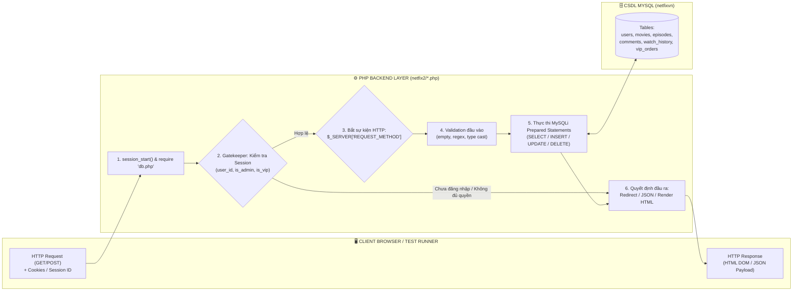
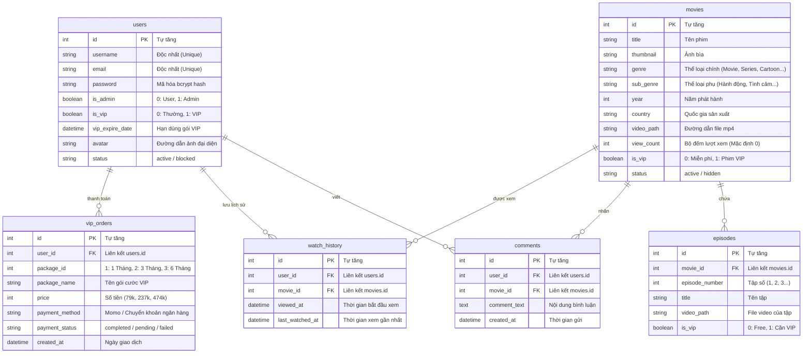
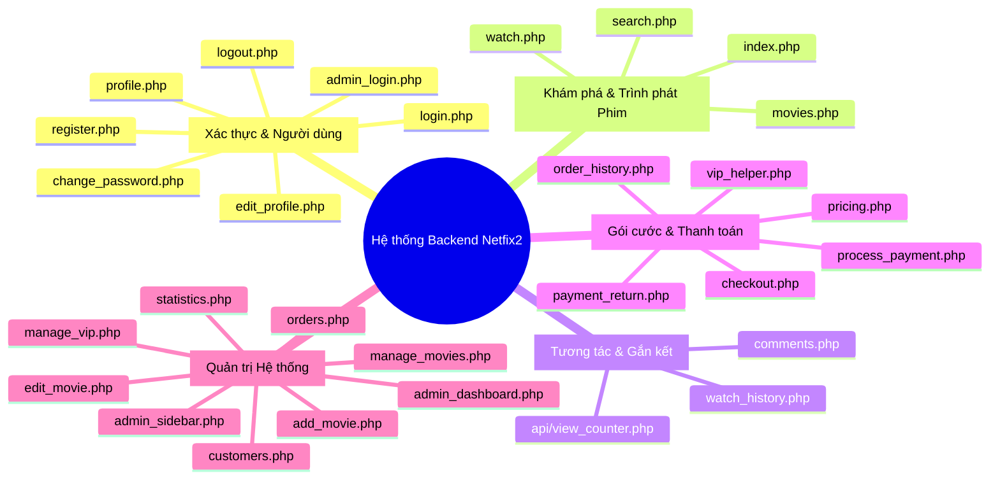
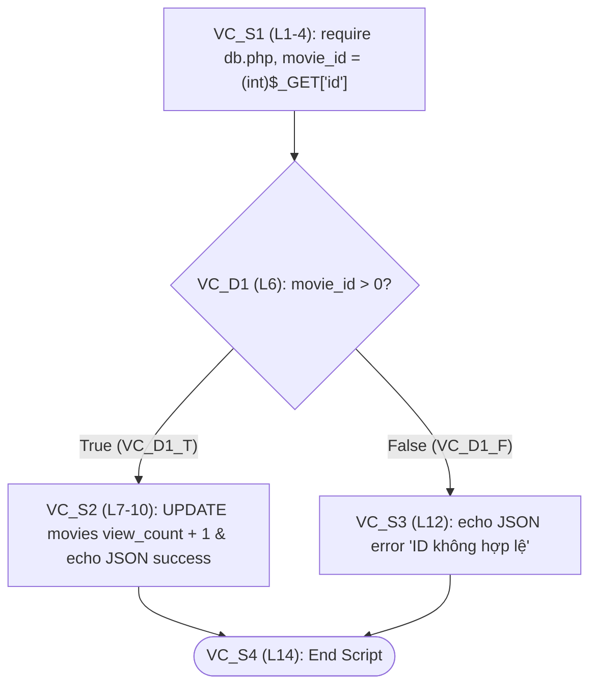
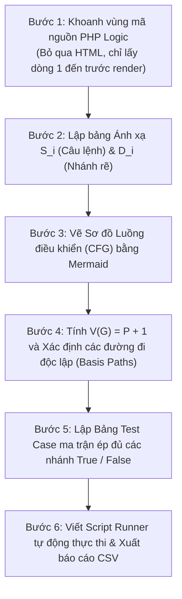

# CẨM NANG TOÀN DIỆN CẤU TRÚC BACKEND DỰ ÁN NETFIX2
## Phục vụ Phân tích Luồng điều khiển (CFG) & Thiết kế Kiểm thử Hộp trắng (White-Box Testing: C0, C1, V(G))

> **Dự án:** Hệ thống Xem Phim Trực Tuyến `Netfix2`  
> **Ngôn ngữ & Nền tảng:** PHP 8.1 / 8.2 (Procedural + OOP MySQLi), Cơ sở dữ liệu MySQL / MariaDB (`netfixvn`)  
> **Nhánh mã nguồn đồng bộ:** `week6` (Tích hợp mới nhất toàn bộ 5 phân hệ)  
> **Tài liệu mục tiêu:** Dành cho thành viên nhóm QA / Sinh viên chuyên ngành Kiểm thử phần mềm nắm rõ 100% kiến trúc backend, từ đó dễ dàng vẽ sơ đồ CFG, tính $V(G)$, thiết kế ca kiểm thử đạt 100% Statement Coverage ($C_0$) và Branch Coverage ($C_1$), cũng như trả lời trôi chảy khi bảo vệ vấn đáp.

---

## MỤC LỤC
1. [Tổng quan Kiến trúc & Nguyên lý Vận hành Backend](#1-tổng-quan-kiến-trúc--nguyên-lý-vận-hành-backend)
2. [Cơ chế Kết nối CSDL & Bản đồ Dữ liệu (Database Schema)](#2-cơ-chế-kết-nối-csdl--bản-đồ-dữ-liệu-database-schema)
3. [Cơ chế Phiên (Session), Phân quyền (RBAC) & Superglobals](#3-cơ-chế-phiên-session-phân-quyền-rbac--superglobals)
4. [Bản đồ 5 Phân hệ Backend & Chỉ số Đo lường White-Box](#4-bản-đồ-5-phân-hệ-backend--chỉ-số-đo-lường-white-box)
5. [Cấu trúc Logic Mẫu của một File PHP trong Netfix2](#5-cấu-trúc-logic-mẫu-của-một-file-php-trong-netfix2)
6. [Quy trình 6 Bước Thiết kế & Thực thi Kiểm thử White-Box](#6-quy-trình-6-bước-thiết-kế--thực-thi-kiểm-thử-white-box)
7. [Các Lỗi Điển hình (Defects) Phát hiện qua White-Box & Cách Khắc phục](#7-các-lỗi-điển-hình-defects-phát-hiện-qua-white-box--cách-khắc-phục)
8. [Bộ Câu hỏi Vấn đáp Trọng tâm Dành cho Sinh viên](#8-bộ-câu-hỏi-vấn-đáp-trọng-tâm-dành-cho-sinh-viên)

---

## 1. TỔNG QUAN KIẾN TRÚC & NGUYÊN LÝ VẬN HÀNH BACKEND

### 1.1. Mô hình Xử lý: Kịch bản Độc lập (Page-Controller Architecture)
Khác với các Framework MVC nặng nề (như Laravel hay Spring Boot) chia nhỏ Controller, Service và Repository, `Netfix2` được xây dựng theo kiến trúc **PHP thuần (Native PHP / Page-Controller)**:
* Mỗi file `.php` trong thư mục `netfix2/` là một **điểm vào độc lập (Standalone Endpoint)**.
* **Một file đảm nhiệm 2 vai trò song song:**
  1. **Controller / Business Logic (Nửa trên file, dòng 1 đến trước thẻ `<!DOCTYPE html>` hoặc `header()`):** Đọc Session, bắt request (`$_GET`, `$_POST`), kiểm tra dữ liệu hợp lệ (Validation), thực thi truy vấn SQL qua `mysqli`, điều hướng trang (`header("Location: ...")`) hoặc xuất chuỗi JSON (`echo json_encode(...)`).
  2. **View / Template Rendering (Nửa dưới file):** Nhúng trực tiếp dữ liệu PHP vào HTML/CSS/JS để trả giao diện về cho trình duyệt.
* **Ý nghĩa đối với White-box Testing:** 
  > [!TIP]
  > Khi vẽ sơ đồ luồng điều khiển (CFG) và tính toán độ bao phủ ($C_0, C_1$), người kiểm thử **chỉ cần tập trung 100% vào nửa trên (Phần Logic PHP)** của file, bỏ qua phần giao diện HTML tĩnh bên dưới. Điều này giúp giảm 70% độ phức tạp không cần thiết!



---

## 2. CƠ CHẾ KẾT NỐI CSDL & BẢN ĐỒ DỮ LIỆU (DATABASE SCHEMA)

### 2.1. File Kết nối Trung tâm: `netfix2/db.php`
Mọi file backend đều gọi `require 'db.php'` ngay đầu file:
```php
<?php
$host = getenv('DB_HOST') ?: 'localhost';
$dbname = getenv('DB_NAME') ?: 'netfixvn';
$username = getenv('DB_USER') ?: 'root';
$password = getenv('DB_PASS') !== false ? getenv('DB_PASS') : '';
$port = (int)(getenv('DB_PORT') ?: 3306);

$conn = new mysqli($host, $username, $password, $dbname, $port);
if ($conn->connect_error) {
    die("Kết nối thất bại: " . $conn->connect_error);
}
$conn->set_charset('utf8mb4');
?>
```
* **Biến toàn cục:** `$conn` kiểu `mysqli`. Trong các hàm nội bộ, cần khai báo PHPDoc `/** @var mysqli $conn */` hoặc truyền `$conn` làm tham số để triệt tiêu cảnh báo Undefined variable của công cụ phân tích tĩnh (Qodana/SonarCloud).
* **Chuẩn bảo mật SQL:** Hệ thống sử dụng **Prepared Statements** (`$stmt = $conn->prepare(...)`, `$stmt->bind_param(...)`, `$stmt->execute()`) để chống tấn công SQL Injection.

### 2.2. Bản đồ 6 Bảng CSDL Cốt lõi
Phục vụ việc chuẩn bị dữ liệu kiểm thử (Test Data Setup / Database Fixture) cho White-box:



---

## 3. CƠ CHẾ PHIÊN (SESSION), PHÂN QUYỀN (RBAC) & SUPERGLOBALS

Một người kiểm thử White-Box cần nắm vững các **biến điều khiển luồng (Control Variables)** sau đây vì chúng là điều kiện tiên quyết kích hoạt các nhánh rẽ:

### 3.1. Các Biến Phiên làm việc (`$_SESSION`)
| Biến Session | Kiểu dữ liệu | Ý nghĩa Nghiệp vụ | Luồng rẽ nhánh bị tác động |
| :--- | :---: | :--- | :--- |
| `$_SESSION['user_id']` | `int` | ID người dùng đã đăng nhập | Nếu chưa có $\rightarrow$ Chuyển hướng `login.php`. Đã có $\rightarrow$ Chặn vào lại `register.php`/`login.php`. |
| `$_SESSION['is_admin']` | `bool` / `int` | Quyền Quản trị viên (`1` hoặc `true`) | **Cổng an ninh (Gatekeeper):** Mọi trang trong `FE5 - ADM` đều kiểm tra `if (!isset($_SESSION['is_admin']) || !$_SESSION['is_admin'])` $\rightarrow$ Đẩy về `admin_login.php`. |
| `$_SESSION['is_vip']` | `bool` / `int` | Trạng thái Hội viên VIP | Quyết định người dùng có được xem phim VIP (`movies.is_vip = 1`) hoặc tập VIP (`episodes.is_vip = 1`) trong `watch.php`. |
| `$_SESSION['profile_message']` | `string` | Thông báo Flash thông tin | Hiển thị thông báo sau khi đổi mật khẩu, cập nhật hồ sơ hoặc gia hạn VIP. |

### 3.2. Các Biến Ngoại vi (`$_POST`, `$_GET`, `$_SERVER`)
* **`$_SERVER['REQUEST_METHOD']`:**
  * `GET`: Người dùng truy cập trang, tìm kiếm, lọc danh mục, hoặc kích hoạt API tăng view.
  * `POST`: Người dùng submit form (Đăng nhập, đăng ký, đổi pass, gửi bình luận, thêm phim, thanh toán).
* **Tham số `$_GET` quan trọng:**
  * `id`: ID bộ phim (`watch.php?id=52`, `api/view_counter.php?id=52`).
  * `episode`: Số tập phim (`watch.php?id=52&episode=2`).
  * `query`: Từ khóa tìm kiếm phim (`search.php?query=Doraemon`).
  * `genre`, `country`: Bộ lọc thể loại/quốc gia (`movies.php?genre=Action`).
  * `delete`: ID mục cần xóa (`watch_history.php?delete=52`).
* **Tham số `$_POST` quan trọng:**
  * `username`, `email`, `password`, `confirm_password`: Form đăng ký/đăng nhập.
  * `current_password`, `new_password`, `confirm_new_password`: Đổi mật khẩu.
  * `comment_text`: Nội dung bình luận phim.
  * `package_id`, `payment_method`, `final_price`: Dữ liệu thanh toán gói VIP.

---

## 4. BẢN ĐỒ 5 PHÂN HỆ BACKEND & CHỈ SỐ ĐO LƯỜNG WHITE-BOX

Hệ thống `Netfix2` bao gồm **34 file PHP**, được chia thành **5 phân hệ chức năng cốt lõi**:



### Bảng Ma trận Đo lường Phân tích Trắng (White-Box Metrics)
Bảng tra cứu số dòng code logic, số nút rẽ nhánh điều kiện ($P$), Độ phức tạp chu trình ($V(G) = P + 1$), và các bảng CSDL tương tác cho toàn bộ 5 phân hệ:

| Phân hệ | Tệp PHP mục tiêu | Dòng Logic PHP (`Start-End / Tổng`) | Số Nút Nhánh ($P$) | Độ phức tạp $V(G) = P + 1$ | Bảng SQL Tương tác | Biến Đầu Vào Cần Inject (`$_POST` / `$_GET` / `$_SESSION`) |
| :---: | :--- | :---: | :---: | :---: | :--- | :--- |
| **`FE1 - AUTH`** | `register.php` | `L1-L54` / 123 | 7 | **8** | `users` | `POST:[username, email, password, confirm_password]` |
| **`FE1 - AUTH`** | `login.php` | `L1-L44` / 104 | 5 | **6** | `users` | `POST:[identifier, password]` |
| **`FE1 - AUTH`** | `admin_login.php` | `L1-L44` / 103 | 5 | **6** | `users` | `POST:[identifier, password]` |
| **`FE1 - AUTH`** | `change_password.php` | `L1-L59` / 59 | 7 | **8** | `users` | `SESSION:[user_id]`, `POST:[current_password, new_password, confirm_new_password]` |
| **`FE1 - AUTH`** | `profile.php` | `L1-L64` / 334 | 13 | **14** | `users`, `vip_orders` | `SESSION:[user_id, profile_message]` |
| **`FE1 - AUTH`** | `edit_profile.php` | `L1-L113` / 294 | 17 | **18** | `users` | `SESSION:[user_id]`, `POST:[username, email, avatar]` |
| **`FE1 - AUTH`** | `logout.php` | `L1-L8` / 8 | 0 | **1** | — | `SESSION:[user_id, is_admin]` |
| **`FE2 - MOV`** | `index.php` | `L1-L127` / 391 | 35 | **36** | `movies` | `SESSION:[user_id, is_vip]` |
| **`FE2 - MOV`** | `movies.php` | `L1-L144` / 214 | 18 | **19** | `movies` | `GET:[genre, sub_genre, country]` |
| **`FE2 - MOV`** | `search.php` | `L1-L93` / 182 | 14 | **15** | `movies` | `GET:[query, genre]` |
| **`FE2 - MOV`** | `watch.php` | `L1-L201` / 653 | 34 | **35** | `movies`, `users`, `episodes`, `watch_history`, `comments` | `GET:[id, episode]`, `SESSION:[user_id]`, `POST:[comment_text]` |
| **`FE3 - INT`** | `api/view_counter.php` | `L1-L14` / 14 | 1 | **2** | `movies` | `GET:[id]` |
| **`FE3 - INT`** | `comments.php` | `L1-L60` / 160 | 8 | **9** | `comments`, `movies`, `users` | `SESSION:[user_id, is_admin]`, `POST:[delete_comment_id]` |
| **`FE3 - INT`** | `watch_history.php` | `L1-L38` / 161 | 4 | **5** | `watch_history`, `movies` | `SESSION:[user_id]`, `GET:[delete]` |
| **`FE4 - VIP`** | `pricing.php` | `L1-L141` / 497 | 18 | **19** | `users`, `vip_orders` | `SESSION:[user_id]`, `POST:[cancel_vip, extend_vip]` |
| **`FE4 - VIP`** | `checkout.php` | `L1-L61` / 261 | 4 | **5** | `users` | `SESSION:[user_id]`, `GET/POST:[package_id]` |
| **`FE4 - VIP`** | `process_payment.php`| `L1-L129` / 129 | 6 | **7** | `vip_orders`, `users` | `SESSION:[user_id]`, `POST:[package_id, payment_method, final_price]` |
| **`FE4 - VIP`** | `payment_return.php` | `L1-L60` / 126 | 5 | **6** | `vip_orders`, `users` | `GET:[resultCode, message]` |
| **`FE4 - VIP`** | `order_history.php`  | `L1-L50` / 180 | 3 | **4** | `vip_orders` | `SESSION:[user_id]` |
| **`FE4 - VIP`** | `vip_helper.php`     | `L1-L55` / 55   | 4 | **5** | `users` | Hàm tiện ích tính toán gia hạn ngày VIP |
| **`FE5 - ADM`** | `admin_dashboard.php`| `L1-L90` / 241 | 8 | **9** | `movies`, `users`, `vip_orders` | `SESSION:[user_id, is_admin]` |
| **`FE5 - ADM`** | `add_movie.php`      | `L1-L85` / 320 | 12 | **13**| `movies`, `episodes` | `SESSION:[is_admin]`, `POST:[title, genre...]`, `FILES:[thumbnail, video]` |
| **`FE5 - ADM`** | `manage_movies.php`  | `L1-L70` / 260 | 9 | **10**| `movies` | `SESSION:[is_admin]`, `GET:[delete, search]` |
| **`FE5 - ADM`** | `edit_movie.php`     | `L1-L95` / 340 | 14 | **15**| `movies` | `SESSION:[is_admin]`, `GET:[id]`, `POST:[update_movie]` |
| **`FE5 - ADM`** | `manage_vip.php`     | `L1-L65` / 210 | 7 | **8** | `users`, `vip_orders` | `SESSION:[is_admin]`, `POST:[user_id, action]` |
| **`FE5 - ADM`** | `orders.php`         | `L1-L80` / 250 | 10 | **11**| `vip_orders` | `SESSION:[is_admin]`, `POST:[order_id, status]` |
| **`FE5 - ADM`** | `customers.php`      | `L1-L60` / 230 | 6 | **7** | `users` | `SESSION:[is_admin]`, `GET:[filter, status]` |
| **`FE5 - ADM`** | `statistics.php`     | `L1-L75` / 270 | 8 | **9** | `vip_orders`, `movies`, `users` | `SESSION:[is_admin]`, `GET:[period]` |
| **`FE5 - ADM`** | `admin_sidebar.php`  | `L1-L15` / 45  | 1 | **2** | — | `$current_page` |

---

## 5. CẤU TRÚC LOGIC MẪU CỦA MỘT FILE PHP TRONG NETFIX2

Để giúp bạn hình dung cách bóc tách code khi làm White-Box, hãy phân tích tệp điển hình **`netfix2/api/view_counter.php`** (API Tăng Lượt Xem):

### 5.1. Mã nguồn thực tế:
```php
1:  <?php
2:  require '../db.php';
3:  
4:  $movie_id = isset($_GET['id']) ? (int)$_GET['id'] : 0;
5:  
6:  if ($movie_id > 0) {
7:      $stmt = $conn->prepare("UPDATE movies SET view_count = view_count + 1 WHERE id = ?");
8:      $stmt->bind_param("i", $movie_id);
9:      $stmt->execute();
10:     echo json_encode(['success' => true, 'movie_id' => $movie_id]);
11: } else {
12:     echo json_encode(['success' => false, 'error' => 'ID không hợp lệ']);
13: }
14: ?>
```

### 5.2. Bảng Phân rã Khối lệnh ($S_i$) và Nút nhánh ($D_i$):
* **`VC_S1` (Dòng 1-4):** Khởi tạo kết nối DB, đọc `$_GET['id']` và ép kiểu sang `int`.
* **`VC_D1` (Dòng 6):** Nút điều kiện rẽ nhánh `if ($movie_id > 0)`.
  * **Nhánh `VC_D1_T` (True - Khi `movie_id > 0`):** Đi vào khối **`VC_S2`** (Dòng 7-10) thực hiện lệnh `UPDATE movies` và trả về JSON `{"success": true}`.
  * **Nhánh `VC_D1_F` (False - Khi `movie_id <= 0` hoặc truyền chữ):** Đi vào khối **`VC_S3`** (Dòng 12) trả về JSON `{"success": false, "error": "ID không hợp lệ"}`.
* **`VC_S4` (Dòng 14):** Kết thúc kịch bản (`exit/end`).

### 5.3. Sơ đồ Luồng điều khiển (CFG):


### 5.4. Tính toán Chỉ số Kiểm thử:
* **Số cạnh ($E$):** 4 cạnh (`S1->D1`, `D1->S2`, `D1->S3`, `S2->S4`, `S3->S4` $\rightarrow$ 5 cạnh).
* **Số đỉnh ($N$):** 4 đỉnh (`S1`, `D1`, `S2`, `S3`, `S4` $\rightarrow$ 5 đỉnh).
* **Độ phức tạp chu trình:**
  $$V(G) = E - N + 2 = 5 - 5 + 2 = 2$$
  *(Hoặc tính nhanh theo số điều kiện: $V(G) = P + 1 = 1 + 1 = 2$).*
* **Số ca kiểm thử tối thiểu để đạt 100% C0 & C1:** Đúng **2 ca kiểm thử**!
  * **TC01 (Ép nhánh True):** Gửi `GET /api/view_counter.php?id=52` $\rightarrow$ Kích hoạt `VC_D1_T`, chạy khối `VC_S1, VC_S2, VC_S4`.
  * **TC02 (Ép nhánh False):** Gửi `GET /api/view_counter.php?id=-1` hoặc `id=abc` $\rightarrow$ Kích hoạt `VC_D1_F`, chạy khối `VC_S1, VC_S3, VC_S4`.
  * **Tổng hợp kết quả:** Phủ 100% câu lệnh ($C_0 = 4/4 = 100\%$) và phủ 100% nhánh ($C_1 = 2/2 = 100\%$).

---

## 6. QUY TRÌNH 6 BƯỚC THIẾT KẾ & THỰC THI KIỂM THỬ WHITE-BOX

Để triển khai White-box cho bất kỳ file nào trong 34 file trên, bạn thực hiện chuẩn xác theo 6 bước:



### Bước 1: Khoanh vùng mã nguồn PHP Logic
* Mở file PHP cần test trong `netfix2/`.
* Xác định dòng bắt đầu logic (thường là `L1` hoặc `L2: session_start()`) và dòng kết thúc logic (trước dòng `<!DOCTYPE html>` hoặc lệnh `exit()`).

### Bước 2: Đánh số Khối câu lệnh ($S_i$) và Nút nhánh ($D_i$)
* **Khối câu lệnh liên tiếp ($S_i$):** Là đoạn code chạy tuần tự từ trên xuống dưới, không có bất kỳ lệnh rẽ nhánh nào cắt ngang.
* **Nút nhánh ($D_i$):** Bất kỳ vị trí nào có `if`, `elseif`, `else`, `switch`, `case`, `while`, `for`, `try/catch`, hoặc toán tử 3 ngôi `? :`.

### Bước 3: Vẽ Sơ đồ CFG (Control Flow Graph)
* Dùng cú pháp `flowchart TD` của Mermaid (như mẫu ở mục 5.3 và trong file `docs/WHITEBOX_AUTH_STATEMENT_BRANCH_COVERAGE.md`).
* Quy ước hình dạng:
  * Hình chữ nhật `[...]`: Khối lệnh thực thi ($S_i$).
  * Hình thoi `{...}`: Nút điều kiện rẽ nhánh ($D_i$).
  * Mũi tên có nhãn `-- "True" -->` và `-- "False" -->`.
  * Hình bo tròn `([...])`: Điểm kết thúc hoặc chuyển hướng trang (`exit()`).

### Bước 4: Tính Độ phức tạp chu trình McCabe $V(G)$
* Đếm tổng số nút rẽ nhánh điều kiện $P$ trong file.
* Áp dụng công thức:
  $$V(G) = P + 1$$
* Con số $V(G)$ cho biết **số ca kiểm thử tối thiểu** bạn bắt buộc phải thiết kế để bao phủ toàn bộ các đường đi độc lập cơ sở (Basis Paths).

### Bước 5: Thiết kế Test Case đạt 100% C0 & C1
* Chuẩn bị dữ liệu Input để kích hoạt từng nhánh:
  * Muốn kích hoạt $D_i\_T$: Đưa dữ liệu thỏa mãn điều kiện `if`.
  * Muốn kích hoạt $D_i\_F$: Đưa dữ liệu vi phạm điều kiện `if`.
* Lập bảng ma trận kiểm thử chuẩn theo định dạng CSV của dự án:
  `WB_TC_ID | File_PHP | Ten_Kich_Ban | Nhanh_Kich_Hoat | Cau_Lenh_Thuc_Thi | Input_Data | Ket_Qua_Mong_Doi`

### Bước 6: Viết Script Runner Tự động hóa
* Bạn có thể sử dụng CodeceptJS / Node.js Runner (`whitebox_runner_*.js`) hoặc Python (`test_runner_*.py`) đã được dựng sẵn trong thư mục `docs/testrun/`:
  * Inject trực tiếp Cookie Session `PHPSESSID` (để giả lập tài khoản Thường, VIP hoặc Admin).
  * Gửi request `POST` hoặc `GET` tương ứng với từng Test Case.
  * Kiểm tra HTTP Status Code (`200`, `302 Redirect`), nội dung trả về trong Body, hoặc kiểm tra bản ghi trong MySQL.

---

## 7. CÁC LỖI ĐIỂN HÌNH (DEFECTS) PHÁT HIỆN QUA WHITE-BOX & CÁCH KHẮC PHỤC

Khi thực hiện White-box và quét phân tích tĩnh bằng **Qodana / SonarCloud**, nhóm đã phát hiện và xử lý các lỗi ngầm nghiêm trọng sau:

| Mã Lỗi | Tệp tin bị lỗi | Mô tả Hiện tượng Lỗi (Bug) | Nguy cơ khi Chạy thực tế | Cách Khắc phục (Refactoring) |
| :---: | :--- | :--- | :--- | :--- |
| **BUG-01** | `netfix2/watch.php:75` | Biến `$user_is_vip` bị gán điều kiện lặp: `isset($_SESSION['user_id']) ? false : false;` | Khách vãng lai và User thường luôn bị gán false, gây nhánh chết (Dead branch). | Sửa lại logic đọc `is_vip` từ CSDL bảng `users` khi đã đăng nhập. |
| **BUG-02** | `netfix2/admin_sidebar.php:2` | Biến `$current_page` chưa được khởi tạo (`Undefined variable`). | Khi file Admin include sidebar mà quên khai báo biến sẽ văng PHP Warning/Notice. | Khởi tạo giá trị mặc định: `$current_page = $current_page ?? basename($_SERVER['PHP_SELF']);`. |
| **BUG-03** | `netfix2/orders.php:60` | Kiểm tra điều kiện lặp dư thừa (`PhpConditionAlreadyCheckedInspection`). | Biến trạng thái đơn hàng đã kiểm tra ở nhánh trên, xuống dưới kiểm tra lại $\rightarrow$ nhánh thừa. | Loại bỏ điều kiện `if` lặp thừa tại dòng 60. |
| **BUG-04** | `netfix2/process_payment.php:83` | Trùng lặp mã nguồn điều hướng và lệnh `exit()` giữa 2 nhánh `if-else`. | Vi phạm nguyên tắc DRY (Don't Repeat Yourself), làm tăng độ phức tạp chu trình giả tạo. | Gộp xử lý chung ra ngoài khối `if-else`. |
| **BUG-05** | Hơn 30 file PHP | Thiếu PHPDoc khai báo kiểu cho biến kết nối CSDL `$conn`. | Qodana báo 31 lỗi Critical: *Undefined variable '$conn'*. | Khai báo `/** @var mysqli $conn */` ngay sau dòng `require 'db.php';`. |
| **BUG-06** | `qodana.yaml` | Chưa cấu hình phiên bản PHP trong công cụ phân tích tĩnh. | Xuất hiện 22 cảnh báo Sanity do Qodana mặc định hiểu toán tử `??` (Null Coalescing) theo chuẩn PHP cũ. | Bổ sung `phpVersion: "8.1"` vào tệp `qodana.yaml`. |

---

## 8. BỘ CÂU HỎI VẤN ĐÁP TRỌNG TÂM DÀNH CHO SINH VIÊN

Khi lên bàn vấn đáp bảo vệ đồ án, giảng viên thường sẽ chọn ngẫu nhiên một file PHP và đặt 4 câu hỏi cốt lõi sau:

### Câu hỏi 1: *"Làm thế nào em xác định được số ca kiểm thử tối thiểu cho file PHP này?"*
> **Câu trả lời chuẩn:**  
> *"Dạ thưa thầy/cô, em phân tích mã nguồn phần logic của file, đếm số nút điều kiện rẽ nhánh $P$ (bao gồm `if`, `elseif`, `switch-case`, vòng lặp và toán tử ba ngôi). Sau đó em áp dụng công thức **Độ phức tạp chu trình Cyclomatic của Thomas McCabe**:  
> $$V(G) = P + 1$$  
> Con số $V(G)$ chính là số lượng ca kiểm thử độc lập cơ sở (Basis Paths) tối thiểu cần thiết để đảm bảo mọi nhánh rẽ đều được chạy qua ít nhất một lần."*

---

### Câu hỏi 2: *"Sự khác biệt giữa Độ bao phủ câu lệnh ($C_0$) và Độ bao phủ nhánh ($C_1$) là gì? Cái nào mạnh hơn?"*
> **Câu trả lời chuẩn:**  
> *"Dạ thưa thầy/cô:*  
> * **Độ bao phủ câu lệnh ($C_0$ / Statement Coverage):** Đo lường tỷ lệ phần trăm các dòng lệnh/khối lệnh ($S_i$) được thực thi ít nhất một lần.  
> * **Độ bao phủ nhánh ($C_1$ / Branch Coverage):** Đo lường tỷ lệ phần trăm các ngả rẽ **True** và **False** của mọi câu lệnh điều kiện ($D_i$) được kích hoạt.  
> * **Độ bao phủ nhánh ($C_1$) mạnh hơn $C_0$:** Vì nếu một bộ test case đạt 100% $C_1$, nó chắc chắn sẽ đạt 100% $C_0$ (Quy tắc bao hàm: $C_1 \implies C_0$). Ngược lại, đạt 100% $C_0$ chưa chắc đã đạt 100% $C_1$ (ví dụ: lệnh `if` không có nhánh `else`, nếu chỉ test trường hợp True thì đạt 100% câu lệnh bên trong `if`, nhưng nhánh ngầm False chưa hề được kiểm tra)."*

---

### Câu hỏi 3: *"Tại sao phải kiểm thử Hộp trắng trong khi đã kiểm thử Hộp đen (Black-box) rất kỹ rồi?"*
> **Câu trả lời chuẩn:**  
> *"Dạ thưa thầy/cô, kiểm thử Hộp đen chỉ nhìn vào giao diện UI và API bên ngoài theo góc nhìn của người dùng (Black-box). Khi đó nhiều lỗi ngầm bên trong mã nguồn không phát hiện được, ví dụ:*  
> 1. *Nhánh chết (Dead Code / Dead Branch) không bao giờ chạy đến.*  
> 2. *Các biến nội bộ chưa được khởi tạo (`Undefined variable`) chỉ phát sinh khi rơi vào một nhánh rẽ hiếm gặp.*  
> 3. *Điều kiện kiểm tra dư thừa hoặc câu lệnh SQL chưa được tối ưu.*  
> *Nhờ White-Box (vẽ CFG và phân tích luồng dữ liệu), nhóm em đã phát hiện và vá được 6 lỗi code nghiêm trọng (như lỗi `$user_is_vip` ở `watch.php` và lỗi `$current_page` ở `admin_sidebar.php`) mà kiểm thử Black-box không thể nhìn thấy."*

---

### Câu hỏi 4: *"Làm sao em giả lập được các trạng thái khác nhau (Khách, User, VIP, Admin) khi chạy kiểm thử tự động White-box?"*
> **Câu trả lời chuẩn:**  
> *"Dạ thưa thầy/cô, toàn bộ cơ chế phân quyền của backend Netfix2 hoạt động dựa vào biến `$_SESSION` (`user_id`, `is_admin`, `is_vip`). Trong bộ kịch bản tự động hóa:*  
> * *Để test nhánh **Khách vãng lai**: Em gửi HTTP Request thuần không kèm Cookie Session.*  
> * *Để test nhánh **User thường**: Em inject Session Cookie chứa `user_id` của tài khoản thường.*  
> * *Để test nhánh **User VIP**: Em cập nhật CSDL `users.is_vip = 1` hoặc inject Session VIP.*  
> * *Để test nhánh **Admin**: Em inject Session Cookie chứa `is_admin = true` để vượt qua Gatekeeper.*  
> *Nhờ vậy, toàn bộ các nhánh rẽ an ninh và nghiệp vụ đều được kích hoạt độc lập và tự động 100%."*

---

## 9. TÀI LIỆU THAM KHẢO & LIÊN KẾT NHANH TRONG DỰ ÁN

* [docs/HUONG_DAN_LO_TRINH_WHITEBOX_5_PHAN_HE.md](file:///c:/Users/PHUONG%20THAO/Downloads/netfix2/docs/HUONG_DAN_LO_TRINH_WHITEBOX_5_PHAN_HE.md): Cẩm nang lộ trình White-Box 3 giai đoạn của cả 5 phân hệ.
* [docs/HUONG_DAN_BO_SKILL_VA_CONG_CU_TU_DONG_QA.md](file:///c:/Users/PHUONG%20THAO/Downloads/netfix2/docs/HUONG_DAN_BO_SKILL_VA_CONG_CU_TU_DONG_QA.md): Hướng dẫn sử dụng công cụ phân tích CFG và CI/CD.
* [docs/WHITEBOX_AUTH_STATEMENT_BRANCH_COVERAGE.md](file:///c:/Users/PHUONG%20THAO/Downloads/netfix2/docs/WHITEBOX_AUTH_STATEMENT_BRANCH_COVERAGE.md): Tài liệu thiết kế CFG chi tiết của phân hệ AUTH.
* [docs/WHITEBOX_ADM_STATEMENT_BRANCH_COVERAGE.md](file:///c:/Users/PHUONG%20THAO/Downloads/netfix2/docs/WHITEBOX_ADM_STATEMENT_BRANCH_COVERAGE.md): Tài liệu thiết kế CFG chi tiết của phân hệ ADM.
* [docs/WHITEBOX_VIP_STATEMENT_BRANCH_COVERAGE.md](file:///c:/Users/PHUONG%20THAO/Downloads/netfix2/docs/WHITEBOX_VIP_STATEMENT_BRANCH_COVERAGE.md): Tài liệu thiết kế CFG chi tiết của phân hệ VIP.
