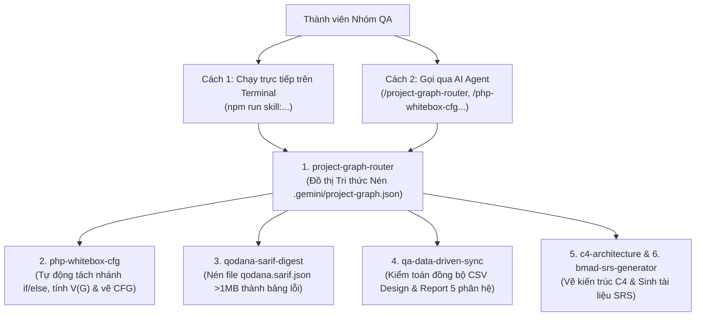

# CẨM NANG GIỚI THIỆU & HƯỚNG DẪN SỬ DỤNG BỘ SKILL TỰ ĐỘNG HÓA QA
**Dự án:** Hệ thống Xem Phim Trực Tuyến `Netfix2`  
**Thư mục lưu trữ trên nhánh Git:** `.gemini/skills/`

> [!TIP]
> **Dành cho mọi thành viên trong nhóm (Dù CÓ hay KHÔNG cài AI Agent):**
> Toàn bộ các bộ Skill trong dự án này được thiết kế theo kiến trúc **Hybrid (Lai ghép)**:
> 1. **Nếu bạn KHÔNG dùng AI Agent:** Mỗi Skill đều có sẵn **Script Node.js độc lập** bên trong. Bạn chỉ cần mở Terminal của VS Code và gõ lệnh `npm run skill:...` là lấy được ngay sơ đồ CFG, độ phức tạp $V(G)$, bảng lỗi Qodana hoặc bản đồ dự án trong **1 giây** mà không cần cài đặt thêm bất kỳ phần mềm nào!
> 2. **Nếu bạn CÓ dùng AI Agent (Antigravity / Cursor / Copilot / Claude):** Chỉ cần gõ `/ten-skill` trên khung chat, AI sẽ tự động chạy các script này để trả kết quả và tiết kiệm **85% – 95% Token/Quota**.

---

## I. SƠ ĐỒ KIẾN TRÚC HOẠT ĐỘNG CỦA HỆ THỐNG SKILL



---

## II. CHI TIẾT CÁCH HOẠT ĐỘNG & CÁCH SỬ DỤNG TỪNG BỘ SKILL

### 1. Bộ Skill số 1: `project-graph-router` (Bộ Định Tuyến & Đồ Thị Tri Thức Dự Án Nén)
* **Vị trí:** `.gemini/skills/project-graph-router/`
* **File dữ liệu trung tâm:** `.gemini/project-graph.json`
* **Nguyên lý hoạt động (How it works):**
  * Thay vì phải mở từng file trong 32 file PHP của `netfix2/` (nhiều file dài 400–650 dòng do trộn lẫn HTML/CSS) để tìm xem code PHP nằm ở dòng nào, dùng biến `$_POST`/`$_GET` gì, truy vấn bảng SQL nào...
  * Script `build_graph.js` quét toàn bộ mã nguồn dự án và **nén thành một Đồ thị Tri thức (`project-graph.json`)**. Đồ thị này ghi nhận chính xác:
    * Tọa độ dòng logic PHP (`StartLine - EndLine`) cần đọc cho từng file.
    * Danh sách các bảng SQL (`users`, `movies`, `vip_orders`, `comments`, `watch_history`, `episodes`) mà file đó tương tác.
    * Danh sách tham số đầu vào `$_POST`, `$_GET`, `$_SESSION` và các liên kết chuyển hướng (`header("Location: ...")`).
* **Cách sử dụng trên Terminal (Không cần AI):**
  ```powershell
  # Xem bảng tổng quan toàn bộ 32 file của cả 5 phân hệ:
  npm run skill:graph -- --overview

  # Tra cứu riêng các file thuộc phân hệ của bạn (ví dụ AUTH, MOV, INT, VIP, ADM):
  npm run skill:graph -- --query AUTH
  npm run skill:graph -- --query MOV

  # Tra cứu chi tiết 1 file bất kỳ (ví dụ watch.php hoặc orders.php):
  npm run skill:graph -- --query watch.php

  # Cập nhật lại đồ thị sau khi nhóm sửa code PHP:
  npm run skill:graph -- --build
  ```

---

### 2. Bộ Skill số 2: `php-whitebox-cfg` (Máy Phân Tích Kiểm Thử Hộp Trắng & Vẽ Sơ Đồ CFG)
* **Vị trí:** `.gemini/skills/php-whitebox-cfg/`
* **Nguyên lý hoạt động (How it works):**
  * Khi làm Kiểm thử Hộp trắng (White-Box Testing), nếu ngồi đếm từng lệnh `if`, `elseif`, `while`, `for`, `foreach`, `case`, toán tử `?:` bằng mắt thường sẽ rất dễ sót nhánh và tính sai độ phức tạp Cyclomatic $V(G)$.
  * Script `analyze_cfg.js` tự động bóc tách phần code PHP của file, lọc bỏ các đoạn HTML/JavaScript/Comment để:
    1. Liệt kê chính xác **số dòng và biểu thức điều kiện** của từng nút rẽ nhánh ($P$).
    2. Tự động tính **Độ phức tạp Cyclomatic theo nhánh ($C_1$)**: $V(G) = P + 1$.
    3. Tự động tính **Độ phức tạp điều kiện con ($C_2$ / MC/DC)** khi trong `if` có các phép toán `&&`, `||`.
    4. Tự động sinh đoạn mã **Mermaid Flowchart (`flowchart TD`)** để vẽ ngay Đồ thị Luồng điều khiển (CFG).
* **Cách sử dụng trên Terminal (Không cần AI):**
  ```powershell
  # Quét bảng tổng hợp số nhánh (P) và V(G) của toàn bộ 5 phân hệ trong 1 giây:
  npm run skill:cfg -- --summary

  # Phân tích chi tiết từng dòng rẽ nhánh và xuất sơ đồ CFG cho 1 file cụ thể:
  npm run skill:cfg -- netfix2/register.php
  npm run skill:cfg -- netfix2/watch.php
  npm run skill:cfg -- netfix2/orders.php
  ```

---

### 3. Bộ Skill số 3: `qodana-sarif-digest` (Bộ Giải Nén & Phân Tích Lỗi Tĩnh Qodana SARIF)
* **Vị trí:** `.gemini/skills/qodana-sarif-digest/`
* **Nguyên lý hoạt động (How it works):**
  * Báo cáo lỗi xuất ra từ JetBrains Qodana trên GitHub Actions có định dạng `qodana.sarif.json` nặng hơn **1MB** (hàng chục nghìn dòng JSON lồng nhau), rất khó đọc bằng mắt thường.
  * Script `parse_sarif.js` đọc trực tiếp cấu trúc JSON SARIF, lọc bỏ các thông tin thừa và gom nhóm toàn bộ lỗi thành một **Bảng Markdown ngắn gọn** gồm:
    * Thống kê tổng số lỗi `Critical` (Error), `High` (Warning), `Moderate` (Note) và lỗi `Sanity` (phiên bản PHP).
    * Chỉ rõ tọa độ **`Tên_File:Số_Dòng`**, mã **`Rule ID`** và **Nội dung lỗi** để từng thành viên mở đúng dòng code đó ra fix.
* **Cách sử dụng trên Terminal (Không cần AI):**
  ```powershell
  # Chạy phân tích file qodana.sarif.json bất kỳ:
  npm run skill:sarif -- "<duong_dan_toi_file_qodana.sarif.json>"
  ```

---

### 4. Bộ Skill số 4: `qa-data-driven-sync` (Bộ Kiểm Toán Đồng Bộ Test Case CSV 5 Phân Hệ)
* **Vị trí:** `.gemini/skills/qa-data-driven-sync/`
* **Nguyên lý hoạt động (How it works):**
  * Dự án có 5 phân hệ (`AUTH`, `MOV`, `INT`, `VIP`, `ADM`), mỗi phân hệ có file CSV Thiết kế (`docs/Design/design_testcase_*.csv`) và file CSV Báo cáo (`docs/Report/report_run_testcase_*.csv`).
  * Script `audit_coverage.js` tự động quét đối chiếu toàn bộ các cặp file CSV của 5 phân hệ để kiểm tra:
    * Số lượng Test Case giữa file Design và file Report có khớp nhau 100% không.
    * Tỷ lệ `PASS` / `FAIL` của từng phân hệ.
    * Độ bao phủ các nhãn kiểm thử (`V` - Hợp lệ, `X` - Không hợp lệ, `B` - Giá trị biên, `SEC` - Bảo mật, `API`, `ST` - Chuyển đổi trạng thái).
* **Cách sử dụng trên Terminal (Không cần AI):**
  ```powershell
  # Kiểm toán toàn bộ các file CSV của cả 5 phân hệ:
  npm run skill:audit
  ```

---

### 5. Bộ Skill số 5 (`c4-architecture`) & Số 6 (`bmad-srs-generator`)
* **`c4-architecture` (`.gemini/skills/c4-architecture/`):** Hỗ trợ chuẩn hóa và sinh sơ đồ kiến trúc hệ thống theo chuẩn **C4 Model (Structurizr DSL)** từ cấp độ System Context $\rightarrow$ Container $\rightarrow$ Component trong file `workspace.dsl`.
* **`bmad-srs-generator` (`.gemini/skills/bmad-srs-generator/`):** Hỗ trợ trích xuất cấu trúc CSDL và luồng nghiệp vụ từ đồ thị nén để tự động sinh tài liệu **Đặc tả Yêu cầu Phần mềm (SRS)** theo chuẩn IEEE 830 / ISO 29148.

---

## III. BẢNG TRA CỨU NHANH LỆNH CHO THÀNH VIÊN NHÓM

| Nhu cầu của Thành viên | Lệnh chạy trên Terminal (Không cần AI) | Lệnh gọi trên AI Agent |
| :--- | :--- | :--- |
| Xem bản đồ dòng code PHP & biến POST/GET toàn dự án | `npm run skill:graph -- --overview` | `/project-graph-router` |
| Xem tổng hợp số nhánh & độ phức tạp $V(G)$ của 5 phân hệ | `npm run skill:cfg -- --summary` | `/php-whitebox-cfg` |
| Lấy danh sách nhánh `if/else` & sơ đồ CFG của 1 file PHP | `npm run skill:cfg -- netfix2/<ten_file>.php` | `/php-whitebox-cfg` |
| Đọc nhanh file báo cáo lỗi `qodana.sarif.json` | `npm run skill:sarif -- <duong_dan_sarif>` | `/qodana-sarif-digest` |
| Kiểm tra độ đồng bộ Test Case CSV của cả 5 phân hệ | `npm run skill:audit` | `/qa-data-driven-sync` |
