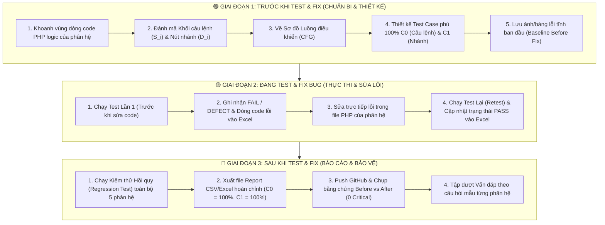

# CẨM NANG LỘ TRÌNH THỰC HIỆN KIỂM THỬ HỘP TRẮNG (WHITE-BOX TESTING) CHO 5 PHÂN HỆ
**Dự án:** Hệ thống Xem Phim Trực Tuyến `Netfix2` (PHP & MySQL)  
**Mục tiêu:** Hướng dẫn toàn diện từ A-Z cho cả 5 thành viên phụ trách 5 phân hệ (`AUTH`, `MOV`, `INT`, `VIP`, `ADM`) nắm rõ **Cần chuẩn bị gì – Thực hiện ra sao – Làm thế nào** ở cả 3 giai đoạn: **TRƯỚC $\rightarrow$ ĐANG $\rightarrow$ SAU** khi thực hiện kiểm thử Hộp trắng để báo cáo giảng viên.

---

## SƠ ĐỒ TỔNG QUAN QUY TRÌNH 3 GIAI ĐOẠN



---

## BẢNG ĐỊNH MỨC & PHÂN CÔNG PHẠM VI MÃ NGUỒN CỦA 5 PHÂN HỆ

> **Lưu ý tiết kiệm thời gian:** Mỗi thành viên **CHỈ** cần đọc phần **Dòng Logic PHP (`Start - End`)** ở bảng dưới đây để vẽ CFG và viết Test Case, bỏ qua phần giao diện HTML/CSS tĩnh bên dưới.

| Phân hệ | File PHP phụ trách | Dòng Logic PHP (`Start-End / Tổng`) | Số Nút Nhánh ($P$) | Độ phức tạp $V(G)=P+1$ | Bảng SQL tương tác | Biến Đầu Vào (`$_POST` / `$_GET`) |
| :---: | :--- | :---: | :---: | :---: | :--- | :--- |
| **`FE1 - AUTH`** | `netfix2/register.php` | `L1-L54` / 123 | 9 | **10** | `users` | `POST:[username, email, password, confirm_password]` |
| **`FE1 - AUTH`** | `netfix2/login.php` | `L1-L44` / 104 | 6 | **7** | `users` | `POST:[identifier, password]` |
| **`FE1 - AUTH`** | `netfix2/admin_login.php` | `L1-L44` / 103 | 6 | **7** | `users` | `POST:[identifier, password]` |
| **`FE1 - AUTH`** | `netfix2/profile.php` | `L1-L64` / 334 | 13 | **14** | `users`, `vip_orders` | `SESSION:[user_id, profile_message]` |
| **`FE1 - AUTH`** | `netfix2/edit_profile.php` | `L1-L113` / 294 | 17 | **18** | `users` | `POST:[update_profile, username, email, change_password]` |
| **`FE1 - AUTH`** | `netfix2/change_password.php` | `L1-L59` / 59 | 8 | **9** | `users` | `POST:[current_password, new_password, confirm_new_password]` |
| **`FE2 - MOV`** | `netfix2/index.php` | `L1-L127` / 391 | 35 | **36** | `movies` | — |
| **`FE2 - MOV`** | `netfix2/movies.php` | `L1-L144` / 214 | 18 | **19** | `movies` | `GET:[genre, sub_genre, country]` |
| **`FE2 - MOV`** | `netfix2/search.php` | `L1-L93` / 182 | 14 | **15** | `movies` | `GET:[query, genre]` |
| **`FE2 - MOV`** | `netfix2/watch.php` | `L1-L201` / 653 | 34 | **35** | `movies`, `users`, `episodes`, `watch_history` | `GET:[id, episode]`, `POST:[comment_text]` |
| **`FE3 - INT`** | `netfix2/api/view_counter.php` | `L1-L15` / 15 | 1 | **2** | `movies` | `GET:[id]` |
| **`FE3 - INT`** | `netfix2/comments.php` | `L1-L66` / 160 | 8 | **9** | `comments`, `movies`, `users` | `POST:[delete_comment_id]` |
| **`FE3 - INT`** | `netfix2/watch_history.php` | `L1-L39` / 162 | 4 | **5** | `watch_history`, `movies` | `GET:[delete]` |
| **`FE4 - VIP`** | `netfix2/pricing.php` | `L1-L141` / 497 | 18 | **19** | `users`, `vip_orders` | `POST:[cancel_vip, extend_vip]` |
| **`FE4 - VIP`** | `netfix2/checkout.php` | `L1-L61` / 261 | 4 | **5** | `users` | `POST/GET:[package_id]` |
| **`FE4 - VIP`** | `netfix2/process_payment.php` | `L1-L136` / 136 | 6 | **7** | `vip_orders`, `users` | `POST:[package_id, payment_method, final_price]` |
| **`FE4 - VIP`** | `netfix2/payment_return.php` | `L1-L60` / 126 | 5 | **6** | `vip_orders`, `users` | `GET:[resultCode, message]` |
| **`FE4 - VIP`** | `netfix2/order_history.php` | `L1-L52` / 248 | 9 | **10** | `users`, `vip_orders` | `SESSION:[user_id]` |
| **`FE5 - ADM`** | `netfix2/admin_dashboard.php` | `L1-L69` / 229 | 1 | **2** | `movies`, `users`, `vip_orders` | `SESSION:[is_admin]` |
| **`FE5 - ADM`** | `netfix2/add_movie.php` | `L1-L109` / 529 | 18 | **19** | `movies`, `episodes` | `POST:[title, description, genre, sub_genre]`, `GET:[added]` |
| **`FE5 - ADM`** | `netfix2/edit_movie.php` | `L1-L170` / 615 | 30 | **31** | `movies`, `episodes` | `POST:[title, description, genre, sub_genre]`, `GET:[id, updated]` |
| **`FE5 - ADM`** | `netfix2/manage_movies.php` | `L1-L37` / 191 | 7 | **8** | `movies` | `POST:[delete_id]` |
| **`FE5 - ADM`** | `netfix2/manage_vip.php` | `L1-L46` / 239 | 8 | **9** | `users` | `POST:[user_id, action]` |
| **`FE5 - ADM`** | `netfix2/orders.php` | `L1-L140` / 361 | 27 | **28** | `vip_orders`, `users` | `POST:[order_id, action]`, `GET:[user_id]` |
| **`FE5 - ADM`** | `netfix2/customers.php` | `L1-L47` / 218 | 6 | **7** | `users` | `POST:[delete_id]`, `GET:[message, msg]` |
| **`FE5 - ADM`** | `netfix2/statistics.php` | `L1-L84` / 429 | 7 | **8** | `vip_orders`, `users`, `movies` | `GET:[start_date, end_date, package]` |

---

# 🟢 GIAI ĐOẠN 1: TRƯỚC KHI TEST & FIX BUG (Chuẩn bị Thiết kế & Phân tích Tĩnh)

### I. Cần có những gì sau Giai đoạn 1?
1. **Tài liệu Phân tích CFG & Bảng Nút ($S_i, D_i$):** Giống mẫu chuẩn `docs/WHITEBOX_AUTH_STATEMENT_BRANCH_COVERAGE.md`.
2. **File CSV/Excel Thiết kế Test Case White-Box:** `docs/Design/whitebox_testcase_<phan_he>.csv` (cột trạng thái ghi `Chua_Thuc_Hien`).
3. **Danh sách lỗi tĩnh ban đầu (Baseline):** Ghi nhận các cảnh báo từ Qodana (`qodana.sarif.json`) và SonarCloud trước khi sửa code.

### II. Thực hiện ra sao? Làm thế nào từng bước?

#### Bước 1: Quét tự động các nút điều kiện và lấy sơ đồ CFG bằng công cụ của nhóm
Mỗi thành viên chạy lệnh sau tại thư mục gốc dự án để tự động trích xuất toàn bộ các dòng lệnh `if`, `elseif`, `while`, `foreach`, toán tử `?:` mà không cần đếm tay:
```powershell
node ".gemini/skills/php-whitebox-cfg/scripts/analyze_cfg.js" netfix2/<ten_file>.php
```

#### Bước 2: Đánh mã Khối Câu lệnh ($S_i$) và Nút Nhánh ($D_i$)
* **Khối câu lệnh thực thi (`S1, S2, S3...` - Statement Block):** Gom các dòng lệnh chạy tuần tự liên tiếp nhau (ví dụ: `session_start(); require 'db.php';`) thành 1 khối `S`.
* **Nút quyết định rẽ nhánh (`D1, D2, D3...` - Decision Node):** Mỗi lệnh `if (...)` hoặc `elseif (...)` được đánh 1 mã `D`. Mỗi nút `D` luôn đẻ ra 2 nhánh con:
  * Nhánh Đúng: **`D_T` (True)**
  * Nhánh Sai: **`D_F` (False)**

#### Bước 3: Thiết kế bộ Test Case để đạt 100% $C_0$ (Câu lệnh) và 100% $C_1$ (Nhánh)
* **Nguyên lý bắt buộc nắm vững:**
  $$\text{Độ bao phủ Câu lệnh } (C_0) = \frac{\text{Số khối } S_i \text{ đã đi qua}}{\text{Tổng số khối } S_i} \times 100\%$$
  $$\text{Độ bao phủ Nhánh } (C_1) = \frac{\text{Số nhánh } (D_i\_T, D_i\_F) \text{ đã kích hoạt}}{\text{Tổng số nhánh khả thi}} \times 100\%$$
* **Cách đặt bộ Input (`Payload_Params` & `Session_Role`) cho từng phân hệ:**
  * **Phân hệ `AUTH`:** Thiết kế 32 Test Cases (đã hoàn tất tại `docs/Design/whitebox_testcase_auth.csv`).
  * **Phân hệ `MOV`:**
    * Với `movies.php` & `search.php`: Tạo các TC truyền `genre` hợp lệ (`D_T`), không truyền `genre` (`D_F`), truyền `sub_genre`, `country`, truyền từ khóa `query` khớp phim (`num_rows > 0` $\rightarrow$ `D_T`) và từ khóa không khớp phim (`num_rows == 0` $\rightarrow$ `D_F`).
    * Với `watch.php`: Tạo TC truyền `id` không tồn tại (Redirect về `index.php`), TC xem phim miễn phí (`is_vip == 0`), TC khách chưa đăng nhập xem phim VIP (`!isset($_SESSION['user_id'])`), TC user thường xem phim VIP (`$user_is_vip == false` $\rightarrow$ chặn phát video), và TC user VIP xem phim VIP (`$user_is_vip == true` $\rightarrow$ cho phép xem & ghi `watch_history`).
  * **Phân hệ `INT`:**
    * Với `api/view_counter.php`: TC1 truyền `GET ?id=1` (`D1_T` $\rightarrow$ tăng `views` và trả JSON `status: success`); TC2 không truyền `id` (`D1_F` $\rightarrow$ trả JSON `status: error`).
    * Với `comments.php`: TC1 gửi bình luận hợp lệ; TC2 xóa bình luận khi là chủ sở hữu hoặc Admin (`D_T`); TC3 xóa bình luận của người khác khi không đủ quyền (`D_F`).
    * Với `watch_history.php`: TC1 chưa đăng nhập (`D1_T` $\rightarrow$ Redirect `login.php`); TC2 đã đăng nhập xem danh sách lịch sử (`D1_F`); TC3 truyền `?delete=<id>` để xóa 1 mục lịch sử (`D2_T`).
  * **Phân hệ `VIP`:**
    * Với `checkout.php` & `process_payment.php`: TC1 chưa đăng nhập (`Redirect login.php`); TC2 truyền `package_id` không hợp lệ (`!isset($packages[$package_id])`); TC3 thanh toán gói VIP khi tài khoản chưa từng có VIP (`strtotime($vip_expires_at) <= time()` $\rightarrow$ tính hạn mới từ `now`); TC4 gia hạn gói VIP khi tài khoản vẫn đang còn hạn VIP (`strtotime($vip_expires_at) > time()` $\rightarrow$ cộng dồn thêm ngày vào hạn cũ).
  * **Phân hệ `ADM`:**
    * Với tất cả các trang `admin_*`, `manage_*`, `orders.php`, `customers.php`: Luôn có **TC1** dùng `Session_Role = guest/user` (`is_admin != 1` $\rightarrow$ kích hoạt nhánh bảo vệ đá về `admin_login.php`).
    * Các TC tiếp theo dùng `Session_Role = admin`: Kích hoạt nhánh thêm phim thiếu trường, upload ảnh sai đuôi mở rộng, duyệt đơn VIP (`action=approve`), hủy đơn VIP (`action=reject`), lọc thống kê theo ngày (`start_date`, `end_date`).

---

# 🟡 GIAI ĐOẠN 2: ĐANG THỰC HIỆN TEST WHITE-BOX & FIX BUG (Chạy Test $\rightarrow$ Ghi nhận Lỗi $\rightarrow$ Sửa Code $\rightarrow$ Retest)

### I. Cần chuẩn bị gì ở Giai đoạn 2?
1. **Môi trường chạy thực nghiệm:** Bật XAMPP (Apache cổng 80 + MySQL cổng 3306) đã import `database/netfixvn.sql`.
2. **Bổ sung 4 cột theo dõi Thực thi & Fix Bug vào file Excel/CSV của mỗi phân hệ:**
   * `Ket_Qua_Lan_1`: Ghi kết quả chạy lần đầu (`PASS`, `FAIL`, hoặc `DEFECT`).
   * `Mo_Ta_Bug_Phat_Hien`: Ghi rõ số dòng code và lỗi phát hiện (từ khi chạy nhánh hoặc từ Qodana/Sonar).
   * `Cach_Fix_Code`: Ghi rõ đã sửa dòng số mấy, sửa câu lệnh gì trong file PHP.
   * `Ket_Qua_Sau_Fix`: Ghi kết quả sau khi sửa xong và chạy test lại (`PASS`).

### II. Quy trình 4 nhịp thực hiện ("Test $\rightarrow$ Ghi Bug $\rightarrow$ Sửa Code $\rightarrow$ Retest")

Mỗi thành viên thực hiện tuần tự 4 nhịp sau cho phân hệ của mình:

#### Nhịp 1: Chạy Test Lần 1 & Đối chiếu lỗi
* Chạy từng Test Case trong bảng thiết kế (bằng trình duyệt/Postman hoặc chạy script runner `node docs/testrun/whitebox_runner_<phan_he>.js`).
* Kết hợp đọc bảng lỗi từ lệnh quét nhanh Qodana SARIF:
  ```powershell
  node ".gemini/skills/qodana-sarif-digest/scripts/parse_sarif.js" "<duong_dan_qodana.sarif.json>"
  ```
* Điền các dòng có lỗi vào cột `Ket_Qua_Lan_1` và `Mo_Ta_Bug_Phat_Hien`.

#### Nhịp 2: Thực hiện Sửa lỗi (Fix Bug) trong code PHP theo đúng tọa độ dưới đây

##### 1. Hướng dẫn Fix cho Phân hệ `FE1 - AUTH` (6 file)
* **Bug 1 (6 lỗi Critical `Undefined variable '$conn'`):**
  * **Vị trí:** `netfix2/register.php:29`, `netfix2/login.php:21`, `netfix2/admin_login.php:21`, `netfix2/profile.php:15`, `netfix2/edit_profile.php:16`, `netfix2/change_password.php:20`.
  * **Cách sửa:** Ngay dưới dòng `require 'db.php';` (hoặc `include 'db.php';`), thêm dòng chú thích kiểu PHPDoc:
    ```php
    require 'db.php';
    /** @var mysqli $conn */
    ```
* **Bug 2 (Cảnh báo `PhpRedundantClosingTagInspection`):**
  * **Vị trí:** `netfix2/change_password.php:59` và `netfix2/logout.php:13`.
  * **Cách sửa:** Xóa bỏ thẻ đóng `?>` ở dòng cuối cùng của file thuần PHP theo chuẩn PSR-12.

##### 2. Hướng dẫn Fix cho Phân hệ `FE2 - MOV` (4 file)
* **Bug 1 (4 lỗi Critical `Undefined variable '$conn'`):**
  * **Vị trí:** `netfix2/index.php:102`, `netfix2/movies.php:122`, `netfix2/search.php:52`, `netfix2/watch.php:52`.
  * **Cách sửa:** Thêm `/** @var mysqli $conn */` ngay dưới `require 'db.php';`.
* **Bug 2 (Lỗi Logic Nhánh Nghiêm Trọng tại `netfix2/watch.php:75` & `L507`):**
  * **Hiện tượng:**
    1. Ở đầu file `netfix2/watch.php`, biến `$user_is_vip` chỉ được gán bên trong nhánh `if (isset($_SESSION['user_id']))`. Khi khách vãng lai (Guest) vào xem phim, luồng đi theo nhánh `False` khiến biến `$user_is_vip` ở dòng 507 bị lỗi `Undefined variable '$user_is_vip'`!
    2. Ở dòng 75, biểu thức toán tử 3 ngôi kiểm tra trùng toán hạng dư thừa (`PhpExpressionWithSameOperandsInspection`).
  * **Cách sửa:** Khởi tạo `$user_is_vip = false;` ngay trước khối `if (isset($_SESSION['user_id']))` và rút gọn biểu thức điều kiện ở dòng 75.
* **Bug 3 (Lỗi mức High tại `netfix2/index.php:31`):**
  * **Hiện tượng:** `PhpOptionalBeforeRequiredParametersInspection` — Hàm PHP khai báo tham số có giá trị mặc định đứng trước tham số bắt buộc (bị Deprecated từ PHP 8.0+).
  * **Cách sửa:** Gán giá trị mặc định cho tham số phía sau hoặc đổi thứ tự tham số.
* **Bug 4 (Cú pháp chuỗi tại `netfix2/search.php:64`):**
  * **Cách sửa:** Bỏ cặp ngoặc nhọn `{}` không cần thiết quanh biến trong chuỗi.

##### 3. Hướng dẫn Fix cho Phân hệ `FE3 - INT` (3 file)
* **Bug 1 (4 lỗi Critical `Undefined variable '$conn'`):**
  * **Vị trí:** `netfix2/comments.php:44`, `netfix2/watch_history.php:15` & `L32`, `netfix2/api/view_counter.php:7`.
  * **Cách sửa:** Thêm `/** @var mysqli $conn */` ngay dưới `require 'db.php';` (hoặc `require '../db.php';`).
* **Bug 2 (Rò rỉ thẻ đóng ở API `netfix2/api/view_counter.php:14`):**
  * **Cách sửa:** Xóa thẻ đóng `?>` ở cuối file API để tránh khoảng trắng thừa làm hỏng dữ liệu trả về.

##### 4. Hướng dẫn Fix cho Phân hệ `FE4 - VIP` (5 file)
* **Bug 1 (6 lỗi Critical `Undefined variable '$conn'`):**
  * **Vị trí:** `netfix2/pricing.php:15`, `netfix2/checkout.php:15`, `netfix2/process_payment.php:85` & `L103`, `netfix2/payment_return.php:15`, `netfix2/order_history.php:15`.
  * **Cách sửa:** Thêm `/** @var mysqli $conn */` ngay dưới `require 'db.php';`.
* **Bug 2 (Lỗi Đồ thị Nhánh Lặp Code Chung tại `netfix2/process_payment.php:83`):**
  * **Hiện tượng:** `PhpIfWithCommonPartsInspection` — Cả 2 nhánh `if` và `else` đều lặp lại cùng một đoạn lệnh ở cuối nhánh.
  * **Cách sửa:** Đưa câu lệnh chung ra bên ngoài sau khối `if ... else` để làm gọn luồng điều khiển (CFG).
* **Bug 3 (Chưa bắt ngoại lệ `PhpUnhandledExceptionInspection`):**
  * **Vị trí:** `netfix2/process_payment.php:119`, `netfix2/pricing.php:123`, `netfix2/payment_return.php:43` khi khởi tạo `new DateTime(...)`.
  * **Cách sửa:** Bọc trong khối `try { ... } catch (Exception $e) { ... }` hoặc dùng `strtotime()` an toàn.

##### 5. Hướng dẫn Fix cho Phân hệ `FE5 - ADM` (8 file)
* **Bug 1 (9 lỗi Critical `Undefined variable '$conn'`):**
  * **Vị trí:** `netfix2/admin_dashboard.php:60`, `netfix2/manage_movies.php:20`, `netfix2/add_movie.php:59`, `netfix2/edit_movie.php:16`, `netfix2/manage_vip.php:22`, `netfix2/orders.php:28`, `netfix2/customers.php:14` & `L36`, `netfix2/statistics.php:24`.
  * **Cách sửa:** Thêm `/** @var mysqli $conn */` ngay dưới `require 'db.php';`.
* **Bug 2 (Lỗi Critical Biến chưa khởi tạo tại `netfix2/admin_sidebar.php:2`):**
  * **Hiện tượng:** `Undefined variable '$current_page'` khi một trang Admin include `admin_sidebar.php` mà quên gán biến `$current_page`.
  * **Cách sửa:** Thêm dòng khởi tạo mặc định ở dòng 1 của `netfix2/admin_sidebar.php`:
    ```php
    <?php $current_page = $current_page ?? basename($_SERVER['PHP_SELF']); ?>
    ```
* **Bug 3 (Lỗi Nhánh Dư Thừa / Dead Condition tại `netfix2/orders.php:60`):**
  * **Hiện tượng:** `PhpConditionAlreadyCheckedInspection` — Biến trạng thái đã được gán/kiểm tra cố định ở trên nhưng xuống dòng 60 lại `if` kiểm tra lại lần nữa (nhánh thừa luôn đúng).
  * **Cách sửa:** Bỏ điều kiện kiểm tra lặp tại dòng 60.

##### 6. Cấu hình chung cho toàn nhóm trong `qodana.yaml`
* Thêm `phpVersion: "8.1"` vào `qodana.yaml` để triệt tiêu toàn bộ **22 cảnh báo Sanity** về toán tử `??` (Null Coalescing).

#### Nhịp 3 & Nhịp 4: Chạy Test Lại (Retest) & Ghi kết quả vào Excel
* Sau khi sửa code xong, chạy lại các Test Case của phân hệ.
* Điền mô tả cách sửa vào cột `Cach_Fix_Code` và cập nhật cột `Ket_Qua_Sau_Fix` thành **`PASS`**.

---

# 🔵 GIAI ĐOẠN 3: SAU KHI TEST & FIX BUG (Đóng gói Báo cáo & Chuẩn bị Vấn đáp Tuần Sau)

### I. Bộ hồ sơ hoàn chỉnh cả nhóm cần có sau Giai đoạn 3
1. **5 bộ Tài liệu Thiết kế CFG & Ma trận Độ bao phủ ($C_0, C_1$)** của 5 phân hệ.
2. **5 file CSV/Excel Báo cáo Kiểm thử & Lịch sử Fix Bug** (`docs/Report/report_whitebox_<phan_he>.csv`) có đủ cột:
   `STT | WB_TC_ID | File_PHP | Ten_Kich_Ban | Nhanh_Kich_Hoat | Cau_Lenh_Thuc_Thi | Ket_Qua_Mong_Doi | Ket_Qua_Lan_1 | Mo_Ta_Bug | Cach_Fix_Code | Ket_Qua_Sau_Fix`
3. **Bằng chứng Hình ảnh CI/CD "Before vs After" (Trước và Sau khi Fix):**
   * Ảnh chụp **Qodana / SonarCloud Before Fix:** 31 Critical Problems, 22 Sanity Problems, các lỗi nhánh Control-Flow.
   * Ảnh chụp **Qodana / SonarCloud After Fix:** **0 Critical Problems**, **0 Sanity Problems**, Pipeline GitHub Actions xanh lá 100%.

### II. Cẩm nang trả lời Vấn đáp trên lớp (Chống bị thầy hỏi xoáy)

Khi lên báo cáo đầu tiên vào tuần sau, mỗi thành viên cần thuộc lòng **3 câu hỏi chắc chắn thầy sẽ hỏi** trên chính file của mình:

1. **Câu hỏi 1: *"Làm sao em tính được Độ bao phủ câu lệnh ($C_0$) và Độ bao phủ nhánh ($C_1$) của file này?"***
   * **Cách trả lời:** Mở sơ đồ CFG ra, chỉ vào các ô hình chữ nhật là **Khối câu lệnh ($S_i$)** và các ô hình thoi là **Nút nhánh ($D_i$)**. Ví dụ ở `login.php` có 12 khối lệnh và 5 nút nhánh `if` (tương ứng 10 ngả rẽ True/False). Nếu chỉ chạy 1 Test Case đăng nhập thành công thì chỉ đi qua 6/12 khối lệnh ($C_0 = 50\%$) và 5/10 nhánh ($C_1 = 50\%$). Do đó em thiết kế đủ 6 Test Cases để kích hoạt hết 10/10 ngả rẽ True/False, đưa $C_1$ lên **100%** và $C_0$ lên **100%**.
2. **Câu hỏi 2: *"Nhờ áp dụng phương pháp White-Box (vẽ CFG & quét mã nguồn), nhóm em đã phát hiện và sửa được những lỗi gì mà lúc test Black-Box không thấy?"***
   * **Cách trả lời:** Lúc test Black-Box trên giao diện nhiều khi trang web vẫn chạy qua nên không thấy lỗi ngầm bên trong code. Nhờ White-Box phân tích từng nhánh code, nhóm đã phát hiện và fix được:
     * Nhánh khách vãng lai trong `watch.php` làm biến `$user_is_vip` (dòng 507) chưa được khởi tạo và điều kiện `if` dòng 75 bị lặp toán hạng.
     * Nhánh kiểm tra dư thừa (Dead condition) tại `orders.php` dòng 60.
     * Hai nhánh `if/else` lặp code chung tại `process_payment.php` dòng 83.
     * Biến `$current_page` chưa khởi tạo tại `admin_sidebar.php` dòng 2 và 30 vị trí thiếu khai báo kiểu biến kết nối `$conn`.
3. **Câu hỏi 3: *"Sau khi sửa code xong, làm sao các em chắc chắn không làm hỏng các chức năng cũ?"***
   * **Cách trả lời:** Sau khi fix từng lỗi và ghi vào cột `Cach_Fix_Code` trong file Excel, nhóm thực hiện **Kiểm thử hồi quy (Regression Testing)** bằng cách chạy lại toàn bộ bộ Test Case White-Box (`Ket_Qua_Sau_Fix = PASS`) kết hợp chạy lại bộ E2E CodeceptJS và quét lại Qodana/SonarCloud trên CI/CD cho đến khi đạt 0 lỗi Critical.
