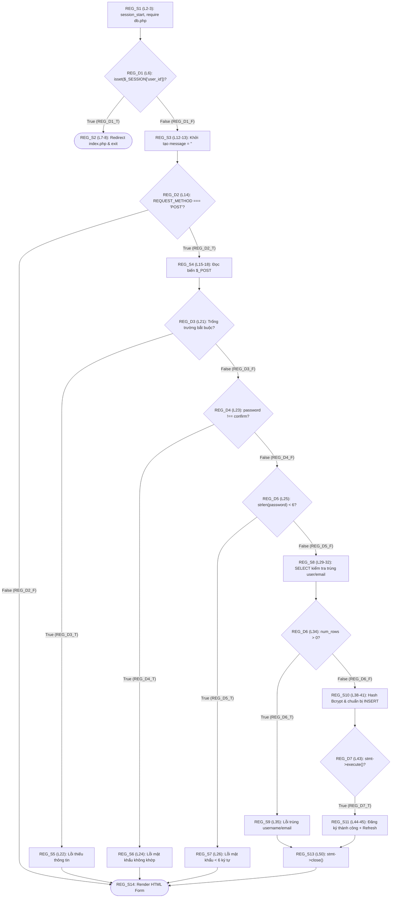
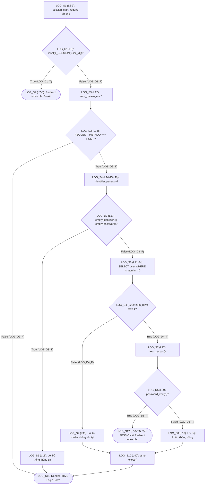
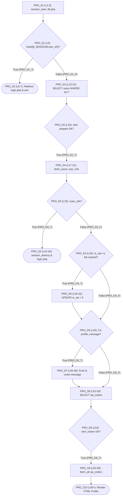
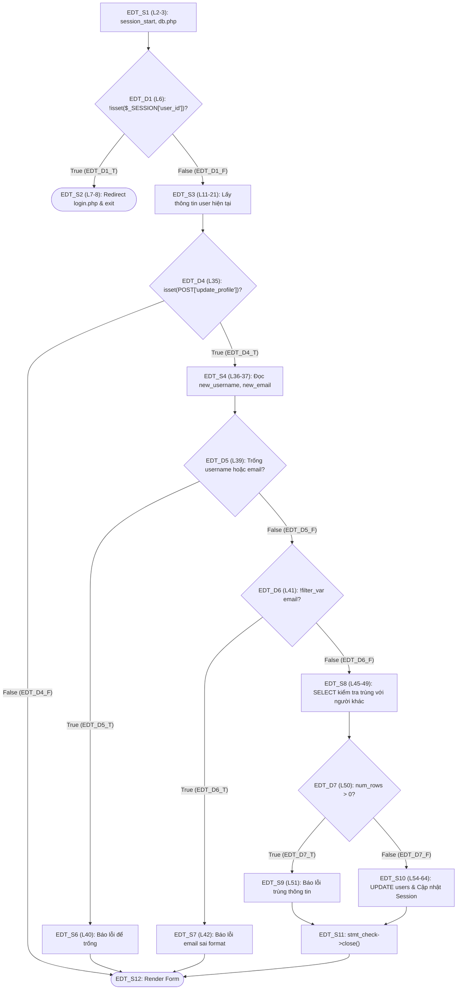
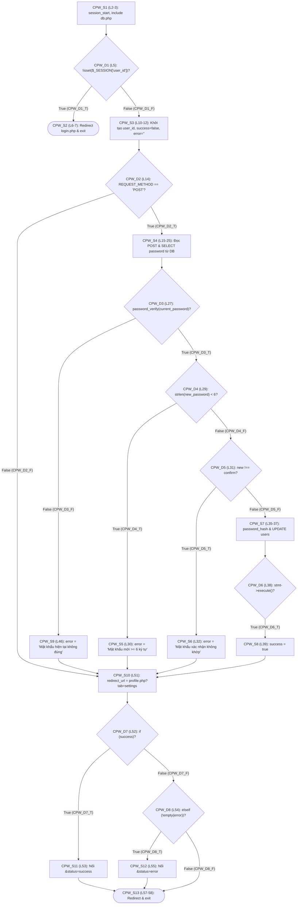
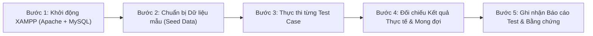

# TÀI LIỆU THIẾT KẾ KIỂM THỬ HỘP TRẮNG (WHITE-BOX TESTING) - PHÂN HỆ AUTH
## Trọng tâm: Độ Bao Phủ Câu Lệnh (Statement Coverage - $C_0$) & Độ Bao Phủ Nhánh (Branch Coverage - $C_1$)

| Thông tin | Chi tiết |
| :--- | :--- |
| **Phân hệ phụ trách** | **FE1 - Authentication & Security (`AUTH`)** |
| **Người thực hiện** | Huỳnh Nguyễn Tiến Lộc (`KAN-44`) |
| **Phạm vi mã nguồn** | `register.php`, `login.php`, `admin_login.php`, `profile.php`, `edit_profile.php`, `change_password.php` |
| **Trạng thái hiện tại** | **ĐÃ HOÀN THIỆN THIẾT KẾ TEST CASE (TEST DESIGN) - CHƯA BẮT ĐẦU CHẠY TEST THEO TIẾN ĐỘ BÀI GIẢNG** |
| **File Thiết kế CSV** |  |
| **Script Runner dự phòng** |  *(Dùng khi lớp bắt đầu thực thi test)* |

---

## I. CƠ SỞ LÝ THUYẾT ÁP DỤNG (THEO BÀI GIẢNG CỦA GIẢNG VIÊN)

Theo tiến độ giảng dạy phương pháp Kiểm thử Hộp trắng (White-Box Testing), nhóm áp dụng chặt chẽ 2 thước đo bao phủ nền tảng:

1. **Độ bao phủ câu lệnh (Statement Coverage - $C_0$):**
   - Đảm bảo **mọi khối câu lệnh thực thi (Executable Statement Block - $S_i$)** trong mã nguồn PHP của phân hệ `AUTH` đều được thiết kế kịch bản để chạy qua ít nhất 1 lần:
   $$\text{Statement Coverage } (C_0) = \frac{\text{Số khối câu lệnh được bao phủ}}{\text{Tổng số khối câu lệnh khả thi}} \times 100\%$$

2. **Độ bao phủ nhánh / quyết định (Branch / Decision Coverage - $C_1$):**
   - Đảm bảo **mọi nút điều kiện rẽ nhánh ($D_i$: `if`, `elseif`)** trong mã nguồn đều được kiểm thử qua cả 2 ngả rẽ **`True` ($D_i\_T$)** và **`False` ($D_i\_F$)**:
   $$\text{Branch Coverage } (C_1) = \frac{\text{Số nhánh (True/False) được bao phủ}}{\text{Tổng số nhánh rẽ khả thi}} \times 100\%$$
   - *(Quy tắc toán học trong kiểm thử: Khi một bộ test case đạt 100% Branch Coverage $C_1$, nó sẽ mặc nhiên đạt 100% Statement Coverage $C_0$).*

---

## II. PHÂN TÍCH ĐỒ THỊ LUỒNG ĐIỀU KHIỂN (CFG), CÂU LỆNH ($S$) & NHÁNH ($D$) TỪNG FILE

### 1. Chức năng Đăng ký tài khoản ()

#### A. Bảng ánh xạ Khối Câu lệnh ($S$) và Nút Nhánh ($D$)
| Mã Nút | Dòng code | Loại Nút | Nội dung Câu lệnh / Biểu thức điều kiện PHP |
| :---: | :---: | :---: | :--- |
| **`REG_S1`** | L2-L3 | Statement | `session_start(); require 'db.php';` |
| **`REG_D1`** | **L6** | **Branch (`if`)** | **`if (isset($_SESSION['user_id']))`** $\rightarrow$ Nhánh `REG_D1_T` / `REG_D1_F` |
| **`REG_S2`** | L7-L8 | Statement | `header("Location: index.php"); exit();` *(Khi `REG_D1_T`)* |
| **`REG_S3`** | L12-L13 | Statement | `$error_message = ''; $success_message = '';` |
| **`REG_D2`** | **L14** | **Branch (`if`)** | **`if ($_SERVER['REQUEST_METHOD'] === 'POST')`** $\rightarrow$ Nhánh `REG_D2_T` / `REG_D2_F` |
| **`REG_S4`** | L15-L18 | Statement | Đọc `$_POST['username']`, `$_POST['email']`, `$_POST['password']`, `$_POST['confirm_password']` |
| **`REG_D3`** | **L21** | **Branch (`if`)** | **`if (empty($username) || empty($email) || empty($password) || empty($confirm_password))`** |
| **`REG_S5`** | L22 | Statement | `$error_message = "Vui lòng nhập đầy đủ thông tin.";` *(Khi `REG_D3_T`)* |
| **`REG_D4`** | **L23** | **Branch (`elseif`)** | **`elseif ($password !== $confirm_password)`** $\rightarrow$ Nhánh `REG_D4_T` / `REG_D4_F` |
| **`REG_S6`** | L24 | Statement | `$error_message = "Mật khẩu xác nhận không khớp.";` *(Khi `REG_D4_T`)* |
| **`REG_D5`** | **L25** | **Branch (`elseif`)** | **`elseif (strlen($password) < 6)`** $\rightarrow$ Nhánh `REG_D5_T` / `REG_D5_F` |
| **`REG_S7`** | L26 | Statement | `$error_message = "Mật khẩu phải có ít nhất 6 ký tự.";` *(Khi `REG_D5_T`)* |
| **`REG_S8`** | L29-L32 | Statement | Thực thi `SELECT id FROM users WHERE username = ? OR email = ?` *(Khi `REG_D5_F`)* |
| **`REG_D6`** | **L34** | **Branch (`if`)** | **`if ($result->num_rows > 0)`** $\rightarrow$ Nhánh `REG_D6_T` / `REG_D6_F` |
| **`REG_S9`** | L35 | Statement | `$error_message = "Tên đăng nhập hoặc email đã được sử dụng.";` *(Khi `REG_D6_T`)* |
| **`REG_S10`** | L38-L41 | Statement | `password_hash(...)` & Chuẩn bị `INSERT INTO users` *(Khi `REG_D6_F`)* |
| **`REG_D7`** | **L43** | **Branch (`if`)** | **`if ($stmt->execute())`** $\rightarrow$ Nhánh `REG_D7_T` |
| **`REG_S11`** | L44-L45 | Statement | `$success_message = "Đăng ký thành công!..."; header("Refresh: 2; url=login.php");` |
| **`REG_S13`** | L50 | Statement | `$stmt->close();` |
| **`REG_S14`** | L55-L123 | Statement | Render giao diện HTML form đăng ký & hiển thị thông báo |

#### B. Sơ đồ Luồng Điều khiển (CFG) của `register.php`

- **Kịch bản thiết kế:** `WB_AUTH_01` $\rightarrow$ `WB_AUTH_07` (7 Test Cases bao phủ toàn bộ 13 khối lệnh và 13 nhánh rẽ).

---

### 2. Chức năng Đăng nhập User () & Đăng nhập Admin ()

#### A. Bảng ánh xạ Khối Câu lệnh ($S$) và Nút Nhánh ($D$) của `login.php`
| Mã Nút | Dòng code | Loại Nút | Nội dung Câu lệnh / Biểu thức điều kiện PHP |
| :---: | :---: | :---: | :--- |
| **`LOG_S1`** | L2-L3 | Statement | `session_start(); require 'db.php';` |
| **`LOG_D1`** | **L6** | **Branch (`if`)** | **`if (isset($_SESSION['user_id']))`** $\rightarrow$ `LOG_D1_T` / `LOG_D1_F` |
| **`LOG_S2`** | L7-L8 | Statement | `header("Location: index.php"); exit();` *(Khi `LOG_D1_T`)* |
| **`LOG_S3`** | L12 | Statement | `$error_message = '';` |
| **`LOG_D2`** | **L13** | **Branch (`if`)** | **`if ($_SERVER['REQUEST_METHOD'] === 'POST')`** $\rightarrow$ `LOG_D2_T` / `LOG_D2_F` |
| **`LOG_S4`** | L14-L15 | Statement | Đọc `$_POST['identifier']` và `$_POST['password']` |
| **`LOG_D3`** | **L17** | **Branch (`if`)** | **`if (empty($identifier) || empty($password))`** $\rightarrow$ `LOG_D3_T` / `LOG_D3_F` |
| **`LOG_S5`** | L18 | Statement | `$error_message = "Vui lòng nhập đầy đủ...";` *(Khi `LOG_D3_T`)* |
| **`LOG_S6`** | L21-L24 | Statement | `SELECT ... FROM users WHERE (username=? OR email=?) AND is_admin=0` |
| **`LOG_D4`** | **L26** | **Branch (`if`)** | **`if ($result->num_rows === 1)`** $\rightarrow$ `LOG_D4_T` / `LOG_D4_F` |
| **`LOG_S7`** | L27 | Statement | `$user = $result->fetch_assoc();` *(Khi `LOG_D4_T`)* |
| **`LOG_D5`** | **L29** | **Branch (`if`)** | **`if (password_verify($password, $user['password']))`** $\rightarrow$ `LOG_D5_T` / `LOG_D5_F` |
| **`LOG_S12`** | L30-L33 | Statement | Gán `$_SESSION['user_id']`, `header("Location: index.php"); exit();` *(Khi `LOG_D5_T`)* |
| **`LOG_S8`** | L35 | Statement | `$error_message = "Mật khẩu không đúng.";` *(Khi `LOG_D5_F`)* |
| **`LOG_S9`** | L38 | Statement | `$error_message = "Tên đăng nhập hoặc email không tồn tại.";` *(Khi `LOG_D4_F`)* |
| **`LOG_S10`** | L40 | Statement | `$stmt->close();` |
| **`LOG_S11`** | L45-L104 | Statement | Render giao diện HTML form đăng nhập |

#### B. Sơ đồ Luồng Điều khiển (CFG) của `login.php`

- **Kịch bản thiết kế:**
  - `login.php`: `WB_AUTH_08` $\rightarrow$ `WB_AUTH_13` (6 Test Cases bao phủ 12 câu lệnh, 10 nhánh).
  - `admin_login.php`: `WB_AUTH_14` $\rightarrow$ `WB_AUTH_19` (6 Test Cases bao phủ 12 câu lệnh, 10 nhánh dành riêng cho cổng quản trị viên).

---

### 3. Chức năng Xem Hồ sơ Cá nhân ()

#### A. Bảng ánh xạ Khối Câu lệnh ($S$) và Nút Nhánh ($D$) của `profile.php`
| Mã Nút | Dòng code | Loại Nút | Nội dung Câu lệnh / Biểu thức điều kiện PHP |
| :---: | :---: | :---: | :--- |
| **`PRO_S1`** | L2-L3 | Statement | `session_start(); require 'db.php';` |
| **`PRO_D1`** | **L5** | **Branch (`if`)** | **`if (!isset($_SESSION['user_id']))`** $\rightarrow$ `PRO_D1_T` / `PRO_D1_F` |
| **`PRO_S2`** | L6-L7 | Statement | `header("Location: login.php"); exit();` *(Khi `PRO_D1_T`)* |
| **`PRO_S3`** | L10-L15 | Statement | Gán `$user_id`, `$stmt = $conn->prepare("SELECT ... FROM users WHERE id = ?");` |
| **`PRO_D2`** | **L16** | **Branch (`if`)** | **`if ($stmt)`** $\rightarrow$ `PRO_D2_T` / `PRO_D2_F` |
| **`PRO_S4`** | L17-L21 | Statement | `bind_param`, `execute`, `fetch_assoc`, `stmt->close()` |
| **`PRO_D3`** | **L23** | **Branch (`if`)** | **`if (!$user_info)`** $\rightarrow$ `PRO_D3_T` / `PRO_D3_F` |
| **`PRO_S5`** | L24-L26 | Statement | `session_destroy(); header("Location: login.php"); exit();` *(Khi `PRO_D3_T`)* |
| **`PRO_D4`** | **L33** | **Branch (`if`)** | **`if ($user_info['is_vip'] == 1 && strtotime(vip_expires_at) < time())`** |
| **`PRO_S6`** | L35-L42 | Statement | Cập nhật `is_vip = 0` trong DB và `$user_info` *(Khi `PRO_D4_T`)* |
| **`PRO_D5`** | **L45** | **Branch (`if`)** | **`if (isset($_SESSION['profile_message']))`** $\rightarrow$ `PRO_D5_T` / `PRO_D5_F` |
| **`PRO_S7`** | L46-L48 | Statement | Đưa thông báo từ session vào `$messages[]` & `unset` |
| **`PRO_S8`** | L52-L53 | Statement | Chuẩn bị câu lệnh lấy lịch sử đơn VIP `vip_orders` |
| **`PRO_D6`** | **L54** | **Branch (`if`)** | **`if ($stmt_orders)`** $\rightarrow$ `PRO_D6_T` / `PRO_D6_F` |
| **`PRO_S9`** | L55-L59 | Statement | `execute`, `fetch_all`, `close` đơn VIP |
| **`PRO_S10`** | L65+ | Statement | Render toàn bộ giao diện HTML Profile & bảng đơn hàng VIP |

#### B. Sơ đồ Luồng Điều khiển (CFG) của `profile.php`

- **Kịch bản thiết kế:** `WB_AUTH_20` $\rightarrow$ `WB_AUTH_21` (2 Test Cases).

---

### 4. Chức năng Chỉnh Sửa Hồ Sơ ()

#### A. Bảng ánh xạ Khối Câu lệnh ($S$) và Nút Nhánh ($D$) của `edit_profile.php`
| Mã Nút | Dòng code | Loại Nút | Nội dung Câu lệnh / Biểu thức điều kiện PHP |
| :---: | :---: | :---: | :--- |
| **`EDT_S1`** | L2-L3 | Statement | `session_start(); require 'db.php';` |
| **`EDT_D1`** | **L6** | **Branch (`if`)** | **`if (!isset($_SESSION['user_id']))`** $\rightarrow$ `EDT_D1_T` / `EDT_D1_F` |
| **`EDT_S2`** | L7-L8 | Statement | `header("Location: login.php"); exit();` *(Khi `EDT_D1_T`)* |
| **`EDT_S3`** | L11-L21 | Statement | Đọc thông tin user hiện tại từ DB |
| **`EDT_D4`** | **L35** | **Branch (`if`)** | **`if (isset($_POST['update_profile']))`** $\rightarrow$ `EDT_D4_T` / `EDT_D4_F` |
| **`EDT_S4`** | L36-L37 | Statement | Đọc `new_username`, `new_email` |
| **`EDT_D5`** | **L39** | **Branch (`if`)** | **`if (empty($new_username) || empty($new_email))`** |
| **`EDT_S6`** | L40 | Statement | Lỗi: Tên người dùng và email không được để trống |
| **`EDT_D6`** | **L41** | **Branch (`elseif`)** | **`elseif (!filter_var($new_email, FILTER_VALIDATE_EMAIL))`** |
| **`EDT_S7`** | L42 | Statement | Lỗi: Địa chỉ email không hợp lệ |
| **`EDT_S8`** | L45-L49 | Statement | Thực thi `SELECT id FROM users WHERE (username=? OR email=?) AND id != ?` |
| **`EDT_D7`** | **L50** | **Branch (`if`)** | **`if ($result_check->num_rows > 0)`** $\rightarrow$ `EDT_D7_T` / `EDT_D7_F` |
| **`EDT_S9`** | L51 | Statement | Lỗi: Tên người dùng hoặc email đã được sử dụng |
| **`EDT_S10`** | L54-L64 | Statement | Thực thi `UPDATE users SET username=?, email=? WHERE id=?` & cập nhật Session |
| **`EDT_S11`** | L73 | Statement | `$stmt_check->close();` |
| **`EDT_S12`** | L110+ | Statement | Render giao diện Form chỉnh sửa hồ sơ & thông báo |

#### B. Sơ đồ Luồng Điều khiển (CFG) của `edit_profile.php`

- **Kịch bản thiết kế:** `WB_AUTH_22` $\rightarrow$ `WB_AUTH_26` (5 Test Cases).

---

### 5. Chức năng Đổi Mật Khẩu ()

#### A. Bảng ánh xạ Khối Câu lệnh ($S$) và Nút Nhánh ($D$) của `change_password.php`
| Mã Nút | Dòng code | Loại Nút | Nội dung Câu lệnh / Biểu thức điều kiện PHP |
| :---: | :---: | :---: | :--- |
| **`CPW_S1`** | L2-L3 | Statement | `session_start(); include 'db.php';` |
| **`CPW_D1`** | **L5** | **Branch (`if`)** | **`if (!isset($_SESSION['user_id']))`** $\rightarrow$ `CPW_D1_T` / `CPW_D1_F` |
| **`CPW_S2`** | L6-L7 | Statement | `header("Location: login.php"); exit();` *(Khi `CPW_D1_T`)* |
| **`CPW_S3`** | L10-L12 | Statement | `$user_id = $_SESSION['user_id']; $success = false; $error = '';` |
| **`CPW_D2`** | **L14** | **Branch (`if`)** | **`if ($_SERVER['REQUEST_METHOD'] == 'POST')`** $\rightarrow$ `CPW_D2_T` / `CPW_D2_F` |
| **`CPW_S4`** | L15-L25 | Statement | Đọc `$_POST`, `SELECT password FROM users WHERE id = ?` |
| **`CPW_D3`** | **L27** | **Branch (`if`)** | **`if (password_verify($current_password, $db_password))`** |
| **`CPW_D4`** | **L29** | **Branch (`if`)** | **`if (strlen($new_password) < 6)`** $\rightarrow$ `CPW_D4_T` / `CPW_D4_F` |
| **`CPW_S5`** | L30 | Statement | `$error = "Mật khẩu mới phải có ít nhất 6 ký tự.";` *(Khi `CPW_D4_T`)* |
| **`CPW_D5`** | **L31** | **Branch (`elseif`)** | **`elseif ($new_password !== $confirm_new_password)`** |
| **`CPW_S6`** | L32 | Statement | `$error = "Mật khẩu xác nhận không khớp.";` *(Khi `CPW_D5_T`)* |
| **`CPW_S7`** | L35-L37 | Statement | `password_hash` & `UPDATE users SET password = ? WHERE id = ?` |
| **`CPW_D6`** | **L38** | **Branch (`if`)** | **`if ($stmt_update->execute())`** $\rightarrow$ `CPW_D6_T` |
| **`CPW_S8`** | L39 | Statement | `$success = true;` *(Khi `CPW_D6_T`)* |
| **`CPW_S9`** | L46 | Statement | `$error = "Mật khẩu hiện tại không đúng.";` *(Khi `CPW_D3_F`)* |
| **`CPW_S10`** | L51 | Statement | `$redirect_url = 'profile.php?tab=settings';` |
| **`CPW_D7`** | **L52** | **Branch (`if`)** | **`if ($success)`** $\rightarrow$ `CPW_D7_T` / `CPW_D7_F` |
| **`CPW_S11`** | L53 | Statement | `$redirect_url .= '&status=success...';` *(Khi `CPW_D7_T`)* |
| **`CPW_D8`** | **L54** | **Branch (`elseif`)** | **`elseif (!empty($error))`** $\rightarrow$ `CPW_D8_T` / `CPW_D8_F` |
| **`CPW_S12`** | L55 | Statement | `$redirect_url .= '&status=error...';` *(Khi `CPW_D8_T`)* |
| **`CPW_S13`** | L57-L58 | Statement | `header("Location: " . $redirect_url); exit();` |

#### B. Sơ đồ Luồng Điều khiển (CFG) của `change_password.php`

- **Kịch bản thiết kế:** `WB_AUTH_27` $\rightarrow$ `WB_AUTH_32` (6 Test Cases).

---

## III. BẢNG MA TRẬN THIẾT KẾ ĐỘ BAO PHỦ CÂU LỆNH ($C_0$) & NHÁNH ($C_1$)

> [!IMPORTANT]
> **TIẾN ĐỘ THỰC TẾ:** Hiện tại nhóm đã hoàn thành toàn bộ công đoạn **Thiết kế Kịch bản Kiểm thử (Test Case Design)**. Toàn bộ các Test Case đều đang ở trạng thái **`Chưa thực hiện`** (Ready for Execution). Nhóm chưa chạy test thực tế và chưa ghi nhận kết quả PASS/FAIL sớm, bám sát tuyệt đối tiến trình giảng dạy trên lớp của giáo viên.

### 1. Bảng Thống kê Tỷ lệ Bao phủ Theo Thiết kế (Design Coverage Matrix)

| File PHP trong phân hệ `AUTH` | Số Test Case Thiết Kế | Tổng Số Khối Lệnh ($S_i$) Phủ Được ($C_0$) | Tổng Số Nhánh Rẽ ($D_i$) Phủ Được ($C_1$) | Trạng Thái Thiết Kế |
| :--- | :---: | :---: | :---: | :---: |
|  | 7 (`WB_AUTH_01` $\rightarrow$ `07`) | **13/13 khối lệnh (100.00%)** | **13/13 nhánh (100.00%)** | Sẵn sàng (Chưa test) |
|  | 6 (`WB_AUTH_08` $\rightarrow$ `13`) | **12/12 khối lệnh (100.00%)** | **10/10 nhánh (100.00%)** | Sẵn sàng (Chưa test) |
|  | 6 (`WB_AUTH_14` $\rightarrow$ `19`) | **12/12 khối lệnh (100.00%)** | **10/10 nhánh (100.00%)** | Sẵn sàng (Chưa test) |
|  | 2 (`WB_AUTH_20` $\rightarrow$ `21`) | **8/8 khối lệnh (100.00%)** | **7/7 nhánh (100.00%)** | Sẵn sàng (Chưa test) |
|  | 5 (`WB_AUTH_22` $\rightarrow$ `26`) | **12/12 khối lệnh (100.00%)** | **14/14 nhánh (100.00%)** | Sẵn sàng (Chưa test) |
|  | 6 (`WB_AUTH_27` $\rightarrow$ `32`) | **13/13 khối lệnh (100.00%)** | **15/15 nhánh (100.00%)** | Sẵn sàng (Chưa test) |
| **TỔNG CỘNG PHÂN HỆ `AUTH`** | **32 Test Cases** | **70/70 khối lệnh ($C_0$: 100%)** | **69/69 nhánh ($C_1$: 100%)** | **Hoàn tất thiết kế** |

---

### 2. Bảng Đặc tả Chi tiết 32 Test Cases White-Box Phân hệ `AUTH`

Dữ liệu được đồng bộ trực tiếp từ file :

| STT | Mã TC | File PHP | Tên Kịch Bản Kiểm Thử | Method | Role | Tham số (Payload) | Nhánh Kích Hoạt ($D_i$) | Khối Lệnh Thực Thi ($S_i$) | Kết Quả Mong Đợi | Trạng Thái |
| :---: | :--- | :--- | :--- | :---: | :---: | :--- | :--- | :--- | :--- | :---: |
| 1 | **WB_AUTH_01** | `/register.php` | Nhanh D1=True: User da dang nhap truy cap trang Dang ky | GET | user | *(Trống)* | `REG_D1_T` | `REG_S1; REG_S2` | Redirect 302 ve `index.php` | Chưa thực hiện |
| 2 | **WB_AUTH_02** | `/register.php` | Nhanh D1=False & D2=False: Khach vang lai mo form Dang ky | GET | guest | *(Trống)* | `REG_D1_F; REG_D2_F` | `REG_S1; REG_S3; REG_S14` | Hien thi form dang ky (200 OK) | Chưa thực hiện |
| 3 | **WB_AUTH_03** | `/register.php` | Nhanh D2=True & D3=True: Gui POST Dang ky bo trong truong bat buoc | POST | guest | `username=&email=&password=&confirm_password=` | `REG_D1_F; REG_D2_T; REG_D3_T` | `REG_S1; REG_S3; REG_S4; REG_S5; REG_S14` | Bao loi: Vui long nhap day du thong tin | Chưa thực hiện |
| 4 | **WB_AUTH_04** | `/register.php` | Nhanh D3=False & D4=True: Mat khau xac nhan khong khop | POST | guest | `username=wb_u1&email=wb_u1@gmail.com&password=123456&confirm_password=654321` | `REG_D1_F; REG_D2_T; REG_D3_F; REG_D4_T` | `REG_S1; REG_S3; REG_S4; REG_S6; REG_S14` | Bao loi: Mat khau xac nhan khong khop | Chưa thực hiện |
| 5 | **WB_AUTH_05** | `/register.php` | Nhanh D4=False & D5=True: Mat khau nho hon 6 ky tu | POST | guest | `username=wb_u2&email=wb_u2@gmail.com&password=12345&confirm_password=12345` | `REG_D1_F; REG_D2_T; REG_D3_F; REG_D4_F; REG_D5_T` | `REG_S1; REG_S3; REG_S4; REG_S7; REG_S14` | Bao loi: Mat khau phai co it nhat 6 ky tu | Chưa thực hiện |
| 6 | **WB_AUTH_06** | `/register.php` | Nhanh D5=False & D6=True: Username hoac Email da ton tai trong DB | POST | guest | `username=tuan&email=tuan@gmail.com&password=123456&confirm_password=123456` | `REG_D1_F; REG_D2_T; REG_D3_F; REG_D4_F; REG_D5_F; REG_D6_T` | `REG_S1; REG_S3; REG_S4; REG_S8; REG_S9; REG_S13; REG_S14` | Bao loi: Ten dang nhap hoac email da duoc su dung | Chưa thực hiện |
| 7 | **WB_AUTH_07** | `/register.php` | Nhanh D6=False & D7=True: Dang ky tai khoan moi thanh cong | POST | guest | `username=wb_new01&email=wb_new01@gmail.com&password=123456&confirm_password=123456` | `REG_D1_F; REG_D2_T; REG_D3_F; REG_D4_F; REG_D5_F; REG_D6_F; REG_D7_T` | `REG_S1; REG_S3; REG_S4; REG_S8; REG_S10; REG_S11; REG_S13; REG_S14` | Dang ky thanh cong! Vui long dang nhap | Chưa thực hiện |
| 8 | **WB_AUTH_08** | `/login.php` | Nhanh D1=True: User da dang nhap truy cap `/login.php` | GET | user | *(Trống)* | `LOG_D1_T` | `LOG_S1; LOG_S2` | Redirect 302 ve `index.php` | Chưa thực hiện |
| 9 | **WB_AUTH_09** | `/login.php` | Nhanh D1=False & D2=False: Khach vang lai mo trang `/login.php` | GET | guest | *(Trống)* | `LOG_D1_F; LOG_D2_F` | `LOG_S1; LOG_S3; LOG_S11` | Hien thi form dang nhap (200 OK) | Chưa thực hiện |
| 10 | **WB_AUTH_10** | `/login.php` | Nhanh D2=True & D3=True: Bo trong identifier hoac password | POST | guest | `identifier=&password=` | `LOG_D1_F; LOG_D2_T; LOG_D3_T` | `LOG_S1; LOG_S3; LOG_S4; LOG_S5; LOG_S11` | Bao loi: Vui long nhap day du ten dang nhap/email va mat khau | Chưa thực hiện |
| 11 | **WB_AUTH_11** | `/login.php` | Nhanh D3=False & D4=False: Tai khoan khong ton tai hoac la Admin | POST | guest | `identifier=khong_ton_tai@gmail.com&password=123456` | `LOG_D1_F; LOG_D2_T; LOG_D3_F; LOG_D4_F` | `LOG_S1; LOG_S3; LOG_S4; LOG_S6; LOG_S9; LOG_S10; LOG_S11` | Bao loi: Ten dang nhap hoac email khong ton tai | Chưa thực hiện |
| 12 | **WB_AUTH_12** | `/login.php` | Nhanh D4=True & D5=False: Tai khoan ton tai nhung sai mat khau | POST | guest | `identifier=tuan@gmail.com&password=sai_mat_khau` | `LOG_D1_F; LOG_D2_T; LOG_D3_F; LOG_D4_T; LOG_D5_F` | `LOG_S1; LOG_S3; LOG_S4; LOG_S6; LOG_S7; LOG_S8; LOG_S10; LOG_S11` | Bao loi: Mat khau khong dung | Chưa thực hiện |
| 13 | **WB_AUTH_13** | `/login.php` | Nhanh D4=True & D5=True: Dang nhap User thanh cong | POST | guest | `identifier=tuan@gmail.com&password=123456` | `LOG_D1_F; LOG_D2_T; LOG_D3_F; LOG_D4_T; LOG_D5_T` | `LOG_S1; LOG_S3; LOG_S4; LOG_S6; LOG_S7; LOG_S12` | Set SESSION user_id & Redirect 302 ve `index.php` | Chưa thực hiện |
| 14 | **WB_AUTH_14** | `/admin_login.php` | Nhanh D1=True: Admin da dang nhap truy cap `/admin_login.php` | GET | admin | *(Trống)* | `ADM_D1_T` | `ADM_S1; ADM_S2` | Redirect 302 ve `admin_dashboard.php` | Chưa thực hiện |
| 15 | **WB_AUTH_15** | `/admin_login.php` | Nhanh D1=False & D2=False: Mo form `/admin_login.php` | GET | guest | *(Trống)* | `ADM_D1_F; ADM_D2_F` | `ADM_S1; ADM_S3; ADM_S11` | Hien thi form dang nhap Admin (200 OK) | Chưa thực hiện |
| 16 | **WB_AUTH_16** | `/admin_login.php` | Nhanh D2=True & D3=True: Bo trong identifier hoac password tai cong Admin | POST | guest | `identifier=&password=` | `ADM_D1_F; ADM_D2_T; ADM_D3_T` | `ADM_S1; ADM_S3; ADM_S4; ADM_S5; ADM_S11` | Bao loi: Vui long nhap day du ten dang nhap/email va mat khau | Chưa thực hiện |
| 17 | **WB_AUTH_17** | `/admin_login.php` | Nhanh D3=False & D4=False: User thuong dang nhap cong Admin | POST | guest | `identifier=tuan@gmail.com&password=123456` | `ADM_D1_F; ADM_D2_T; ADM_D3_F; ADM_D4_F` | `ADM_S1; ADM_S3; ADM_S4; ADM_S6; ADM_S9; ADM_S10; ADM_S11` | Bao loi: Ten dang nhap hoac email khong ton tai hoac khong phai admin | Chưa thực hiện |
| 18 | **WB_AUTH_18** | `/admin_login.php` | Nhanh D4=True & D5=False: Dung tai khoan Admin nhung sai mat khau | POST | guest | `identifier=admin&password=sai_pass_admin` | `ADM_D1_F; ADM_D2_T; ADM_D3_F; ADM_D4_T; ADM_D5_F` | `ADM_S1; ADM_S3; ADM_S4; ADM_S6; ADM_S7; ADM_S8; ADM_S10; ADM_S11` | Bao loi: Mat khau khong dung | Chưa thực hiện |
| 19 | **WB_AUTH_19** | `/admin_login.php` | Nhanh D4=True & D5=True: Dang nhap Admin thanh cong | POST | guest | `identifier=admin&password=admin123` | `ADM_D1_F; ADM_D2_T; ADM_D3_F; ADM_D4_T; ADM_D5_T` | `ADM_S1; ADM_S3; ADM_S4; ADM_S6; ADM_S7; ADM_S12` | Set SESSION is_admin=1 & Redirect 302 ve `admin_dashboard.php` | Chưa thực hiện |
| 20 | **WB_AUTH_20** | `/profile.php` | Nhanh D1=True: Khach chua dang nhap truy cap `/profile.php` | GET | guest | *(Trống)* | `PRO_D1_T` | `PRO_S1; PRO_S2` | Redirect 302 ve `login.php` | Chưa thực hiện |
| 21 | **WB_AUTH_21** | `/profile.php` | Nhanh D1=False & D2=True & D3=False & D4=False: Xem ho so User hop le | GET | user | *(Trống)* | `PRO_D1_F; PRO_D2_T; PRO_D3_F; PRO_D4_F; PRO_D5_F; PRO_D6_T` | `PRO_S1; PRO_S3; PRO_S4; PRO_S6; PRO_S8; PRO_S9; PRO_S10` | Hien thi thong tin ho so va bang don hang VIP (200 OK) | Chưa thực hiện |
| 22 | **WB_AUTH_22** | `/edit_profile.php` | Nhanh D1=True: Khach chua dang nhap truy cap `/edit_profile.php` | GET | guest | *(Trống)* | `EDT_D1_T` | `EDT_S1; EDT_S2` | Redirect 302 ve `login.php` | Chưa thực hiện |
| 23 | **WB_AUTH_23** | `/edit_profile.php` | Nhanh D4=True & D5=True: Cap nhat ho so nhung de trong username hoac email | POST | user | `update_profile=1&username=&email=` | `EDT_D1_F; EDT_D2_T; EDT_D3_F; EDT_D4_T; EDT_D5_T; EDT_D10_F` | `EDT_S1; EDT_S3; EDT_S4; EDT_S5; EDT_S6; EDT_S12` | Bao loi: Ten nguoi dung va email khong duoc de trong | Chưa thực hiện |
| 24 | **WB_AUTH_24** | `/edit_profile.php` | Nhanh D5=False & D6=True: Cap nhat ho so voi email sai dinh dang | POST | user | `update_profile=1&username=tuan&email=email_sai_dinh_dang` | `EDT_D1_F; EDT_D2_T; EDT_D3_F; EDT_D4_T; EDT_D5_F; EDT_D6_T; EDT_D10_F` | `EDT_S1; EDT_S3; EDT_S4; EDT_S5; EDT_S7; EDT_S12` | Bao loi: Dia chi email khong hop le | Chưa thực hiện |
| 25 | **WB_AUTH_25** | `/edit_profile.php` | Nhanh D6=False & D7=True: Cap nhat ho so trung username/email cua nguoi khac | POST | user | `update_profile=1&username=admin&email=admin@netfixvn.com` | `EDT_D1_F; EDT_D2_T; EDT_D3_F; EDT_D4_T; EDT_D5_F; EDT_D6_F; EDT_D7_T; EDT_D10_F` | `EDT_S1; EDT_S3; EDT_S4; EDT_S5; EDT_S8; EDT_S9; EDT_S11; EDT_S12` | Bao loi: Ten nguoi dung hoac email nay da duoc su dung boi nguoi khac | Chưa thực hiện |
| 26 | **WB_AUTH_26** | `/edit_profile.php` | Nhanh D7=False & D8=True & D9=True: Cap nhat ho so thanh cong | POST | user | `update_profile=1&username=tuan&email=tuan@gmail.com` | `EDT_D1_F; EDT_D2_T; EDT_D3_F; EDT_D4_T; EDT_D5_F; EDT_D6_F; EDT_D7_F; EDT_D8_T; EDT_D9_T; EDT_D10_F` | `EDT_S1; EDT_S3; EDT_S4; EDT_S5; EDT_S8; EDT_S10; EDT_S11; EDT_S12` | Thong tin ca nhan da duoc cap nhat thanh cong | Chưa thực hiện |
| 27 | **WB_AUTH_27** | `/change_password.php` | Nhanh D1=True: Khach chua dang nhap truy cap `/change_password.php` | GET | guest | *(Trống)* | `CPW_D1_T` | `CPW_S1; CPW_S2` | Redirect 302 ve `login.php` | Chưa thực hiện |
| 28 | **WB_AUTH_28** | `/change_password.php` | Nhanh D1=False & D2=False: User da dang nhap goi GET `/change_password.php` | GET | user | *(Trống)* | `CPW_D1_F; CPW_D2_F; CPW_D7_F; CPW_D8_F` | `CPW_S1; CPW_S3; CPW_S10; CPW_S13` | Redirect 302 ve `profile.php?tab=settings` | Chưa thực hiện |
| 29 | **WB_AUTH_29** | `/change_password.php` | Nhanh D2=True & D3=False: Nhap sai mat khau hien tai | POST | user | `current_password=sai_pass&new_password=123456&confirm_new_password=123456` | `CPW_D1_F; CPW_D2_T; CPW_D3_F; CPW_D7_F; CPW_D8_T` | `CPW_S1; CPW_S3; CPW_S4; CPW_S9; CPW_S10; CPW_S12; CPW_S13` | Bao loi: Mat khau hien tai khong dung | Chưa thực hiện |
| 30 | **WB_AUTH_30** | `/change_password.php` | Nhanh D3=True & D4=True: Mat khau moi rong hoac < 6 ky tu | POST | user | `current_password=123456&new_password=12345&confirm_new_password=12345` | `CPW_D1_F; CPW_D2_T; CPW_D3_T; CPW_D4_T; CPW_D7_F; CPW_D8_T` | `CPW_S1; CPW_S3; CPW_S4; CPW_S5; CPW_S10; CPW_S12; CPW_S13` | Bao loi: Mat khau moi phai co it nhat 6 ky tu | Chưa thực hiện |
| 31 | **WB_AUTH_31** | `/change_password.php` | Nhanh D4=False & D5=True: Mat khau moi va xac nhan khong khop | POST | user | `current_password=123456&new_password=654321&confirm_new_password=999999` | `CPW_D1_F; CPW_D2_T; CPW_D3_T; CPW_D4_F; CPW_D5_T; CPW_D7_F; CPW_D8_T` | `CPW_S1; CPW_S3; CPW_S4; CPW_S6; CPW_S10; CPW_S12; CPW_S13` | Bao loi: Mat khau moi va xac nhan mat khau khong khop | Chưa thực hiện |
| 32 | **WB_AUTH_32** | `/change_password.php` | Nhanh D5=False & D6=True & D7=True: Doi mat khau thanh cong | POST | user | `current_password=123456&new_password=123456&confirm_new_password=123456` | `CPW_D1_F; CPW_D2_T; CPW_D3_T; CPW_D4_F; CPW_D5_F; CPW_D6_T; CPW_D7_T` | `CPW_S1; CPW_S3; CPW_S4; CPW_S7; CPW_S8; CPW_S10; CPW_S11; CPW_S13` | Redirect status=success Doi mat khau thanh cong | Chưa thực hiện |

---

## IV. QUY TRÌNH THỰC HIỆN KIỂM THỬ TRÊN LỚP (KHI GIÁO VIÊN YÊU CẦU BẮT ĐẦU TEST)

Khi giáo viên giảng xong lý thuyết và yêu cầu cả lớp bắt tay vào thực hiện kiểm thử (Test Execution Phase), bạn và nhóm sẽ thực hiện theo các bước chuẩn sau:



1. **Bước 1: Khởi động Môi trường:**
   - Mở XAMPP Control Panel, Start **Apache** (cổng 80) và **MySQL** (cổng 3306).
   - Đảm bảo database `netfix2` đã được import và tài khoản test mẫu sẵn sàng (`tuan` / `123456`, `admin` / `admin123`).

2. **Bước 2: Thực thi kiểm thử (Test Execution):**
   - **Cách 1 (Kiểm thử Thủ công - Manual Testing):** Mở trình duyệt web hoặc Postman, nhập từng bộ tham số trong bảng thiết kế trên, gửi request và quan sát câu lệnh / nhánh được kích hoạt trong mã nguồn PHP.
   - **Cách 2 (Kiểm thử Tự động hóa - Automation):** Khi cần nghiệm thu nhanh và kiểm tra hồi quy toàn bộ 32 nhánh rẽ, chạy script runner tự động đã chuẩn bị:
     ```bash
     node docs/testrun/whitebox_runner_auth.js
     ```

3. **Bước 3: Ghi nhận Báo cáo Kết quả (Test Report):**
   - Tạo file báo cáo thực tế `docs/Report/report_whitebox_auth.csv` ghi nhận: Mã test case, Thời gian phản hồi thực tế, HTTP Status Code thực tế, Trạng thái `PASS`/`FAIL` và chụp màn hình bằng chứng cho từng ca kiểm thử.
