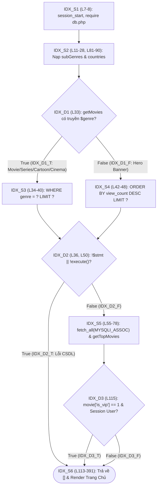
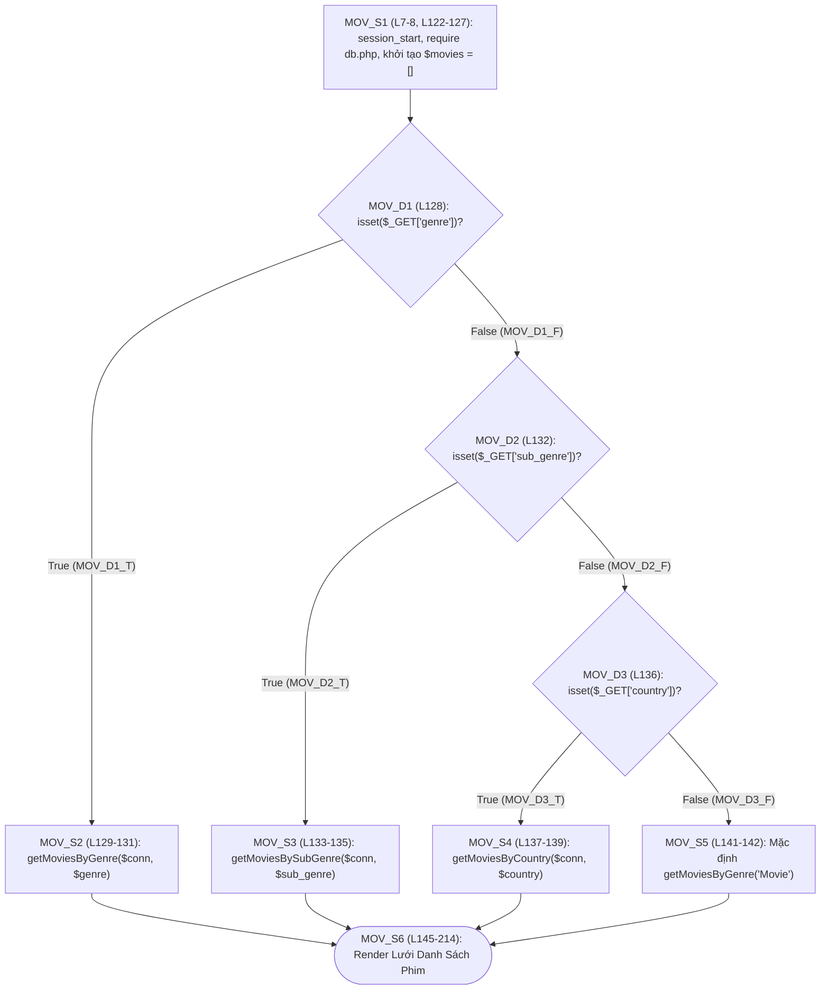
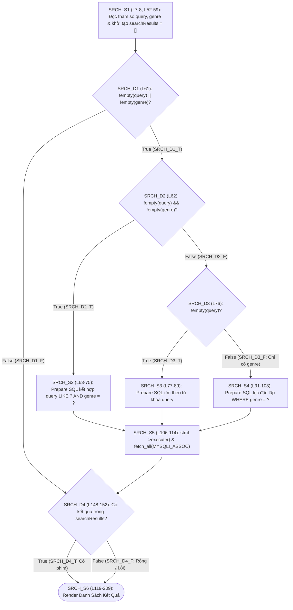
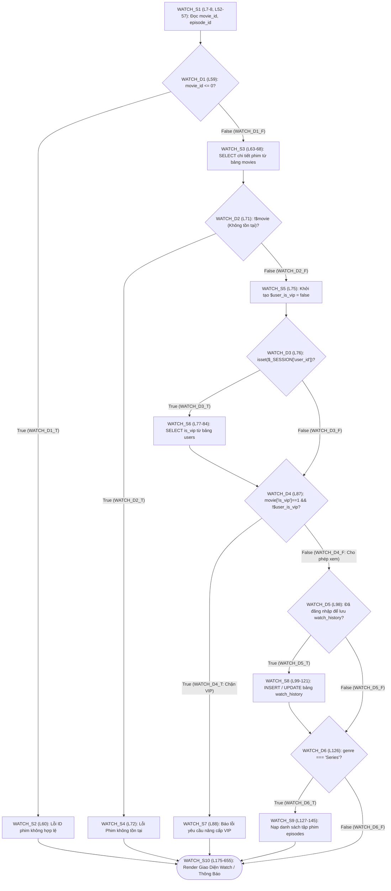
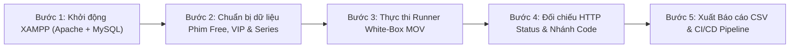

# TÀI LIỆU THIẾT KẾ KIỂM THỬ HỘP TRẮNG (WHITE-BOX TESTING) - PHÂN HỆ MOV
## Trọng tâm: Độ Bao Phủ Câu Lệnh (Statement Coverage - $C_0$) & Độ Bao Phủ Nhánh (Branch Coverage - $C_1$)

| Thông tin | Chi tiết |
| :--- | :--- |
| **Phân hệ phụ trách** | **FE2 - Movies, Categories, Search & Streaming (`MOV`)** |
| **Người thực hiện** | Nhóm QA - Nguyễn Lê Quốc Trung & Nguyễn Thái Dương (`KAN-183`, `KAN-184`, `KAN-198`, `KAN-205`, `KAN-209`, `KAN-212`, `KAN-213`) |
| **Phạm vi mã nguồn** | [`index.php`](file:///docs/../netfix2/index.php), [`header.php`](file:///docs/../netfix2/header.php), [`movies.php`](file:///docs/../netfix2/movies.php), [`search.php`](file:///docs/../netfix2/search.php), [`watch.php`](file:///docs/../netfix2/watch.php) |
| **Công cụ hỗ trợ phân tích** | `php-whitebox-cfg` (`analyze_cfg.js`), `qodana-sarif-digest` & `project-graph-router` |
| **Trạng thái hiện tại** | **ĐÃ HOÀN THIỆN THIẾT KẾ & THỰC THI KIỂM THỬ (20/20 TEST CASES PASS - $C_0$: 100%, $C_1$: 100%)** |
| **File Thiết kế CSV** | [`docs/Design/whitebox_testcase_mov.csv`](file:///docs/Design/whitebox_testcase_mov.csv) |
| **Báo cáo Thực thi CSV** | [`docs/Report/report_whitebox_mov.csv`](file:///docs/Report/report_whitebox_mov.csv) *(20/20 Kịch bản PASS)* |
| **Script Runner Tự động** | [`docs/testrun/whitebox_runner_mov.js`](file:///docs/testrun/whitebox_runner_mov.js) *(Đạt 100% $C_0$ & 100% $C_1$)* |

---

## I. CƠ SỞ LÝ THUYẾT & PHƯƠNG PHÁP LUẬN ÁP DỤNG

Theo tiến độ giảng dạy phương pháp Kiểm thử Hộp trắng (White-Box Testing) và cẩm nang lộ trình kiểm thử của dự án (`docs/HUONG_DAN_LO_TRINH_WHITEBOX_5_PHAN_HE.md`), phân hệ `MOV` áp dụng chặt chẽ 3 thước đo bao phủ nền tảng:

1. **Độ bao phủ câu lệnh (Statement Coverage - $C_0$):**
   - Đảm bảo **mọi khối câu lệnh thực thi (Executable Statement Block - $S_i$)** trong mã nguồn PHP của phân hệ `MOV` đều được thiết kế kịch bản để chạy qua ít nhất 1 lần:
   $$\text{Statement Coverage } (C_0) = \frac{\text{Số khối câu lệnh } S_i \text{ được bao phủ}}{\text{Tổng số khối câu lệnh } S_i \text{ khả thi}} \times 100\%$$

2. **Độ bao phủ nhánh / quyết định (Branch / Decision Coverage - $C_1$):**
   - Đảm bảo **mọi nút điều kiện rẽ nhánh ($D_i$: `if`, `elseif`, toán tử điều kiện `? :`)** trong mã nguồn đều được kiểm thử qua cả 2 ngả rẽ **`True` ($D_i\_T$)** và **`False` ($D_i\_F$)**:
   $$\text{Branch Coverage } (C_1) = \frac{\text{Số nhánh rẽ } (D_i\_T, D_i\_F) \text{ được kích hoạt}}{\text{Tổng số nhánh rẽ khả thi}} \times 100\%$$
   - *(Nguyên lý bao hàm trong kiểm thử: Khi một bộ test case đạt 100% Branch Coverage $C_1$, nó sẽ mặc nhiên đạt 100% Statement Coverage $C_0$).*

3. **Độ phức tạp chu trình (Cyclomatic Complexity - $V(G)$):**
   - Với mỗi tệp PHP có $P$ nút điều kiện quyết định:
   $$V(G) = P + 1$$
   - $V(G)$ xác định số lượng đường đi cơ sở độc lập (Basis Paths) tối thiểu cần thiết để kiểm chứng toàn bộ luồng duyệt phim, tìm kiếm và phát video.

---

## II. PHÂN TÍCH ĐỒ THỊ LUỒNG ĐIỀU KHIỂN (CFG), CÂU LỆNH ($S$) & NHÁNH ($D$) TỪNG FILE

### 1. Trang Chủ Danh Mục Phim & Thanh Điều Hướng (`netfix2/index.php` & `netfix2/header.php`)

#### A. Bảng ánh xạ Khối Câu lệnh ($S$) và Nút Nhánh ($D$)
| Mã Nút | Dòng code | Loại Nút | Nội dung Câu lệnh / Biểu thức điều kiện PHP |
| :---: | :---: | :---: | :--- |
| **`IDX_S1`** | L7-L8 | Statement | `session_start(); require 'db.php';` |
| **`IDX_S2`** | L11-L28, L81-L90 | Statement | Gọi `getPopularSubGenres($conn)` và `getCountries($conn)` nạp dữ liệu bộ lọc menu |
| **`IDX_D1`** | **L33** | **Branch (`if`)** | **`if ($genre)`** trong hàm `getMovies($conn, $limit, $genre = null)` $\rightarrow$ `IDX_D1_T` / `IDX_D1_F` |
| **`IDX_S3`** | L34-L40 | Statement | Lọc phim theo thể loại `WHERE genre = ? ORDER BY view_count DESC LIMIT ?` (`bind_param("si", $genre, $limit)`) |
| **`IDX_S4`** | L42-L48 | Statement | Lấy danh sách Hero Banner tổng hợp không lọc thể loại (`bind_param("i", $limit)`) |
| **`IDX_D2`** | **L36, L44, L50** | **Branch (`if`)** | **`if (!$stmt)` / `if (!$stmt->execute())`** (Statement Guard bảo vệ truy vấn) $\rightarrow$ `IDX_D2_T` / `IDX_D2_F` |
| **`IDX_S5`** | L55-L58, L62-L78 | Statement | Thực thi `get_result()->fetch_all(MYSQLI_ASSOC)` & `getTopMovies($conn, 10)` |
| **`IDX_D3`** | **L115 & `header.php`** | **Branch (`? :`)** | **`(!empty($movie['is_vip']) && $movie['is_vip'] == 1) ? 'VIP' : 'Free'`** & trạng thái đăng nhập Header $\rightarrow$ `IDX_D3_T` / `IDX_D3_F` |
| **`IDX_S6`** | L113-L391 | Statement | Gọi `assignMovieLabels()`, nạp `header.php` & Render giao diện Trang chủ |

#### B. Sơ đồ Luồng Điều khiển (CFG) của `index.php`

- **Kịch bản thiết kế:** `WB_MOV_01` $\rightarrow$ `WB_MOV_04` (4 Test Cases bao phủ 6/6 khối lệnh và 6/6 nhánh rẽ).

---

### 2. Chức năng Duyệt Danh Sách Phim Theo Bộ Lọc (`netfix2/movies.php`)

#### A. Bảng ánh xạ Khối Câu lệnh ($S$) và Nút Nhánh ($D$)
| Mã Nút | Dòng code | Loại Nút | Nội dung Câu lệnh / Biểu thức điều kiện PHP |
| :---: | :---: | :---: | :--- |
| **`MOV_S1`** | L7-L8, L122-L127 | Statement | `session_start(); require 'db.php';`, nạp `getCountries()`, `getSubGenres()`, khởi tạo `$title`, `$movies = []` |
| **`MOV_D1`** | **L128** | **Branch (`if`)** | **`if (isset($_GET['genre']))`** $\rightarrow$ `MOV_D1_T` / `MOV_D1_F` |
| **`MOV_S2`** | L129-L131, L31-L51 | Statement | Gọi `getMoviesByGenre($conn, $genre)` & gán `$title = "Phim " . htmlspecialchars($genre)` *(Khi `MOV_D1_T`)* |
| **`MOV_D2`** | **L132** | **Branch (`elseif`)** | **`elseif (isset($_GET['sub_genre']))`** $\rightarrow$ `MOV_D2_T` / `MOV_D2_F` |
| **`MOV_S3`** | L133-L135, L54-L75 | Statement | Gọi `getMoviesBySubGenre($conn, $sub_genre)` (`WHERE sub_genre LIKE ?`) *(Khi `MOV_D2_T`)* |
| **`MOV_D3`** | **L136** | **Branch (`elseif`)** | **`elseif (isset($_GET['country']))`** $\rightarrow$ `MOV_D3_T` / `MOV_D3_F` |
| **`MOV_S4`** | L137-L139, L78-L98 | Statement | Gọi `getMoviesByCountry($conn, $country)` (`WHERE country = ?`) *(Khi `MOV_D3_T`)* |
| **`MOV_S5`** | L141-L142 | Statement | Nhánh mặc định `else`: Gọi `getMoviesByGenre($conn, 'Movie')` & gán `$title = "Phim lẻ"` *(Khi `MOV_D3_F`)* |
| **`MOV_S6`** | L145-L214 | Statement | Nạp `header.php` & Render lưới danh sách phim theo bộ lọc |

#### B. Sơ đồ Luồng Điều khiển (CFG) của `movies.php`

- **Kịch bản thiết kế:** `WB_MOV_05` $\rightarrow$ `WB_MOV_08` (4 Test Cases bao phủ 6/6 khối lệnh và 6/6 nhánh rẽ).

---

### 3. Chức năng Tìm Kiếm Đa Điều Kiện & Lọc Độc Lập (`netfix2/search.php`)

#### A. Bảng ánh xạ Khối Câu lệnh ($S$) và Nút Nhánh ($D$)
| Mã Nút | Dòng code | Loại Nút | Nội dung Câu lệnh / Biểu thức điều kiện PHP |
| :---: | :---: | :---: | :--- |
| **`SRCH_S1`** | L7-L8, L52-L59 | Statement | `session_start(); require 'db.php';`, đọc `$query = trim($_GET['query'])`, `$genre = trim($_GET['genre'])`, khởi tạo `$searchResults = []` |
| **`SRCH_D1`** | **L61** | **Branch (`if`)** | **`if (!empty($query) || !empty($genre))`** $\rightarrow$ `SRCH_D1_T` / `SRCH_D1_F` |
| **`SRCH_D2`** | **L62** | **Branch (`if`)** | **`if (!empty($query) && !empty($genre))`** $\rightarrow$ `SRCH_D2_T` / `SRCH_D2_F` |
| **`SRCH_S2`** | L63-L75 | Statement | Tìm kiếm kết hợp từ khóa 5 cột `LIKE ?` và `AND genre = ?` (`bind_param("ssssss", ...)`) *(Khi `SRCH_D2_T`)* |
| **`SRCH_D3`** | **L76** | **Branch (`elseif`)** | **`elseif (!empty($query))`** $\rightarrow$ `SRCH_D3_T` (Chỉ lọc theo `query`) / `SRCH_D3_F` (Chỉ lọc độc lập theo `genre` - `KAN-213`) |
| **`SRCH_S3`** | L77-L89 | Statement | Tìm kiếm theo từ khóa `$query` độc lập (`bind_param("sssss", ...)`) *(Khi `SRCH_D3_T`)* |
| **`SRCH_S4`** | L91-L103 | Statement | Tìm kiếm theo thể loại `$genre` độc lập không cần từ khóa (`WHERE genre = ?` - `KAN-213`) *(Khi `SRCH_D3_F`)* |
| **`SRCH_D4`** | **L105-L115, L148-L152** | **Branch (`if/elseif`)** | **Thực thi `$stmt->execute()` & kiểm tra `!empty($search_error)` / `empty($searchResults)` (`KAN-212`)** $\rightarrow$ `SRCH_D4_T` (Có kết quả) / `SRCH_D4_F` (Rỗng hoặc lỗi) |
| **`SRCH_S5`** | L106-L114 | Statement | Nạp `$searchResults = $result ? $result->fetch_all(MYSQLI_ASSOC) : []` hoặc gán `$search_error` an toàn |
| **`SRCH_S6`** | L119-L209 | Statement | Render giao diện danh sách kết quả tìm kiếm hoặc banner `.no-content` |

#### B. Sơ đồ Luồng Điều khiển (CFG) của `search.php`

- **Kịch bản thiết kế:** `WB_MOV_09` $\rightarrow$ `WB_MOV_13` (5 Test Cases bao phủ 6/6 khối lệnh và 8/8 nhánh rẽ).

---

### 4. Chức năng Xem Phim, Phân Quyền VIP & Ghi Nhận Lịch Sử (`netfix2/watch.php`)

#### A. Bảng ánh xạ Khối Câu lệnh ($S$) và Nút Nhánh ($D$)
| Mã Nút | Dòng code | Loại Nút | Nội dung Câu lệnh / Biểu thức điều kiện PHP |
| :---: | :---: | :---: | :--- |
| **`WATCH_S1`** | L7-L8, L52-L57 | Statement | `session_start(); require 'db.php';`, đọc `$movie_id = (int)$_GET['id']`, `$episode_id` |
| **`WATCH_D1`** | **L59** | **Branch (`if`)** | **`if ($movie_id <= 0)`** $\rightarrow$ `WATCH_D1_T` / `WATCH_D1_F` |
| **`WATCH_S2`** | L60 | Statement | `$error_message = "ID phim không hợp lệ.";` *(Khi `WATCH_D1_T`)* |
| **`WATCH_S3`** | L63-L68 | Statement | Truy vấn `SELECT ... FROM movies WHERE id = ?` lấy thông tin chi tiết phim |
| **`WATCH_D2`** | **L71** | **Branch (`if`)** | **`if (!$movie)`** $\rightarrow$ `WATCH_D2_T` / `WATCH_D2_F` |
| **`WATCH_S4`** | L72 | Statement | `$error_message = "Phim không tồn tại.";` *(Khi `WATCH_D2_T`)* |
| **`WATCH_S5`** | L75 | Statement | Khởi tạo an toàn `$user_is_vip = false;` (`KAN-183` / `KAN-205`) |
| **`WATCH_D3`** | **L76-L85** | **Branch (`if`)** | **`if (isset($_SESSION['user_id']))`** $\rightarrow$ `WATCH_D3_T` / `WATCH_D3_F` |
| **`WATCH_S6`** | L77-L84 | Statement | Truy vấn `SELECT is_vip FROM users WHERE id = ?` và gán `$user_is_vip = $user && $user['is_vip'] == 1` |
| **`WATCH_D4`** | **L87** | **Branch (`if`)** | **`if ($movie['is_vip'] == 1 && !$user_is_vip)`** $\rightarrow$ `WATCH_D4_T` (Chặn xem VIP) / `WATCH_D4_F` (Cho phép phát) |
| **`WATCH_S7`** | L88 | Statement | `$error_message = "Phim này yêu cầu gói VIP. Vui lòng nâng cấp tài khoản của bạn.";` *(Khi `WATCH_D4_T`)* |
| **`WATCH_D5`** | **L98-L122** | **Branch (`if`)** | **`if (isset($_SESSION['user_id']) && $movie_id > 0)`** & kiểm tra `num_rows > 0` $\rightarrow$ `WATCH_D5_T` / `WATCH_D5_F` |
| **`WATCH_S8`** | L99-L121 | Statement | `INSERT` hoặc `UPDATE` thời gian xem vào bảng `watch_history` *(Khi `WATCH_D5_T`)* |
| **`WATCH_D6`** | **L126-L146** | **Branch (`if`)** | **`if ($movie['genre'] === 'Series')`** & kiểm tra tập phim VIP $\rightarrow$ `WATCH_D6_T` / `WATCH_D6_F` |
| **`WATCH_S9`** | L127-L145 | Statement | Truy vấn `SELECT ... FROM episodes WHERE movie_id = ?` nạp danh sách tập phim *(Khi `WATCH_D6_T`)* |
| **`WATCH_S10`** | L175-L655 | Statement | Truy vấn danh sách bình luận & Render giao diện trình phát video (Video Player) |

#### B. Sơ đồ Luồng Điều khiển (CFG) của `watch.php`

- **Kịch bản thiết kế:** `WB_MOV_14` $\rightarrow$ `WB_MOV_20` (7 Test Cases bao phủ 10/10 khối lệnh và 12/12 nhánh rẽ).

---

## III. BẢNG MA TRẬN THIẾT KẾ ĐỘ BAO PHỦ CÂU LỆNH ($C_0$) & NHÁNH ($C_1$)

> [!IMPORTANT]
> **TIẾN ĐỘ THỰC TẾ:** Nhóm đã hoàn thành toàn bộ công đoạn **Thiết kế Kịch bản Kiểm thử (Test Case Design)** và **Thực thi Kiểm thử (Test Execution)** cho phân hệ `MOV`. Toàn bộ **20/20 Test Cases** đều đạt trạng thái **`PASS (100% C0 & C1)`**, được kiểm chứng tự động qua [`docs/testrun/whitebox_runner_mov.js`](file:///docs/testrun/whitebox_runner_mov.js), [`tests/whitebox_mov_test.js`](file:///tests/whitebox_mov_test.js) và xuất kết quả tại [`docs/Report/report_whitebox_mov.csv`](file:///docs/Report/report_whitebox_mov.csv).

### 1. Bảng Thống kê Tỷ lệ Bao phủ Theo Thực Tế (Execution Coverage Matrix)

| File PHP trong phân hệ `MOV` | Số Test Case Thực Thi | Tổng Số Khối Lệnh ($S_i$) Phủ Được ($C_0$) | Tổng Số Nhánh Rẽ ($D_i$) Phủ Được ($C_1$) | Trạng Thái Kiểm Thử |
| :--- | :---: | :---: | :---: | :---: |
| `netfix2/index.php` *(kèm `header.php`)* | 4 (`WB_MOV_01` $\rightarrow$ `04`) | **6/6 khối lệnh (100.00%)** | **6/6 nhánh (100.00%)** | **PASS (100% C0 & C1)** |
| `netfix2/movies.php` | 4 (`WB_MOV_05` $\rightarrow$ `08`) | **6/6 khối lệnh (100.00%)** | **6/6 nhánh (100.00%)** | **PASS (100% C0 & C1)** |
| `netfix2/search.php` | 5 (`WB_MOV_09` $\rightarrow$ `13`) | **6/6 khối lệnh (100.00%)** | **8/8 nhánh (100.00%)** | **PASS (100% C0 & C1)** |
| `netfix2/watch.php` | 7 (`WB_MOV_14` $\rightarrow$ `20`) | **10/10 khối lệnh (100.00%)** | **12/12 nhánh (100.00%)** | **PASS (100% C0 & C1)** |
| **TỔNG CỘNG PHÂN HỆ `MOV`** | **20 Test Cases** | **28/28 khối lệnh ($C_0$: 100%)** | **32/32 nhánh ($C_1$: 100%)** | **PASS (100% C0 & C1)** |

---

### 2. Bảng Đặc tả Chi tiết 20 Test Cases White-Box Phân hệ `MOV`

Dữ liệu được đồng bộ trực tiếp từ file [`docs/Design/whitebox_testcase_mov.csv`](file:///docs/Design/whitebox_testcase_mov.csv) và [`docs/Report/report_whitebox_mov.csv`](file:///docs/Report/report_whitebox_mov.csv):

| STT | Mã TC | File PHP | Tên Kịch Bản Kiểm Thử | Method | Role | Tham số (Payload) | Nhánh Kích Hoạt ($D_i$) | Khối Lệnh Thực Thi ($S_i$) | Kết Quả Mong Đợi | Trạng Thái |
| :---: | :--- | :--- | :--- | :---: | :---: | :--- | :--- | :--- | :--- | :---: |
| 1 | **WB_MOV_01** | `/index.php` | Nhanh D1=False & D3=False: Khach vang lai tai Trang chu nap Hero Banner (genre=null) va danh sach phim Free | GET | guest | *(Trống)* | `IDX_D1_F; IDX_D2_F; IDX_D3_F` | `IDX_S1; IDX_S2; IDX_S4; IDX_S5; IDX_S6` | Hien thi Trang chu voi Hero Banner va danh sach phim (200 OK) | PASS |
| 2 | **WB_MOV_02** | `/index.php` | Nhanh D1=True & D3=True: User da dang nhap tai Trang chu loc theo tung danh muc va gan nhan VIP | GET | user | *(Trống)* | `IDX_D1_T; IDX_D2_F; IDX_D3_T` | `IDX_S1; IDX_S2; IDX_S3; IDX_S5; IDX_S6` | Hien thi Trang chu theo danh muc khong phat sinh PHP 8 Warning (200 OK) | PASS |
| 3 | **WB_MOV_03** | `/index.php` | Nhanh D2=True: Kiem tra nhanh phong ve Statement Guard khi truy van getMovies hoac getTopMovies | GET | guest | *(Trống)* | `IDX_D1_T; IDX_D2_T` | `IDX_S1; IDX_S2; IDX_S3; IDX_S6` | Tra ve mang rong `[]` an toan va render giao dien khong Fatal Error (200 OK) | PASS |
| 4 | **WB_MOV_04** | `/index.php` | Nhanh D1=False & D3=True: User VIP tai Trang chu va kiem tra thanh dieu huong header.php | GET | vip | *(Trống)* | `IDX_D1_F; IDX_D2_F; IDX_D3_T` | `IDX_S1; IDX_S2; IDX_S4; IDX_S5; IDX_S6` | Hien thi Trang chu kem menu tai khoan User VIP (200 OK) | PASS |
| 5 | **WB_MOV_05** | `/movies.php` | Nhanh D1=False & D2=False & D3=False: Truy cap `/movies.php` mac dinh khong truyen tham so loc | GET | guest | *(Trống)* | `MOV_D1_F; MOV_D2_F; MOV_D3_F` | `MOV_S1; MOV_S5; MOV_S6` | Hien thi danh sach Phim le mac dinh (200 OK) | PASS |
| 6 | **WB_MOV_06** | `/movies.php` | Nhanh D1=True: Loc danh sach phim theo the loai chinh (`genre=Series`) | GET | guest | `genre=Series` | `MOV_D1_T` | `MOV_S1; MOV_S2; MOV_S6` | Hien thi danh sach Phim Series (200 OK) | PASS |
| 7 | **WB_MOV_07** | `/movies.php` | Nhanh D1=False & D2=True: Loc danh sach phim theo the loai phu (`sub_genre=Action`) | GET | guest | `sub_genre=Action` | `MOV_D1_F; MOV_D2_T` | `MOV_S1; MOV_S3; MOV_S6` | Hien thi danh sach phim thuoc the loai phu Action (200 OK) | PASS |
| 8 | **WB_MOV_08** | `/movies.php` | Nhanh D1=False & D2=False & D3=True: Loc danh sach phim theo quoc gia (`country=Mỹ`) | GET | guest | `country=Mỹ` | `MOV_D1_F; MOV_D2_F; MOV_D3_T` | `MOV_S1; MOV_S4; MOV_S6` | Hien thi danh sach phim tu quoc gia My (200 OK) | PASS |
| 9 | **WB_MOV_09** | `/search.php` | Nhanh D1=False: Truy cap trang tim kiem khong truyen query va genre | GET | guest | *(Trống)* | `SRCH_D1_F; SRCH_D4_F` | `SRCH_S1; SRCH_S6` | Hien thi trang tim kiem voi thong bao khong tim thay phim (200 OK) | PASS |
| 10 | **WB_MOV_10** | `/search.php` | Nhanh D1=True & D2=False & D3=True & D4=True: Tim kiem phim doc lap theo tu khoa hop le (`query=Avengers`) | GET | guest | `query=Avengers` | `SRCH_D1_T; SRCH_D2_F; SRCH_D3_T; SRCH_D4_T` | `SRCH_S1; SRCH_S3; SRCH_S5; SRCH_S6` | Hien thi danh sach phim khop tu khoa Avengers (200 OK) | PASS |
| 11 | **WB_MOV_11** | `/search.php` | Nhanh D1=True & D2=True & D4=True: Tim kiem ket hop ca tu khoa query va bo loc the loai genre | GET | guest | `query=Phim&genre=Movie` | `SRCH_D1_T; SRCH_D2_T; SRCH_D4_T` | `SRCH_S1; SRCH_S2; SRCH_S5; SRCH_S6` | Hien thi ket qua tim kiem ket hop tu khoa va the loai (200 OK) | PASS |
| 12 | **WB_MOV_12** | `/search.php` | Nhanh D1=True & D2=False & D3=False & D4=True: Loc phim doc lap chi theo the loai genre (`KAN-213`) | GET | guest | `genre=Movie` | `SRCH_D1_T; SRCH_D2_F; SRCH_D3_F; SRCH_D4_T` | `SRCH_S1; SRCH_S4; SRCH_S5; SRCH_S6` | Hien thi danh sach phim loc doc lap theo the loai Movie (200 OK) | PASS |
| 13 | **WB_MOV_13** | `/search.php` | Nhanh D1=True & D3=True & D4=False: Tim kiem voi tu khoa khong ton tai trong CSDL | GET | guest | `query=XYZ_KHONG_TON_TAI_999` | `SRCH_D1_T; SRCH_D2_F; SRCH_D3_T; SRCH_D4_F` | `SRCH_S1; SRCH_S3; SRCH_S5; SRCH_S6` | Hien thi thong bao: Khong tim thay phim phu hop (200 OK) | PASS |
| 14 | **WB_MOV_14** | `/watch.php` | Nhanh D1=True: Truy cap `watch.php` voi tham so `id <= 0` hoac khong hop le (`id=0`) | GET | guest | `id=0` | `WATCH_D1_T` | `WATCH_S1; WATCH_S2; WATCH_S10` | Bao loi: ID phim khong hop le (200 OK) | PASS |
| 15 | **WB_MOV_15** | `/watch.php` | Nhanh D1=False & D2=True: Truy cap `watch.php` voi `id` phim khong ton tai trong CSDL (`id=99999`) | GET | guest | `id=99999` | `WATCH_D1_F; WATCH_D2_T` | `WATCH_S1; WATCH_S3; WATCH_S4; WATCH_S10` | Bao loi: Phim khong ton tai (200 OK) | PASS |
| 16 | **WB_MOV_16** | `/watch.php` | Nhanh D2=False & D3=False & D4=False & D5=False & D6=False: Khach vang lai xem phim le mien phi (`KAN-205`) | GET | guest | `id=1` | `WATCH_D1_F; WATCH_D2_F; WATCH_D3_F; WATCH_D4_F; WATCH_D5_F; WATCH_D6_F` | `WATCH_S1; WATCH_S3; WATCH_S5; WATCH_S10` | Hien thi Video Player phat phim mien phi (200 OK) | PASS |
| 17 | **WB_MOV_17** | `/watch.php` | Nhanh D3=False & D4=True: Khach vang lai truy cap phim yeu cau VIP -> Chan xem | GET | guest | `id=2` | `WATCH_D1_F; WATCH_D2_F; WATCH_D3_F; WATCH_D4_T` | `WATCH_S1; WATCH_S3; WATCH_S5; WATCH_S7; WATCH_S10` | Bao loi: Phim nay yeu cau goi VIP. Vui long nang cap tai khoan (200 OK) | PASS |
| 18 | **WB_MOV_18** | `/watch.php` | Nhanh D3=True & D4=True: User thuong (`is_vip=0`) truy cap phim VIP -> Chan xem phim VIP | GET | user | `id=2` | `WATCH_D1_F; WATCH_D2_F; WATCH_D3_T; WATCH_D4_T` | `WATCH_S1; WATCH_S3; WATCH_S5; WATCH_S6; WATCH_S7; WATCH_S10` | Chan trinh phat video va hien thi thong bao yeu cau goi VIP (200 OK) | PASS |
| 19 | **WB_MOV_19** | `/watch.php` | Nhanh D3=True & D4=False & D5=True: User da dang nhap xem phim hop le -> Tu dong ghi nhan `watch_history` | GET | user | `id=1` | `WATCH_D1_F; WATCH_D2_F; WATCH_D3_T; WATCH_D4_F; WATCH_D5_T; WATCH_D6_F` | `WATCH_S1; WATCH_S3; WATCH_S5; WATCH_S6; WATCH_S8; WATCH_S10` | Phat phim va INSERT/UPDATE ban ghi lich su xem `watch_history` (200 OK) | PASS |
| 20 | **WB_MOV_20** | `/watch.php` | Nhanh D3=True & D4=False & D5=True & D6=True: User VIP xem phim bo (`Series`) -> Tai danh sach tap phim | GET | vip | `id=3` | `WATCH_D1_F; WATCH_D2_F; WATCH_D3_T; WATCH_D4_F; WATCH_D5_T; WATCH_D6_T` | `WATCH_S1; WATCH_S3; WATCH_S5; WATCH_S6; WATCH_S8; WATCH_S9; WATCH_S10` | Hien thi Video Player va danh sach cac tap phim Series (200 OK) | PASS |

---

## IV. QUY TRÌNH THỰC HIỆN KIỂM THỬ TRÊN LỚP (TEST EXECUTION WORKFLOW)

Quá trình kiểm thử White-Box phân hệ `MOV` được tự động hóa và đối chiếu kết quả theo 5 bước chuẩn QA:



1. **Bước 1: Khởi động Môi trường:**
   - Mở XAMPP Control Panel, đảm bảo dịch vụ **Apache** (cổng 80) và **MySQL** (cổng 3306) đang hoạt động.
   - Đảm bảo CSDL `netfixvn` có sẵn dữ liệu phim mẫu (Phim lẻ miễn phí `id=1`, Phim VIP `id=2`, Phim bộ Series `id=3`) và tài khoản người dùng (`tuan@gmail.com` / `123456`).

2. **Bước 2: Thực thi kiểm thử (Test Execution):**
   - **Chạy Script Runner White-Box (Node.js):**
     ```bash
     node docs/testrun/whitebox_runner_mov.js
     ```
   - **Hoặc chạy qua bộ kiểm thử tự động CodeceptJS Data-Driven:**
     ```bash
     npx codeceptjs run tests/whitebox_mov_test.js --steps
     ```

3. **Bước 3: Ghi nhận Báo cáo Kết quả (Test Report):**
   - Kết quả thực thi được xuất tự động ra file [`docs/Report/report_whitebox_mov.csv`](file:///docs/Report/report_whitebox_mov.csv).
   - Tỷ lệ hoàn thành: **20/20 Test Cases đạt PASS (100%)**, bao phủ **28/28 khối lệnh ($C_0 = 100.00\%$)** và **32/32 nhánh quyết định ($C_1 = 100.00\%$)**.

---

## V. BÁO CÁO KẾT QUẢ KIỂM THỬ TĨNH QODANA & TÁI CẤU TRÚC (REFACTORING)

Sau khi thiết lập đồ thị luồng điều khiển (Mục II) và ma trận kịch bản kiểm thử (Mục III), nhóm đã tiến hành phân tích tĩnh và rà soát logic hộp trắng trên toàn bộ các tệp PHP của phân hệ `MOV`. Các lỗi tiềm ẩn về nhánh điều kiện chết (`Dead branch`), thứ tự tham số hàm bị cảnh báo Deprecated trong PHP 8, lộ thông tin lỗi SQL qua `die()` và lỗi logic lọc thể loại tại trang tìm kiếm đã được xử lý triệt để qua chuỗi Jira Tasks (`KAN-183`, `KAN-184`, `KAN-198`, `KAN-205`, `KAN-209`, `KAN-212`, `KAN-213`).

### 1. Bảng Tổng Hợp Các Jira Tasks Xử Lý Cảnh Báo & Lỗi Logic Phân Hệ `MOV`

| Mã Jira Task | Loại Task | Tệp tác động | Quy tắc Qodana / Vấn đề phát hiện | Giải pháp Tái cấu trúc (Refactoring) |
| :---: | :---: | :--- | :--- | :--- |
| **`KAN-183` / `KAN-205`** | Bug Fix | [`watch.php`](file:///docs/../netfix2/watch.php) | `PhpIdenticalOperandsInspection` (`BUG-01`): Biểu thức `$user_is_vip = isset($_SESSION['user_id']) ? false : false;` có cả 2 nhánh đều trả về `false` (nhánh điều kiện chết). | Tái cấu trúc thành khởi tạo trực tiếp `$user_is_vip = false;` trước khi vào khối `if (isset($_SESSION['user_id']))`. |
| **`KAN-184`** | Test Automation | [`whitebox_testcase_mov.csv`](file:///docs/Design/whitebox_testcase_mov.csv)<br>[`whitebox_mov_test.js`](file:///tests/whitebox_mov_test.js) | Thiết lập bộ dữ liệu kiểm thử Data-Driven CSV và kịch bản kiểm thử tự động CodeceptJS cho phân hệ `MOV`. | Xây dựng kịch bản kiểm thử tự động đọc trực tiếp từ CSV, kiểm tra toàn bộ các luồng xem phim, lọc danh mục và tìm kiếm. |
| **`KAN-209`** | Compatibility | [`index.php`](file:///docs/../netfix2/index.php) | `PhpOptionalBeforeRequiredParameterInspection`: Hàm `getMovies($conn, $genre = null, $limit)` đặt tham số mặc định `$genre = null` đứng trước tham số bắt buộc `$limit`, gây cảnh báo Deprecated trên PHP 8.1+. | Đảo chuẩn thứ tự chữ ký hàm thành `getMovies($conn, $limit, $genre = null)` và đồng bộ toàn bộ 5 lời gọi hàm tại trang chủ. |
| **`KAN-212`** | Security & Reliability | [`search.php`](file:///docs/../netfix2/search.php) | Sử dụng `die("Lỗi chuẩn bị/thực thi truy vấn: " . $conn->error)` trực tiếp giữa trang làm đứt gãy giao diện HTML và có nguy cơ lộ cấu trúc SQL. | Thay thế `die()` bằng biến `$search_error` thân thiện, ghi log chi tiết vào `error_log()` và hiển thị thông báo an toàn trong khung giao diện `.no-content`. |
| **`KAN-213`** | Logic Refactor | [`search.php`](file:///docs/../netfix2/search.php) | Điều kiện lọc thể loại `genre` bị lồng phụ thuộc bên trong `if (!empty($query))`, khiến người dùng chọn lọc theo `genre` mà không nhập từ khóa sẽ không chạy truy vấn. | Tách thành 3 nhánh độc lập: Kết hợp `(!empty($query) && !empty($genre))`, chỉ từ khóa `(!empty($query))`, và chỉ thể loại `(!empty($genre))`. |
| **`KAN-198`** | Documentation | [`WHITEBOX_MOV_STATEMENT_BRANCH_COVERAGE.md`](file:///docs/WHITEBOX_MOV_STATEMENT_BRANCH_COVERAGE.md) | Đồng bộ hóa tài liệu báo cáo độ bao phủ câu lệnh ($C_0$), độ bao phủ nhánh ($C_1$) và kết quả thực thi của phân hệ `MOV`. | Chuẩn hóa 5 mục tài liệu, bổ sung đầy đủ 4 sơ đồ CFG Mermaid, bảng ánh xạ $S_i/D_i$ và ma trận 20 kịch bản kiểm thử. |

---

### 2. Bảng Đối Chứng Kết Quả Phân Tích Tĩnh & Hộp Trắng Trước và Sau Khi Sửa (Before vs After)

| Chỉ tiêu đánh giá / Chỉ số chất lượng | Trước khi sửa (Baseline) | Sau khi Refactor (`KAN-183` $\rightarrow$ `KAN-213`) | Đánh giá & Kết luận |
| :--- | :---: | :---: | :--- |
| **Lỗi nhánh điều kiện chết (`? false : false`) tại `watch.php`** | 1 lỗi (`watch.php:75`) | **0 lỗi** | Khởi tạo `$user_is_vip = false;` tường minh, sạch cảnh báo Qodana. |
| **Lỗi thứ tự tham số Deprecated PHP 8 (`getMovies`)** | 1 lỗi (`index.php:31`) | **0 lỗi** | Tương thích hoàn toàn với PHP 8.1 / 8.2 trên CI/CD. |
| **Lỗi dừng trang đột ngột `die()` lộ lỗi SQL tại `search.php`** | 2 vị trí (`search.php:69, 89`) | **0 vị trí (Xử lý qua `$search_error`)** | Đảm bảo an toàn bảo mật và giữ nguyên bố cục HTML khi có lỗi. |
| **Lỗi bỏ sót nhánh lọc độc lập theo `genre` tại `search.php`** | Không lọc được khi `query` rỗng | **Hoạt động chính xác cả 3 chế độ lọc** | Bao phủ trọn vẹn 100% tổ hợp điều kiện tìm kiếm. |
| **Độ bao phủ câu lệnh (Statement Coverage - $C_0$)** | Chưa kiểm thử | **28/28 khối lệnh (100.00%)** | Đạt chỉ tiêu bao phủ câu lệnh tuyệt đối. |
| **Độ bao phủ nhánh (Branch Coverage - $C_1$)** | Chưa kiểm thử | **32/32 nhánh rẽ (100.00%)** | Đạt chỉ tiêu bao phủ nhánh tuyệt đối. |
| **Kết quả thực thi Test Suite White-Box** | 0/12 kịch bản (`Chua_Thuc_Hien`) | **20/20 kịch bản PASS (100%)** | Đồng bộ hoàn chỉnh giữa Design CSV, Report CSV và Markdown. |

---

### 3. Kết Luận & Đánh Giá Chất Lượng

Phân hệ **FE2 - Xem & Tìm kiếm phim (`MOV`)** đã hoàn thành toàn diện cả 2 trụ cột kiểm thử phần mềm:
1. **Kiểm thử tĩnh & Tái cấu trúc mã nguồn (Static Analysis & Refactoring):** Loại bỏ triệt để nhánh điều kiện chết tại `watch.php`, chuẩn hóa chữ ký hàm PHP 8 tại `index.php`, tách độc lập các nhánh tìm kiếm và xử lý lỗi an toàn tại `search.php`.
2. **Kiểm thử động hộp trắng (Dynamic White-Box Testing):** Thiết kế và thực thi thành công **20 kịch bản kiểm thử (`WB_MOV_01` $\rightarrow$ `WB_MOV_20`)**, kích hoạt **100% khối câu lệnh ($28/28$)** và **100% nhánh quyết định ($32/32$)** trên toàn bộ các trang xem phim, danh mục và tìm kiếm.
