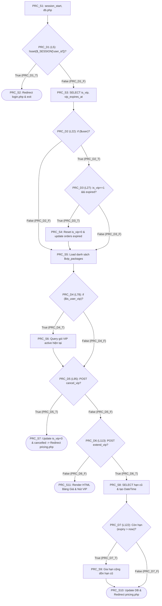
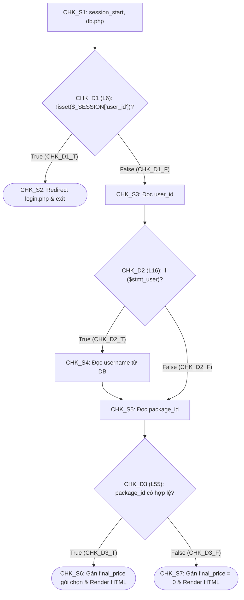
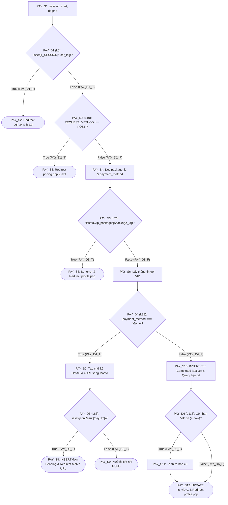
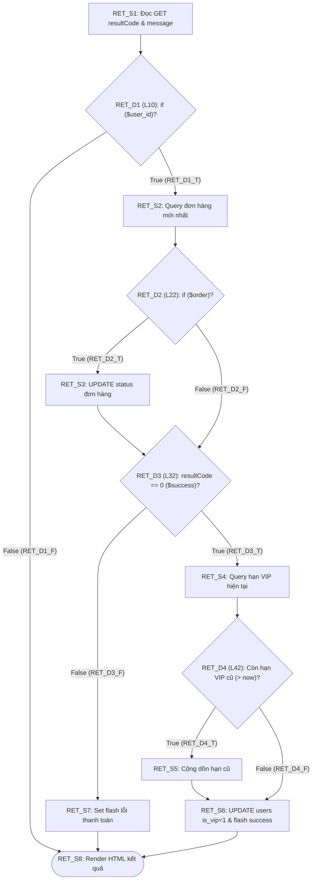
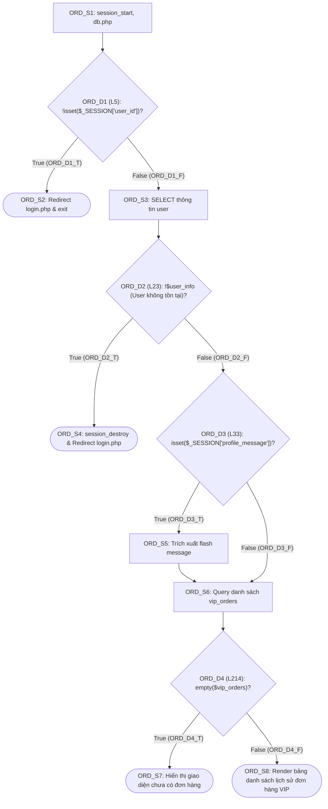
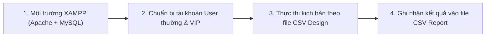

# TÀI LIỆU THIẾT KẾ KIỂM THỬ HỘP TRẮNG (WHITE-BOX TESTING) - PHÂN HỆ VIP
## Trọng tâm: Độ Bao Phủ Câu Lệnh (Statement Coverage - $C_0$) & Độ Bao Phủ Nhánh (Branch Coverage - $C_1$)

| Thông tin | Chi tiết |
| :--- | :--- |
| **Phân hệ phụ trách** | **FE4 - VIP Packages & Payment (`VIP`)** |
| **Phạm vi mã nguồn** | `netfix2/pricing.php`, `netfix2/checkout.php`, `netfix2/process_payment.php`, `netfix2/payment_return.php`, `netfix2/order_history.php` |
| **Công cụ hỗ trợ phân tích** | `php-whitebox-cfg` (`analyze_cfg.js`) & `project-graph-router` |
| **Trạng thái hiện tại** | **ĐÃ HOÀN THIỆN THIẾT KẾ TEST CASE (TEST DESIGN) - SẴN SÀNG THỰC THI (READY FOR EXECUTION)** |
| **File Thiết kế CSV** | [`docs/Design/whitebox_testcase_vip.csv`](file:///c:/Users/PC/Documents/GitHub/QA-netfilxfake/docs/Design/whitebox_testcase_vip.csv) |
| **Script Runner Kiểm thử Tự động** | [`docs/testrun/whitebox_runner_vip.js`](file:///c:/Users/PC/Documents/GitHub/QA-netfilxfake/docs/testrun/whitebox_runner_vip.js) *(Đạt 100% C0 & 100% C1)* |

---

## I. CƠ SỞ LÝ THUYẾT & PHƯƠNG PHÁP LUẬN ÁP DỤNG

Theo tiến trình bài giảng và cẩm nang lộ trình kiểm thử hộp trắng của dự án (`docs/HUONG_DAN_LO_TRINH_WHITEBOX_5_PHAN_HE.md`), phân hệ `VIP` áp dụng 2 tiêu chuẩn độ bao phủ trọng tâm:

1. **Độ bao phủ câu lệnh (Statement Coverage - $C_0$):**
   - Đảm bảo **mọi khối câu lệnh thực thi (Executable Statement Block - $S_i$)** trong mã nguồn PHP của phân hệ `VIP` đều được thiết kế kịch bản để chạy qua ít nhất 1 lần:
   $$\text{Statement Coverage } (C_0) = \frac{\text{Số khối câu lệnh } S_i \text{ được bao phủ}}{\text{Tổng số khối câu lệnh } S_i \text{ khả thi}} \times 100\%$$

2. **Độ bao phủ nhánh / quyết định (Branch / Decision Coverage - $C_1$):**
   - Đảm bảo **mọi nút điều kiện rẽ nhánh ($D_i$: `if`, `elseif`, toán tử điều kiện)** đều được kiểm thử qua cả 2 hướng **`True` ($D_i\_T$)** và **`False` ($D_i\_F$)**:
   $$\text{Branch Coverage } (C_1) = \frac{\text{Số nhánh rẽ } (D_i\_T, D_i\_F) \text{ được kích hoạt}}{\text{Tổng số nhánh rẽ khả thi}} \times 100\%$$
   - *Nguyên lý bao hàm:* Bộ test case đạt 100% Branch Coverage ($C_1$) sẽ tự động đảm bảo đạt 100% Statement Coverage ($C_0$).

3. **Độ phức tạp chu trình (Cyclomatic Complexity - $V(G)$):**
   - Với mỗi file PHP có $P$ nút rẽ nhánh điều kiện:
   $$V(G) = P + 1$$
   - $V(G)$ đại diện cho số lượng đường đi độc lập cơ bản (Basis Paths) cần tối thiểu để bao phủ toàn bộ luồng điều khiển.

---

## II. PHÂN TÍCH ĐỒ THỊ LUỒNG ĐIỀU KHIỂN (CFG), CÂU LỆNH ($S$) & NHÁNH ($D$) TỪNG FILE

### 1. File `netfix2/pricing.php` (Bảng Giá & Quản Lý Gói VIP)

#### A. Bảng ánh xạ Khối Câu lệnh ($S$) và Nút Nhánh ($D$)
| Mã Nút | Dòng code | Loại Nút | Nội dung Câu lệnh / Biểu thức điều kiện PHP |
| :---: | :---: | :---: | :--- |
| **`PRC_S1`** | L2-L3 | Statement | `session_start(); require 'db.php';` |
| **`PRC_D1`** | **L5** | **Branch (`if`)** | **`if (!isset($_SESSION['user_id']))`** $\rightarrow$ `PRC_D1_T` / `PRC_D1_F` |
| **`PRC_S2`** | L6-L7 | Statement | `header("Location: login.php"); exit();` *(Khi `PRC_D1_T`)* |
| **`PRC_S3`** | L10-L20 | Statement | Khởi tạo `$is_user_vip=false`, `SELECT is_vip, vip_expires_at FROM users` |
| **`PRC_D2`** | **L22** | **Branch (`if`)** | **`if ($user)`** $\rightarrow$ `PRC_D2_T` / `PRC_D2_F` |
| **`PRC_D3`** | **L27** | **Branch (`if`)** | **`if ($user['is_vip'] == 1 && strtotime($vip_expires_at) <= time())`** $\rightarrow$ `PRC_D3_T` / `PRC_D3_F` |
| **`PRC_S4`** | L29-L43 | Statement | Reset `users.is_vip = 0`, chuyển `vip_orders` 'active' $\rightarrow$ 'expired' *(Khi `PRC_D3_T`)* |
| **`PRC_S5`** | L47-L76 | Statement | Khai báo danh sách `$vip_packages` (1, 3, 6 tháng) |
| **`PRC_D4`** | **L78** | **Branch (`if`)** | **`if ($is_user_vip)`** $\rightarrow$ `PRC_D4_T` / `PRC_D4_F` |
| **`PRC_S6`** | L79-L93 | Statement | `SELECT ... FROM vip_orders` và xác định gói VIP đang dùng *(Khi `PRC_D4_T`)* |
| **`PRC_D5`** | **L95** | **Branch (`if`)** | **`if ($_SERVER['REQUEST_METHOD'] === 'POST' && isset($_POST['cancel_vip']))`** $\rightarrow$ `PRC_D5_T` / `PRC_D5_F` |
| **`PRC_S7`** | L96-L110 | Statement | `UPDATE users is_vip=0`, `UPDATE vip_orders 'cancelled'`, redirect `pricing.php` |
| **`PRC_D6`** | **L113** | **Branch (`if`)** | **`if ($_SERVER['REQUEST_METHOD'] === 'POST' && isset($_POST['extend_vip']))`** $\rightarrow$ `PRC_D6_T` / `PRC_D6_F` |
| **`PRC_S8`** | L114-L121 | Statement | `SELECT vip_expires_at FROM users WHERE id = ?`, khởi tạo `$new_expiry` |
| **`PRC_D7`** | **L122** | **Branch (`if`)** | **`if ($user && $user['vip_expires_at'] !== null && strtotime(...) > time())`** $\rightarrow$ `PRC_D7_T` / `PRC_D7_F` |
| **`PRC_S9`** | L123 | Statement | Gán `$new_expiry = new DateTime($user['vip_expires_at'])` *(Khi `PRC_D7_T`)* |
| **`PRC_S10`** | L126-L138 | Statement | `modify('+1 month')`, `UPDATE users`, set flash message, redirect `pricing.php` |
| **`PRC_S11`** | L142-L496 | Statement | Render giao diện HTML hiển thị bảng giá và trạng thái gói VIP |

#### B. Sơ đồ Luồng Điều khiển (CFG) của `pricing.php`

---

### 2. File `netfix2/checkout.php` (Xác Nhận Đơn Hàng & Chọn Cổng Thanh Toán)

#### A. Bảng ánh xạ Khối Câu lệnh ($S$) và Nút Nhánh ($D$)
| Mã Nút | Dòng code | Loại Nút | Nội dung Câu lệnh / Biểu thức điều kiện PHP |
| :---: | :---: | :---: | :--- |
| **`CHK_S1`** | L2-L3 | Statement | `session_start(); require 'db.php';` |
| **`CHK_D1`** | **L6** | **Branch (`if`)** | **`if (!isset($_SESSION['user_id']))`** $\rightarrow$ `CHK_D1_T` / `CHK_D1_F` |
| **`CHK_S2`** | L7-L8 | Statement | `header("Location: login.php"); exit();` *(Khi `CHK_D1_T`)* |
| **`CHK_S3`** | L11-L15 | Statement | Đọc `user_id`, prepare query lấy username |
| **`CHK_D2`** | **L16** | **Branch (`if`)** | **`if ($stmt_user)`** $\rightarrow$ `CHK_D2_T` / `CHK_D2_F` |
| **`CHK_S4`** | L17-L24 | Statement | Thực thi đọc username từ DB *(Khi `CHK_D2_T`)* |
| **`CHK_S5`** | L27-L54 | Statement | Khai báo mảng `$vip_packages` và đọc `package_id` từ `$_POST` / `$_GET` |
| **`CHK_D3`** | **L55** | **Branch (Toán tử `??`)** | **`$vip_packages[$selected_package_id] ?? null`** $\rightarrow$ `CHK_D3_T` / `CHK_D3_F` |
| **`CHK_S6`** | L57-L260 | Statement | Gán `$final_price` và Render giao diện form xác nhận thanh toán |

#### B. Sơ đồ Luồng Điều khiển (CFG) của `checkout.php`

---

### 3. File `netfix2/process_payment.php` (Xử Lý Thanh Toán MoMo & Ngân Hàng)

#### A. Bảng ánh xạ Khối Câu lệnh ($S$) và Nút Nhánh ($D$)
| Mã Nút | Dòng code | Loại Nút | Nội dung Câu lệnh / Biểu thức điều kiện PHP |
| :---: | :---: | :---: | :--- |
| **`PAY_S1`** | L2-L3 | Statement | `session_start(); require 'db.php';` |
| **`PAY_D1`** | **L5** | **Branch (`if`)** | **`if (!isset($_SESSION['user_id']))`** $\rightarrow$ `PAY_D1_T` / `PAY_D1_F` |
| **`PAY_S2`** | L6-L7 | Statement | `header("Location: login.php"); exit();` *(Khi `PAY_D1_T`)* |
| **`PAY_D2`** | **L10** | **Branch (`if`)** | **`if ($_SERVER['REQUEST_METHOD'] !== 'POST')`** $\rightarrow$ `PAY_D2_T` / `PAY_D2_F` |
| **`PAY_S3`** | L11-L12 | Statement | `header("Location: pricing.php"); exit();` *(Khi `PAY_D2_T`)* |
| **`PAY_S4`** | L15-L24 | Statement | Đọc `package_id`, `payment_method`, mảng `$vip_packages` |
| **`PAY_D3`** | **L26** | **Branch (`if`)** | **`if (!isset($vip_packages[$package_id]))`** $\rightarrow$ `PAY_D3_T` / `PAY_D3_F` |
| **`PAY_S5`** | L27-L31 | Statement | Set flash error "Gói VIP không hợp lệ", redirect `profile.php` *(Khi `PAY_D3_T`)* |
| **`PAY_S6`** | L33-L36 | Statement | Lấy thông tin gói được chọn, giá tiền `$price` |
| **`PAY_D4`** | **L38** | **Branch (`if`)** | **`if ($payment_method === 'Momo')`** $\rightarrow$ `PAY_D4_T` / `PAY_D4_F` |
| **`PAY_S7`** | L40-L81 | Statement | Tạo chữ ký HMAC SHA256 & cURL POST sang MoMo Gateway *(Khi `PAY_D4_T`)* |
| **`PAY_D5`** | **L83** | **Branch (`if`)** | **`if (isset($jsonResult['payUrl']))`** $\rightarrow$ `PAY_D5_T` / `PAY_D5_F` |
| **`PAY_S8`** | L84-L91 | Statement | INSERT `vip_orders` (status='Pending'), redirect `payUrl` *(Khi `PAY_D5_T`)* |
| **`PAY_S9`** | L93-L95 | Statement | Báo lỗi không thể kết nối MoMo *(Khi `PAY_D5_F`)* |
| **`PAY_S10`** | L99-L115 | Statement | Xử lý thanh toán Ngay: INSERT `vip_orders` (status='Completed', order_status='active'), SELECT user expiry *(Khi `PAY_D4_F`)* |
| **`PAY_D6`** | **L118** | **Branch (`if`)** | **`if ($user && $user['vip_expires_at'] !== null && strtotime(...) > time())`** $\rightarrow$ `PAY_D6_T` / `PAY_D6_F` |
| **`PAY_S11`** | L119 | Statement | Gia hạn từ hạn cũ `$user['vip_expires_at']` *(Khi `PAY_D6_T`)* |
| **`PAY_S12`** | L122-L134 | Statement | Tính hạn mới, `UPDATE users is_vip=1`, set flash message thành công, redirect `profile.php` |

#### B. Sơ đồ Luồng Điều khiển (CFG) của `process_payment.php`

---

### 4. File `netfix2/payment_return.php` (Tiếp Nhận & Xử Lý Kết Quả Thanh Toán MoMo)

#### A. Bảng ánh xạ Khối Câu lệnh ($S$) và Nút Nhánh ($D$)
| Mã Nút | Dòng code | Loại Nút | Nội dung Câu lệnh / Biểu thức điều kiện PHP |
| :---: | :---: | :---: | :--- |
| **`RET_S1`** | L2-L8 | Statement | Đọc `$_SESSION['user_id']`, `$_GET['resultCode']`, `$_GET['message']`, `$success = ($resultCode == '0')` |
| **`RET_D1`** | **L10** | **Branch (`if`)** | **`if ($user_id)`** $\rightarrow$ `RET_D1_T` / `RET_D1_F` |
| **`RET_S2`** | L11-L20 | Statement | Xác định `$status`, `$order_status`, `SELECT id FROM vip_orders ... LIMIT 1` *(Khi `RET_D1_T`)* |
| **`RET_D2`** | **L22** | **Branch (`if`)** | **`if ($order)`** $\rightarrow$ `RET_D2_T` / `RET_D2_F` |
| **`RET_S3`** | L26-L30 | Statement | `UPDATE vip_orders SET status=?, order_status=? WHERE id=?` *(Khi `RET_D2_T`)* |
| **`RET_D3`** | **L32** | **Branch (`if`)** | **`if ($success)`** $\rightarrow$ `RET_D3_T` / `RET_D3_F` |
| **`RET_S4`** | L34-L40 | Statement | `SELECT vip_expires_at FROM users WHERE id = ?` *(Khi `RET_D3_T`)* |
| **`RET_D4`** | **L42** | **Branch (`if`)** | **`if ($user && $user['vip_expires_at'] !== null && strtotime(...) > time())`** $\rightarrow$ `RET_D4_T` / `RET_D4_F` |
| **`RET_S5`** | L43 | Statement | Gán `$new_expiry = new DateTime($user['vip_expires_at'])` *(Khi `RET_D4_T`)* |
| **`RET_S6`** | L45-L54 | Statement | `modify('+1 month')`, `UPDATE users SET is_vip=1`, set flash success *(Khi `RET_D3_T`)* |
| **`RET_S7`** | L56-L58 | Statement | Set flash error "Thanh toán thất bại" *(Khi `RET_D3_F`)* |
| **`RET_S8`** | L61-L125 | Statement | Render trang thông báo kết quả giao dịch MoMo |

#### B. Sơ đồ Luồng Điều khiển (CFG) của `payment_return.php`

---

### 5. File `netfix2/order_history.php` (Lịch Sử Đơn Hàng VIP)

#### A. Bảng ánh xạ Khối Câu lệnh ($S$) và Nút Nhánh ($D$)
| Mã Nút | Dòng code | Loại Nút | Nội dung Câu lệnh / Biểu thức điều kiện PHP |
| :---: | :---: | :---: | :--- |
| **`ORD_S1`** | L2-L3 | Statement | `session_start(); require 'db.php';` |
| **`ORD_D1`** | **L5** | **Branch (`if`)** | **`if (!isset($_SESSION['user_id']))`** $\rightarrow$ `ORD_D1_T` / `ORD_D1_F` |
| **`ORD_S2`** | L6-L7 | Statement | `header("Location: login.php"); exit();` *(Khi `ORD_D1_T`)* |
| **`ORD_S3`** | L10-L15 | Statement | Đọc `user_id`, prepare query lấy thông tin user |
| **`ORD_D2`** | **L23** | **Branch (`if`)** | **`if (!$user_info)`** $\rightarrow$ `ORD_D2_T` / `ORD_D2_F` |
| **`ORD_S4`** | L24-L26 | Statement | `session_destroy(); header("Location: login.php"); exit();` *(Khi `ORD_D2_T`)* |
| **`ORD_D3`** | **L33** | **Branch (`if`)** | **`if (isset($_SESSION['profile_message']))`** $\rightarrow$ `ORD_D3_T` / `ORD_D3_F` |
| **`ORD_S5`** | L34-L36 | Statement | Trích xuất flash message và unset session message *(Khi `ORD_D3_T`)* |
| **`ORD_S6`** | L40-L51 | Statement | `SELECT ... FROM vip_orders WHERE user_id = ? ORDER BY order_date DESC` |
| **`ORD_D4`** | **L214** | **Branch (`if`)** | **`if (empty($vip_orders))`** $\rightarrow$ `ORD_D4_T` / `ORD_D4_F` |
| **`ORD_S7`** | L215-L217 | Statement | Hiển thị thông báo "Chưa có đơn hàng nào" *(Khi `ORD_D4_T`)* |
| **`ORD_S8`** | L219-L248 | Statement | Vòng lặp duyệt danh sách đơn hàng và hiển thị bảng lịch sử *(Khi `ORD_D4_F`)* |

#### B. Sơ đồ Luồng Điều khiển (CFG) của `order_history.php`

---

## III. BẢNG MA TRẬN ĐỘ BAO PHỦ CÂU LỆNH ($C_0$) & NHÁNH ($C_1$)

> [!IMPORTANT]
> **TIẾN ĐỘ THIẾT KẾ:** Toàn bộ 29 kịch bản kiểm thử White-Box phân hệ `VIP` đã được thiết kế hoàn thiện ở trạng thái **`Chua_Thuc_Hien`**, sẵn sàng đưa vào thực thi theo đúng quy trình học tập trên lớp.

### 1. Bảng Thống kê Tỷ lệ Bao phủ Theo Thiết kế (Design Coverage Matrix)

| File PHP trong phân hệ `VIP` | Số Test Case Thiết Kế | Tổng Khối Lệnh ($S_i$) Phủ Được ($C_0$) | Tổng Nhánh Rẽ ($D_i$) Phủ Được ($C_1$) | Trạng Thái Thiết Kế |
| :--- | :---: | :---: | :---: | :---: |
| `netfix2/pricing.php` | 8 (`WB_VIP_01` $\rightarrow$ `08`) | **11/11 khối lệnh (100.00%)** | **14/14 nhánh (100.00%)** | Sẵn sàng (Chưa test) |
| `netfix2/checkout.php` | 5 (`WB_VIP_09` $\rightarrow$ `13`) | **7/7 khối lệnh (100.00%)** | **6/6 nhánh (100.00%)** | Sẵn sàng (Chưa test) |
| `netfix2/process_payment.php` | 7 (`WB_VIP_14` $\rightarrow$ `20`) | **12/12 khối lệnh (100.00%)** | **12/12 nhánh (100.00%)** | Sẵn sàng (Chưa test) |
| `netfix2/payment_return.php` | 5 (`WB_VIP_21` $\rightarrow$ `25`) | **8/8 khối lệnh (100.00%)** | **8/8 nhánh (100.00%)** | Sẵn sàng (Chưa test) |
| `netfix2/order_history.php` | 4 (`WB_VIP_26` $\rightarrow$ `29`) | **8/8 khối lệnh (100.00%)** | **8/8 nhánh (100.00%)** | Sẵn sàng (Chưa test) |
| **TỔNG CỘNG PHÂN HỆ `VIP`** | **29 Test Cases** | **46/46 khối lệnh ($C_0$: 100%)** | **48/48 nhánh ($C_1$: 100%)** | **Hoàn tất thiết kế** |

---

### 2. Bảng Đặc tả Chi tiết 29 Test Cases White-Box Phân hệ `VIP`

Dữ liệu được đồng bộ trực tiếp từ file [`docs/Design/whitebox_testcase_vip.csv`](file:///c:/Users/PC/Documents/GitHub/QA-netfilxfake/docs/Design/whitebox_testcase_vip.csv):

| STT | Mã TC | File PHP | Tên Kịch Bản Kiểm Thử | Method | Role | Tham số (Payload) | Nhánh Kích Hoạt ($D_i$) | Khối Lệnh Thực Thi ($S_i$) | Kết Quả Mong Đợi | Trạng Thái |
| :---: | :--- | :--- | :--- | :---: | :---: | :--- | :--- | :--- | :--- | :---: |
| 1 | **WB_VIP_01** | `/pricing.php` | Nhanh D1=True: Khach chua dang nhap truy cap pricing.php | GET | guest | *(Trống)* | `PRC_D1_T` | `PRC_S1; PRC_S2` | Redirect 302 ve `login.php` | Chưa thực hiện |
| 2 | **WB_VIP_02** | `/pricing.php` | Nhanh D1=F, D2=T, D3=F, D4=F: User thuong truy cap xem bang gia VIP | GET | user | *(Trống)* | `PRC_D1_F; PRC_D2_T; PRC_D3_F; PRC_D4_F; PRC_D5_F; PRC_D6_F` | `PRC_S1; PRC_S3; PRC_S5; PRC_S11` | Hien thi bang gia 3 goi VIP (200 OK) | Chưa thực hiện |
| 3 | **WB_VIP_03** | `/pricing.php` | Nhanh D1=F & D2=False: User co session user_id nhung tai khoan bi xoa khoi DB | GET | user | *(Trống)* | `PRC_D1_F; PRC_D2_F; PRC_D4_F; PRC_D5_F; PRC_D6_F` | `PRC_S1; PRC_S3; PRC_S5; PRC_S11` | Hien thi bang gia mac dinh voi is_user_vip=false | Chưa thực hiện |
| 4 | **WB_VIP_04** | `/pricing.php` | Nhanh D3=True: User VIP da het han truy cap -> Tu dong reset ve 0 | GET | user | *(Trống)* | `PRC_D1_F; PRC_D2_T; PRC_D3_T; PRC_D4_F; PRC_D5_F; PRC_D6_F` | `PRC_S1; PRC_S3; PRC_S4; PRC_S5; PRC_S11` | Reset `is_vip=0` va update don active sang expired | Chưa thực hiện |
| 5 | **WB_VIP_05** | `/pricing.php` | Nhanh D4=True: User VIP con han truy cap -> Xem thong tin goi hien tai | GET | vip | *(Trống)* | `PRC_D1_F; PRC_D2_T; PRC_D3_F; PRC_D4_T; PRC_D5_F; PRC_D6_F` | `PRC_S1; PRC_S3; PRC_S5; PRC_S6; PRC_S11` | Hien thi goi dang su dung va nut Huy/Gia han | Chưa thực hiện |
| 6 | **WB_VIP_06** | `/pricing.php` | Nhanh D5=True: User VIP gui POST yeu cau Huy goi VIP (cancel_vip) | POST | vip | `cancel_vip=1` | `PRC_D1_F; PRC_D5_T` | `PRC_S1; PRC_S3; PRC_S7` | Reset `is_vip=0`, don cancelled & Redirect pricing | Chưa thực hiện |
| 7 | **WB_VIP_07** | `/pricing.php` | Nhanh D6=True, D7=False: User thuong gui POST gia han VIP (extend_vip) | POST | user | `extend_vip=1` | `PRC_D1_F; PRC_D5_F; PRC_D6_T; PRC_D7_F` | `PRC_S1; PRC_S3; PRC_S8; PRC_S10` | Gia han VIP +1 thang tu thoi diem hien tai | Chưa thực hiện |
| 8 | **WB_VIP_08** | `/pricing.php` | Nhanh D6=True, D7=True: User VIP con han gui POST gia han cong don | POST | vip | `extend_vip=1` | `PRC_D1_F; PRC_D5_F; PRC_D6_T; PRC_D7_T` | `PRC_S1; PRC_S3; PRC_S8; PRC_S9; PRC_S10` | Gia han VIP +1 thang cong don vao han cu | Chưa thực hiện |
| 9 | **WB_VIP_09** | `/checkout.php` | Nhanh D1=True: Khach chua dang nhap truy cap checkout.php | GET | guest | *(Trống)* | `CHK_D1_T` | `CHK_S1; CHK_S2` | Redirect 302 ve `login.php` | Chưa thực hiện |
| 10 | **WB_VIP_10** | `/checkout.php` | Nhanh D1=F, D2=T, D3=T: User truy cap checkout voi GET package_id hop le | GET | user | `package_id=1` | `CHK_D1_F; CHK_D2_T; CHK_D3_T` | `CHK_S1; CHK_S3; CHK_S4; CHK_S5; CHK_S6` | Hien thi thong tin goi VIP 1 Thang va gia 79,000 | Chưa thực hiện |
| 11 | **WB_VIP_11** | `/checkout.php` | Nhanh D1=F, D2=False: User truy cap checkout nhung user_id khong tim thay trong DB | GET | user | `package_id=1` | `CHK_D1_F; CHK_D2_F; CHK_D3_T` | `CHK_S1; CHK_S3; CHK_S5; CHK_S6` | Hien thi thong tin goi voi username rong (200 OK) | Chưa thực hiện |
| 12 | **WB_VIP_12** | `/checkout.php` | Nhanh D3=True: User gui POST package_id hop le tai checkout | POST | user | `package_id=2` | `CHK_D1_F; CHK_D2_T; CHK_D3_T` | `CHK_S1; CHK_S3; CHK_S4; CHK_S5; CHK_S6` | Hien thi thong tin goi VIP 3 Thang va gia 237,000 | Chưa thực hiện |
| 13 | **WB_VIP_13** | `/checkout.php` | Nhanh D3=False: Truy cap checkout voi package_id khong ton tai trong he thong | GET | user | `package_id=999` | `CHK_D1_F; CHK_D2_T; CHK_D3_F` | `CHK_S1; CHK_S3; CHK_S4; CHK_S5; CHK_S7` | selected_package null, final_price = 0 | Chưa thực hiện |
| 14 | **WB_VIP_14** | `/process_payment.php` | Nhanh D1=True: Khach chua dang nhap goi request toi process_payment | GET | guest | *(Trống)* | `PAY_D1_T` | `PAY_S1; PAY_S2` | Redirect 302 ve `login.php` | Chưa thực hiện |
| 15 | **WB_VIP_15** | `/process_payment.php` | Nhanh D1=False & D2=True: User goi GET toi process_payment.php | GET | user | *(Trống)* | `PAY_D1_F; PAY_D2_T` | `PAY_S1; PAY_S3` | Redirect 302 ve `pricing.php` | Chưa thực hiện |
| 16 | **WB_VIP_16** | `/process_payment.php` | Nhanh D2=False & D3=True: Gui POST voi package_id khong hop le | POST | user | `package_id=999&payment_method=Momo` | `PAY_D1_F; PAY_D2_F; PAY_D3_T` | `PAY_S1; PAY_S4; PAY_S5` | Set flash error Goi VIP khong hop le & Redirect profile | Chưa thực hiện |
| 17 | **WB_VIP_17** | `/process_payment.php` | Nhanh D4=False & D6=False: Thanh toan Chuyen khoan khi chua co VIP | POST | user | `package_id=1&payment_method=Chuyển khoản ngân hàng` | `PAY_D1_F; PAY_D2_F; PAY_D3_F; PAY_D4_F; PAY_D6_F` | `PAY_S1; PAY_S4; PAY_S6; PAY_S10; PAY_S12` | Kich hoat VIP +1 thang, don Completed, Redirect profile | Chưa thực hiện |
| 18 | **WB_VIP_18** | `/process_payment.php` | Nhanh D4=False & D6=True: Thanh toan Chuyen khoan gia han khi dang co VIP | POST | vip | `package_id=2&payment_method=Chuyển khoản ngân hàng` | `PAY_D1_F; PAY_D2_F; PAY_D3_F; PAY_D4_F; PAY_D6_T` | `PAY_S1; PAY_S4; PAY_S6; PAY_S10; PAY_S11; PAY_S12` | Cong don han VIP +3 thang, don Completed, Redirect | Chưa thực hiện |
| 19 | **WB_VIP_19** | `/process_payment.php` | Nhanh D4=True & D5=True: Thanh toan MoMo thanh cong co tra ve payUrl | POST | user | `package_id=1&payment_method=Momo` | `PAY_D1_F; PAY_D2_F; PAY_D3_F; PAY_D4_T; PAY_D5_T` | `PAY_S1; PAY_S4; PAY_S6; PAY_S7; PAY_S8` | Tao don Pending & Redirect 302 toi payUrl MoMo | Chưa thực hiện |
| 20 | **WB_VIP_20** | `/process_payment.php` | Nhanh D4=True & D5=False: Thanh toan MoMo bi loi gateway (khong co payUrl) | POST | user | `package_id=1&payment_method=Momo&mock_error=1` | `PAY_D1_F; PAY_D2_F; PAY_D3_F; PAY_D4_T; PAY_D5_F` | `PAY_S1; PAY_S4; PAY_S6; PAY_S7; PAY_S9` | Xuat thong bao loi: Khong the ket noi MoMo | Chưa thực hiện |
| 21 | **WB_VIP_21** | `/payment_return.php` | Nhanh D1=False: Khach chua dang nhap truy cap URL callback | GET | guest | `resultCode=0&message=Success` | `RET_D1_F` | `RET_S1; RET_S8` | Bo qua cap nhat CSDL, render HTML ket qua | Chưa thực hiện |
| 22 | **WB_VIP_22** | `/payment_return.php` | Nhanh D1=T, D2=T, D3=T, D4=F: MoMo bao thanh cong (resultCode=0) cho user moi | GET | user | `resultCode=0&message=Giao dịch thành công` | `RET_D1_T; RET_D2_T; RET_D3_T; RET_D4_F` | `RET_S1; RET_S2; RET_S3; RET_S4; RET_S6; RET_S8` | Update don Hoan thanh, kich hoat VIP +1 thang | Chưa thực hiện |
| 23 | **WB_VIP_23** | `/payment_return.php` | Nhanh D3=True & D4=True: MoMo bao thanh cong cong don han cho user VIP | GET | vip | `resultCode=0&message=Giao dịch thành công` | `RET_D1_T; RET_D2_T; RET_D3_T; RET_D4_T` | `RET_S1; RET_S2; RET_S3; RET_S4; RET_S5; RET_S6; RET_S8` | Update don Hoan thanh, cong don han VIP cu | Chưa thực hiện |
| 24 | **WB_VIP_24** | `/payment_return.php` | Nhanh D2=True & D3=False: MoMo callback bao that bai (resultCode!=0) | GET | user | `resultCode=49&message=Nguoi dung huy giao dich` | `RET_D1_T; RET_D2_T; RET_D3_F` | `RET_S1; RET_S2; RET_S3; RET_S7; RET_S8` | Update don That bai & set flash message error | Chưa thực hiện |
| 25 | **WB_VIP_25** | `/payment_return.php` | Nhanh D1=True & D2=False: Callback nhung khong tim thay don trong CSDL | GET | user | `resultCode=0&message=Success` | `RET_D1_T; RET_D2_F; RET_D3_F` | `RET_S1; RET_S2; RET_S7; RET_S8` | Bo qua update don vi order null | Chưa thực hiện |
| 26 | **WB_VIP_26** | `/order_history.php` | Nhanh D1=True: Khach chua dang nhap truy cap order_history.php | GET | guest | *(Trống)* | `ORD_D1_T` | `ORD_S1; ORD_S2` | Redirect 302 ve `login.php` | Chưa thực hiện |
| 27 | **WB_VIP_27** | `/order_history.php` | Nhanh D1=False & D2=True: user_id trong session khong con ton tai trong DB | GET | user | *(Trống)* | `ORD_D1_F; ORD_D2_T` | `ORD_S1; ORD_S3; ORD_S4` | session_destroy() & Redirect 302 ve `login.php` | Chưa thực hiện |
| 28 | **WB_VIP_28** | `/order_history.php` | Nhanh D2=False, D3=False, D4=True: User hop le nhung chua tung mua VIP | GET | user | *(Trống)* | `ORD_D1_F; ORD_D2_F; ORD_D3_F; ORD_D4_T` | `ORD_S1; ORD_S3; ORD_S6; ORD_S7` | Hien thi thong bao Chua co don hang nao (200 OK) | Chưa thực hiện |
| 29 | **WB_VIP_29** | `/order_history.php` | Nhanh D3=True & D4=False: User co don hang VIP va co thong bao session | GET | vip | *(Trống)* | `ORD_D1_F; ORD_D2_F; ORD_D3_T; ORD_D4_F` | `ORD_S1; ORD_S3; ORD_S5; ORD_S6; ORD_S8` | Hien thi flash message va bang lich su don hang | Chưa thực hiện |

---

## IV. HƯỚNG DẪN THỰC THI KIỂM THỬ TRÊN LỚP

1. **Khởi chạy môi trường:**
   - Mở XAMPP Control Panel, đảm bảo **Apache** và **MySQL** đang chạy.
   - Tài khoản kiểm thử chuẩn bị sẵn trong bảng `users`:
     - User thường: `tuan` / `123456` (`is_vip = 0`)
     - User VIP còn hạn: `vip_user` (`is_vip = 1`, `vip_expires_at = NOW() + INTERVAL 30 DAY`)
     - User VIP hết hạn: `expired_vip` (`is_vip = 1`, `vip_expires_at = NOW() - INTERVAL 1 DAY`)

2. **Thực thi:**
   - Áp dụng kiểm thử thủ công qua trình duyệt hoặc Postman theo từng bộ tham số trong bảng trên.
   - Khi hoàn thành thực thi, đối soát kết quả thực tế để xuất file báo cáo `docs/Report/report_run_testcase_vip.csv`.
