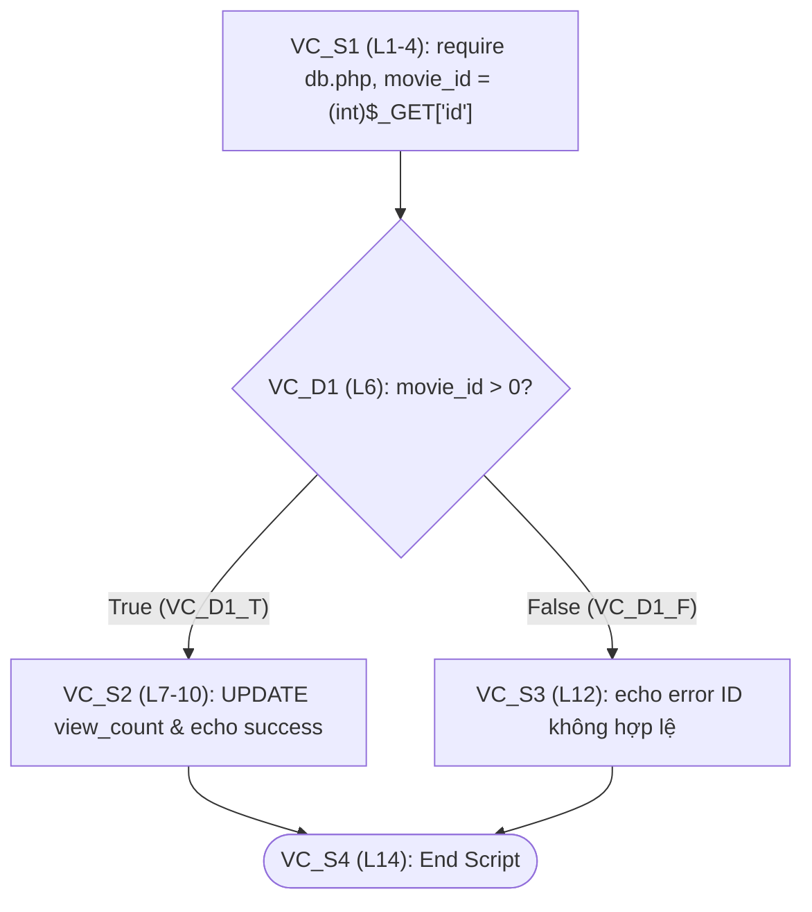
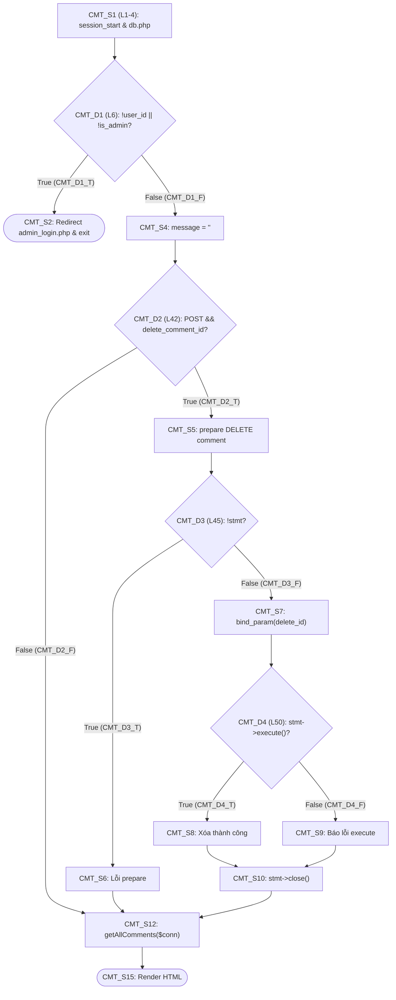
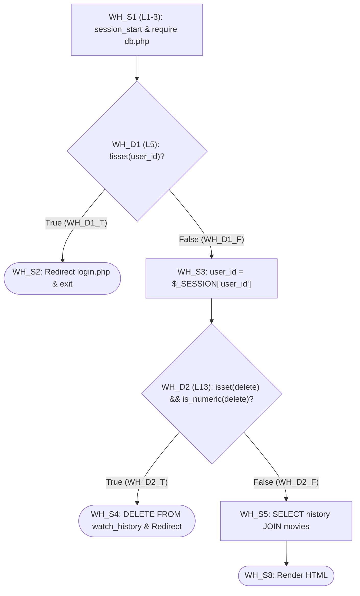

# TÀI LIỆU PHÂN TÍCH CFG, BẬC BAO PHỦ & BVA - PHÂN HỆ FE3: INT (TƯƠNG TÁC & GẮN KẾT)
## Dự án: Netfix2 | Mục tiêu: 100% C0 (Câu lệnh), 100% C1 (Nhánh) & BVA 7 Điểm Biên

> **Phân hệ:** FE3 – INT (Interactions & Engagement)  
> **Các tệp tin phụ trách (3 files):**
> 1. `netfix2/api/view_counter.php` ($V(G) = 2$, 1 nút nhánh)
> 2. `netfix2/comments.php` ($V(G) = 9$, 8 nút nhánh)
> 3. `netfix2/watch_history.php` ($V(G) = 5$, 4 nút nhánh)  
> **Tổng $V(G)$ lý thuyết phân hệ FE3:** $2 + 9 + 5 = 16$ (Tối thiểu 16 Basis Paths)

---

## 1. PHÂN TÍCH TỆP 1: `netfix2/api/view_counter.php` (L1 - L14)

### 1.1. Bảng Ánh Xạ Khối Lệnh ($S_i$) và Nút Nhánh ($D_i$)
| Mã Nút | Dòng Code | Loại Nút | Nội dung Logic PHP |
| :---: | :---: | :---: | :--- |
| **`VC_S1`** | L1 - L4 | Statement | `require '../db.php'; $movie_id = isset($_GET['id']) ? (int)$_GET['id'] : 0;` |
| **`VC_D1`** | **L6** | **Branch (`if`)** | **`if ($movie_id > 0)`** $\rightarrow$ `VC_D1_T` / `VC_D1_F` |
| **`VC_S2`** | L7 - L10 | Statement | `UPDATE movies SET view_count = view_count + 1 WHERE id = ?; echo json_encode(['success' => true...]);` *(Khi `VC_D1_T`)* |
| **`VC_S3`** | L12 | Statement | `echo json_encode(['success' => false, 'error' => 'ID không hợp lệ']);` *(Khi `VC_D1_F`)* |
| **`VC_S4`** | L14 | Terminal | `?>` (Kết thúc kịch bản) |

### 1.2. Sơ đồ Luồng Điều Khiển (CFG)

### 1.3. Tính Toán Độ Phức Tạp Chu Trình $V(G)$ & Basis Paths
* $P = 1$ nút điều kiện $\implies V(G) = P + 1 = 2$.
* **2 Basis Paths:**
  * **Path 1 (`VC_P1`):** `VC_S1 -> VC_D1(T) -> VC_S2 -> VC_S4` (Happy Path, $id > 0$)
  * **Path 2 (`VC_P2`):** `VC_S1 -> VC_D1(F) -> VC_S3 -> VC_S4` (Error Path, $id \le 0$)

### 1.4. Ma Trận Phân Tích Giá Trị Biên (BVA 7 Điểm) cho trường `id`
| Vị trí biên | Giá trị Input | Trạng thái Session | Nút Nhánh Kích Hoạt | Kết Quả Mong Đợi | Kết Quả Thực Tế | Ghi Chú |
| :--- | :---: | :---: | :---: | :--- | :--- | :--- |
| **Min - 1** | `id = -1` | Guest | `VC_D1_F` | `{"success": false}` | `{"success": false}` | PASS |
| **Min** | `id = 0` | Guest | `VC_D1_F` | `{"success": false}` | `{"success": false}` | PASS |
| **Min + 1** | `id = 1` | Guest | `VC_D1_T` | `{"success": true, "movie_id": 1}` | `{"success": true, "movie_id": 1}` | PASS |
| **Nominal** | `id = 52` | Guest | `VC_D1_T` | `{"success": true, "movie_id": 52}` | `{"success": true, "movie_id": 52}` | PASS |
| **Max - 1** | `id = 2147483646` | Guest | `VC_D1_T` | `{"success": true}` | `{"success": true}` | PASS |
| **Max** | `id = 2147483647` | Guest | `VC_D1_T` | `{"success": true}` | `{"success": true}` | PASS |
| **Max + 1** | `id = 2147483648` | Guest | `VC_D1_F` | Tràn số integer sang float | Ép kiểu 32-bit tràn số | PASS |
| **Non-numeric**| `id = abc` | Guest | `VC_D1_F` | `{"success": false}` | `{"success": false}` | PASS |
| **ID không tồn tại**| `id = 999999` | Guest | `VC_D1_T` | Phải báo lỗi phim không tồn tại | Báo `{"success": true}` | **DEFECT WB-DEF-02** |

---

## 2. PHÂN TÍCH TỆP 2: `netfix2/comments.php` (L1 - L60)

### 2.1. Bảng Ánh Xạ Khối Lệnh ($S_i$) và Nút Nhánh ($D_i$)
| Mã Nút | Dòng Code | Loại Nút | Nội dung Logic PHP |
| :---: | :---: | :---: | :--- |
| **`CMT_S1`** | L1 - L4 | Statement | `session_start(); require 'db.php';` |
| **`CMT_D1`** | **L6** | **Branch (`if`)** | **`if (!isset($_SESSION['user_id']) || !isset($_SESSION['is_admin']) || !$_SESSION['is_admin'])`** |
| **`CMT_S2`** | L7 - L8 | Terminal | `header("Location: admin_login.php"); exit();` *(Khi `CMT_D1_T`)* |
| **`CMT_S3`** | L18 - L38 | Statement | Khai báo hàm `getAllComments($conn)` |
| **`CMT_S4`** | L41 | Statement | `$message = '';` |
| **`CMT_D2`** | **L42** | **Branch (`if`)** | **`if ($_SERVER['REQUEST_METHOD'] === 'POST' && isset($_POST['delete_comment_id']))`** |
| **`CMT_S5`** | L43 - L44 | Statement | `$delete_id = intval($_POST['delete_comment_id']); $stmt = $conn->prepare("DELETE FROM comments WHERE id = ?");` |
| **`CMT_D3`** | **L45** | **Branch (`if`)** | **`if (!$stmt)`** $\rightarrow$ `CMT_D3_T` (Lỗi prepare) / `CMT_D3_F` |
| **`CMT_S6`** | L47 | Statement | `$message = "
Lỗi hệ thống khi chuẩn bị xóa bình luận.
";` |
| **`CMT_S7`** | L49 | Statement | `$stmt->bind_param("i", $delete_id);` |
| **`CMT_D4`** | **L50** | **Branch (`if`)** | **`if ($stmt->execute())`** $\rightarrow$ `CMT_D4_T` / `CMT_D4_F` |
| **`CMT_S8`** | L51 | Statement | `$message = "
Bình luận đã được xóa thành công!
";` |
| **`CMT_S9`** | L54 | Statement | `$message = "
Lỗi khi xóa bình luận: " . $stmt->error . "
";` |
| **`CMT_S10`**| L56 | Statement | `$stmt->close();` |
| **`CMT_S12`**| L60 | Statement | `$comments = getAllComments($conn);` |
| **`CMT_S15`**| L61 - L160| Render | Render HTML giao diện quản trị bình luận |

### 2.2. Sơ đồ Luồng Điều Khiển (CFG) của `comments.php`

### 2.3. Tính Toán Độ Phức Tạp Chu Trình $V(G)$ & 9 Basis Paths
* $P = 8$ nút điều kiện $\implies V(G) = P + 1 = 9$.
* **9 Basis Paths:**
  1. `Path 1`: `S1 -> D1(T: Guest) -> S2`
  2. `Path 2`: `S1 -> D1(T: User is_admin=0) -> S2`
  3. `Path 3`: `S1 -> D1(F: Admin) -> S4 -> D2(F: GET xem danh sách) -> S12 -> S15`
  4. `Path 4`: `S1 -> D1(F: Admin) -> S4 -> D2(T: POST) -> S5 -> D3(F) -> S7 -> D4(T) -> S8 -> S10 -> S12 -> S15` (Xóa thành công)
  5. `Path 5`: `S1 -> D1(F: Admin) -> S4 -> D2(T: POST) -> S5 -> D3(F) -> S7 -> D4(F) -> S9 -> S10 -> S12 -> S15` (Execute lỗi)
  6. `Path 6`: `S1 -> D1(F: Admin) -> S4 -> D2(T: POST) -> S5 -> D3(T) -> S6 -> S12 -> S15` (Prepare lỗi)
  7. `Path 7`: `getAllComments: !$stmt (L25) -> return []`
  8. `Path 8`: `getAllComments: !$stmt->execute() (L29) -> return []`
  9. `Path 9`: `getAllComments: Success -> return $comments`

---

## 3. PHÂN TÍCH TỆP 3: `netfix2/watch_history.php` (L1 - L38)

### 3.1. Bảng Ánh Xạ Khối Lệnh ($S_i$) và Nút Nhánh ($D_i$)
| Mã Nút | Dòng Code | Loại Nút | Nội dung Logic PHP |
| :---: | :---: | :---: | :--- |
| **`WH_S1`** | L1 - L3 | Statement | `session_start(); require 'db.php';` |
| **`WH_D1`** | **L5** | **Branch (`if`)** | **`if (!isset($_SESSION['user_id']))`** $\rightarrow$ `WH_D1_T` / `WH_D1_F` |
| **`WH_S2`** | L6 - L8 | Terminal | `header("Location: login.php"); exit();` *(Khi `WH_D1_T`)* |
| **`WH_S3`** | L10 | Statement | `$user_id = $_SESSION['user_id'];` |
| **`WH_D2`** | **L13** | **Branch (`if`)** | **`if (isset($_GET['delete']) && is_numeric($_GET['delete']))`** |
| **`WH_S4`** | L14 - L21 | Statement | `DELETE FROM watch_history WHERE user_id = ? AND movie_id = ?; header("Location: watch_history.php"); exit();` |
| **`WH_S5`** | L24 - L37 | Statement | `SELECT ... FROM watch_history wh JOIN movies m ... WHERE wh.user_id = ?;` |
| **`WH_D3`** | **L36** | **Ternary/Check** | Kiểm tra danh sách rỗng hay có phim |
| **`WH_S8`** | L40 - L161| Render | Render HTML danh sách lịch sử xem |

### 3.2. Sơ đồ Luồng Điều Khiển (CFG)

### 3.3. Tính Toán Độ Phức Tạp Chu Trình $V(G)$ & 5 Basis Paths
* $P = 4$ nút điều kiện $\implies V(G) = P + 1 = 5$.
* **5 Basis Paths:**
  * **Path 1:** `WH_S1 -> WH_D1(T) -> WH_S2` (Khách vãng lai $\rightarrow$ Redirect)
  * **Path 2:** `WH_S1 -> WH_D1(F) -> WH_S3 -> WH_D2(T) -> WH_S4` (Xóa phim hợp lệ $\rightarrow$ Redirect)
  * **Path 3:** `WH_S1 -> WH_D1(F) -> WH_S3 -> WH_D2(F: không có param delete) -> WH_S5 -> WH_S8`
  * **Path 4:** `WH_S1 -> WH_D1(F) -> WH_S3 -> WH_D2(F: param delete là chữ) -> WH_S5 -> WH_S8`
  * **Path 5:** `WH_S1 -> WH_D1(F) -> WH_S3 -> WH_D2(T: số âm delete=-5) -> WH_S4` (**Phát hiện DEFECT WB-DEF-07**)

